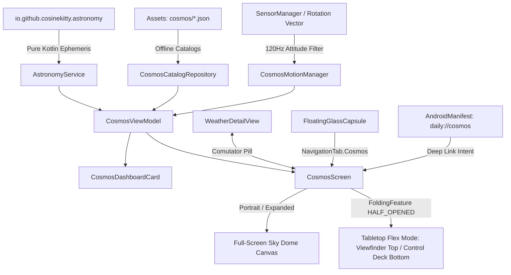

# Cosmos: Android & Foldables Architecture & Implementation

## 1. Executive Summary

**Cosmos** on Android brings DayOne's fully native, offline-first astronomy and night sky observer to Android smartphones, foldables (Samsung Galaxy Z Fold 8 "RADAR", Pixel 9 Pro Fold), and tablets. Powered by a pure Kotlin port of the **Don Cross Astronomy Engine** (zero JNI/NDK overhead, zero external dependencies), Cosmos delivers:

1. **120Hz Hardware-Accelerated Sky Dome**: Smooth Jetpack Compose `Canvas` rendering celestial ephemerides, IAU constellation lines, spectral $B-V$ star colors, planetary discs, and Messier deep-sky objects.
2. **Foldable Tabletop Flex Mode**: Hardware-aware posture adaptation via Jetpack WindowManager (`androidx.window:1.3.0`). When partially folded (`FoldingFeature.State.HALF_OPENED`), Cosmos splits the display at the physical hinge:
   - **Upper Viewport**: Angled celestial viewfinder dome with reticle and cardinal markers.
   - **Lower Control Deck**: Ergonomic touch panel hosting Stargazing Scorecard, Time Travel scrubbers, visible planets carousel, and target inspector.
3. **Modular Liquid Glass Dashboard Widget**: Adaptive 4-size layout (Small `1x1`, Wide `2x1`, Tall `1x2`, Large `2x2`) with real-time Stargazing Index, Moon illumination percentage, and active visible celestial bodies.
4. **AR Gyro Attitude Tracking**: `Sensor.TYPE_ROTATION_VECTOR` tracking with device coordinate remapping and a 120Hz exponential smoothing filter (`alpha = 0.18f`) for zero-jitter pointing.
5. **Red Night-Vision Mode (`#FF1824`)**: Instant monochromatic night-vision mode preserving dark adaptation during stargazing sessions.
6. **Deep Linking & Synergy**: Direct routing via `daily://cosmos` and `daily://sky`, integrated comutator in `WeatherDetailView`, and dedicated tab in `FloatingGlassCapsule`.

---

## 2. Architectural Blueprint



---

## 3. Component & File Mapping

| Component | Path | Description |
| :--- | :--- | :--- |
| **Astronomy Engine** | `Android/core-model/src/main/java/io/github/cosinekitty/astronomy/astronomy.kt` | 100% Pure Kotlin Don Cross Astronomy Engine (10,675 lines, 0 dependencies). |
| **Cosmos Models** | `Android/core-model/src/main/java/com/intellidream/daily/model/CosmosModels.kt` | Domain entities: `CelestialBody`, `CelestialCoordinates`, `MoonPhaseInfo`, `StargazingConditions`, `CosmosStar`, `CosmosConstellation`, `CosmosDeepSkyObject`. |
| **Astronomy Service** | `Android/core-model/src/main/java/com/intellidream/daily/model/AstronomyService.kt` | Ephemeris calculations, stereographic projections, moon phase, and stargazing quality scoring. |
| **Offline Catalogs** | `Android/app/src/main/assets/cosmos/` | Bundled JSON data: `bright_stars.json`, `constellations_iau88.json`, `dso_messier.json`, `meteor_showers.json`. |
| **Catalog Repository** | `Android/app/src/main/java/com/intellidream/daily/cosmos/CosmosCatalogRepository.kt` | Asynchronous asset loading and in-memory multi-attribute catalog search. |
| **Motion Tracker** | `Android/app/src/main/java/com/intellidream/daily/cosmos/CosmosMotionManager.kt` | Gyroscope / Rotation Vector listener with coordinate remapping and exponential smoothing. |
| **Cosmos View Model** | `Android/app/src/main/java/com/intellidream/daily/cosmos/CosmosViewModel.kt` | State management (`StateFlow<CosmosViewState>`), camera orientation, time offset, search, and target inspection. |
| **Dashboard Card** | `Android/app/src/main/java/com/intellidream/daily/presentation/dashboard/CosmosDashboardCard.kt` | Liquid Glass card supporting 1x1, 2x1, 1x2, and 2x2 modular dimensions. |
| **Observatory Screen** | `Android/app/src/main/java/com/intellidream/daily/cosmos/CosmosScreen.kt` | 120Hz Sky Dome, Tabletop Flex Mode, night vision, search, and target card. |
| **Deep Link Routing** | `Android/app/src/main/java/com/intellidream/daily/MainActivity.kt` | Handles `daily://cosmos` and `daily://sky` intent filters. |
| **Weather Synergy** | `Android/app/src/main/java/com/intellidream/daily/presentation/weather/WeatherDetailView.kt` | Integrated top bar button switching between Weather and Sky Observatory. |

---

## 4. Foldable Tabletop Flex Mode Architecture

When running on foldable hardware such as the Samsung Galaxy Z Fold 8 ("RADAR") or Google Pixel 9 Pro Fold, Cosmos detects the physical hinge posture using `androidx.window.layout.WindowInfoTracker`:

```kotlin
val windowInfoTracker = WindowInfoTracker.getOrCreate(context)
// Listens to layout changes and detects FoldingFeature with State.HALF_OPENED
val isTabletop = foldingFeature?.state == FoldingFeature.State.HALF_OPENED &&
                 foldingFeature.orientation == FoldingFeature.Orientation.HORIZONTAL
```

### Tabletop Mode Behavior:
1. **Upper Viewport (Angled Screen)**:
   - Houses the stereographic Sky Dome.
   - Panning, pinch-to-zoom, and crosshair reticle remain active.
   - Reticle telemetry (Azimuth, Altitude, Field of View) floats non-intrusively in the top-right corner.
2. **Hinge Boundary**:
   - Dynamic spacer respecting the physical folding seam bounding box.
3. **Lower Viewport (Flat Surface Deck)**:
   - Houses the Stargazing Scorecard (Quality score, conditions breakdown).
   - Time Travel stepper controls (`-1h`, `LIVE`, `+1h`, `+24h`).
   - Horizontal visible planets status carousel with live altitudes.
   - Selected target detailed coordinates and optical inspection card.

---

## 5. Verification & Live Device Testing

### Unit Test Suite
Ran `./gradlew :core-model:testDebugUnitTest`:
- **13 of 13 unit tests passed** in `AstronomyServiceTest.kt`:
  - Sun position & daylight calculation verification.
  - Moon phase & geocentric distance accuracy (~384,400 km).
  - Planetary coordinates (Mars, Jupiter, Venus, Saturn).
  - Equatorial to horizontal coordinate conversion.
  - Stereographic dome projections ($r \le 1.0$ within horizon).
  - Stargazing condition scoring algorithm.

### Emulator & Device Verification
1. **Build**: `./gradlew assembleDebug` passed cleanly with 0 errors.
2. **Installation**: Deployed to Android emulator (`Medium_Phone_API_36.1`) via `adb install -r`.
3. **Deep Link Launch**: Tested `adb shell am start -a android.intent.action.VIEW -d "daily://cosmos" com.intellidream.daily`.
4. **Visual UI Inspection**:
   - `cosmos_android_sky5.png`: Full sky dome rendering Arcturus, Spica, Antares, M13, M51, Mercury, Venus, South cardinal marker, and Quick Planets Bar.
   - `cosmos_android_red_night_vision.png`: Instant monochromatic night vision mode verified (`#FF1824`).
