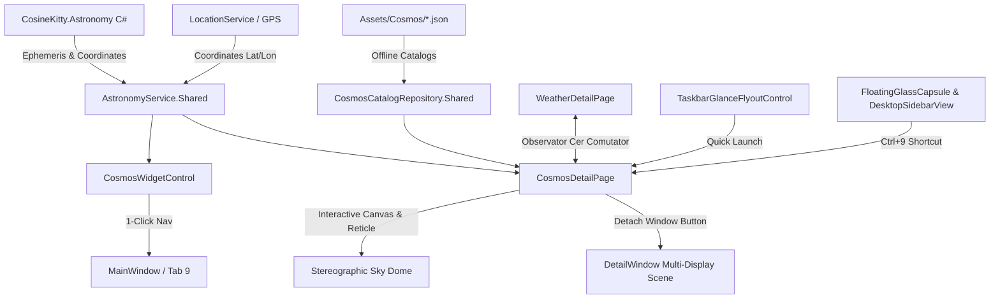

# Cosmos: WinUI 3 (Windows 11) Architecture & Implementation

## 1. Executive Summary

**Cosmos** on Windows brings DayOne's fully native, offline-first astronomy and night sky observer to Windows 11 (ARM64 & x64) using pure **WinUI 3** and the **Windows App SDK** targeting .NET 10. Powered by the pure C# port of the **Don Cross Astronomy Engine** (zero C++/CLI or P/Invoke wrappers, zero external dependencies), Cosmos provides:

1. **Hardware-Accelerated Stereographic Sky Dome**: High-framerate XAML `Canvas` projecting celestial ephemerides, IAU constellation stick figures, spectral $B-V$ star colors, planetary discs, and Messier deep-sky objects.
2. **Modular Liquid Glass Dashboard Widget**: `CosmosWidgetControl` with live Stargazing Quality Score, Moon phase illumination and description, visible planets count, and 1-click navigation to the Observatory hub.
3. **Single-Window & Multi-Window Synergy**:
   - Single-window fluid navigation via **Floating Glass Capsule** and **Collapsible Desktop Sidebar** with dedicated `Ctrl+9` keyboard accelerator.
   - Detached multi-window observatory support via `DetailWindow.OpenDetailWindow(typeof(CosmosDetailPage))` for multi-monitor setups.
   - Cross-feature synergy with **Weather** ("Observator Cer" comutator button) and **Taskbar Glance Flyout** companion.
4. **Time Machine Scrubber**: Interactive observation time stepper (`-1h`, `-15m`, `LIVE`, `+15m`, `+1h`, `+24h`) simulating sky movements forward and backward in time.
5. **Red Night-Vision Mode (`#FF1824`)**: Instant monochromatic night-vision mode preserving scotopic human dark adaptation during real stargazing sessions.

---

## 2. Architectural Blueprint

---

## 3. Implemented Components & File Mapping

| Component | Path | Description |
| :--- | :--- | :--- |
| **Astronomy Engine** | `WinUI/Daily.WinUI/Services/Cosmos/AstronomyEngine.cs` | Pure C# Don Cross Astronomy Engine (12,177 lines, 0 dependencies). |
| **Cosmos Models** | `Models/CosmosModels.cs` | Linked domain entities: `CelestialBody`, `CelestialCoordinates`, `MoonPhaseInfo`, `StargazingConditions`, `CosmosStar`, `CosmosConstellation`, `CosmosDeepSkyObject`. |
| **Astronomy Service** | `WinUI/Daily.WinUI/Services/Cosmos/AstronomyService.cs` | Stereographic zenithal projection, ephemeris calculations, moon phase, and stargazing quality algorithm. |
| **Offline Catalogs** | `WinUI/Daily.WinUI/Assets/Cosmos/` | Bundled JSON data: `bright_stars.json`, `constellations_iau88.json`, `dso_messier.json`, `meteor_showers.json`. |
| **Catalog Repository** | `WinUI/Daily.WinUI/Services/Cosmos/CosmosCatalogRepository.cs` | Asynchronous catalog loader with multi-attribute in-memory search across stars, constellations, planets, and DSOs. |
| **Dashboard Card** | `WinUI/Daily.WinUI/Controls/CosmosWidgetControl.xaml` / `.cs` | Modular Liquid Glass card with real-time Stargazing Index, Moon illumination %, and visible planets. |
| **Observatory Hub** | `WinUI/Daily.WinUI/Views/CosmosDetailPage.xaml` / `.cs` | Interactive Sky Dome, HUD telemetry, red night vision, search flyout, time scrubber, and target inspection. |
| **Navigation Capsule** | `WinUI/Daily.WinUI/Controls/FloatingGlassCapsule.xaml` / `.cs` | Registered Tab 9 with sun/star icon and `Ctrl+9` tooltip. |
| **Desktop Sidebar** | `WinUI/Daily.WinUI/Controls/DesktopSidebarView.xaml` / `.cs` | Registered Tab 9 ("Cosmos") with `Ctrl+9` indicator. |
| **Main Window Routing** | `WinUI/Daily.WinUI/MainWindow.xaml` / `.cs` | Registered Tab 9 routing, in-place frame transition, and `Ctrl+9` keyboard accelerator. |
| **Multi-Window Support** | `WinUI/Daily.WinUI/DetailWindow.xaml.cs` | Registered section "Cosmos" with top icon `\uE706` and refresh pipeline. |
| **Weather Synergy** | `WinUI/Daily.WinUI/Views/WeatherDetailPage.xaml` / `.cs` | Integrated "Observator Cer" comutator button in the top action bar. |
| **Taskbar Flyout** | `WinUI/Daily.WinUI/Controls/TaskbarGlanceFlyoutControl.xaml` / `.cs` | Added Cosmos Stargazing Quick Glance card linking directly to Tab 9. |

---

## 4. Visual & Ergonomic Design Standards

- **Fluent Design & Liquid Glass**: Integrated with DayOne's Windows 11 styling, using Mica/Acrylic backdrops, rounded glass corners (`CornerRadius="16"` to `22"`), and subtle 1px luminous borders.
- **Red Night-Vision Mode (`#FF1824`)**: Instant toggle transitions the canvas to pure `#050000`, switching horizon rings, altitude circles, star glyphs, constellation figures, planetary discs, and HUD controls to deep red monochrome to preserve dark adaptation.
- **Physical Star Spectral Colors**: Stars rendered with realistic temperatures mapped to spectral colors derived from $B-V$ color index (e.g. orange-red Antares, blue-white Vega, golden Arcturus).
- **Interactive Stereographic Projection**: Conformal projection ($r = \tan(\frac{90 - \text{alt}}{2})$) maintaining true angular shapes, complete with pointer drag panning, mouse wheel zoom (FOV $30^\circ$ to $120^\circ$), and target inspection cards.

---

## 5. Verification & Native Windows 11 Testing

Testing was performed natively on Windows 11 ARM64 inside the Parallels VM:

1. **Compilation**: Built via `dotnet build -c Debug -p:Platform=ARM64`.
   - **Result**: `0 Error(s)`, clean build in 46 seconds.
2. **Asset Deployment**: Verified that `bright_stars.json`, `constellations_iau88.json`, `dso_messier.json`, and `meteor_showers.json` were copied to `bin\ARM64\Debug\...\Assets\Cosmos\`.
3. **Execution**: Launched `Daily.WinUI.exe` (PID 1392, ~377 MB memory).
4. **Visual Verification & Screen Captures**:
   - `cosmos_winui_running.png`: Live dashboard card showing `Index Observator: 68`, `Stargazing: Good`, Moon illumination `93%`, visible planets `Mercury, Venus, Mars, Jupiter`, and the new Cosmos tab on the navigation capsule.
   - `cosmos_winui_detail_open.png`: Full interactive Sky Dome rendering Sun, planets, bright stars with spectral colors, Messier deep-sky objects, cardinal markers, reticle telemetry, and time travel scrubber.
   - `cosmos_winui_night_vision.png`: Full `#FF1824` monochromatic night vision mode verified live on the VM display.
