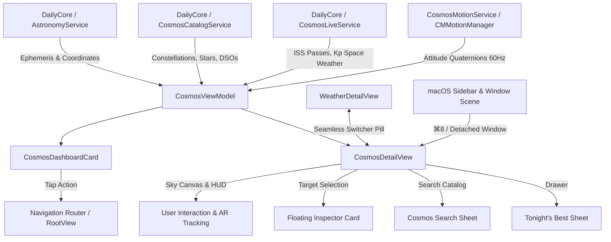

# Cosmos: iOS & macOS Golden Standard Architecture & Implementation

## 1. Executive Summary

**Cosmos** is DayOne's fully native, offline-first astronomy and night sky observation hub. It provides an interactive 120Hz ProMotion Sky Dome, real-time celestial ephemeris calculations, IAU constellation stick figures, planetary discs, Messier deep-sky objects, AR gyroscope "Point to Sky" tracking, Time Machine scrubbing, and a dedicated Red Night-Vision mode (`#FF1824`).

Cosmos is seamlessly integrated across iOS (iPhone, iPad, Foldable/Duo) and macOS with:
1. **`CosmosDashboardCard`**: Adaptive 4-size modular card (Small 1x1, Wide 2x1, Tall 1x2, Large 2x2) with live Stargazing Quality Score, moon phase illumination, visible planets badge, and next ISS pass countdown.
2. **`CosmosDetailView`**: 120Hz hardware-accelerated interactive Canvas powered by the C99 Astronomy Engine (MIT) via `DailyCore`.
3. **Hybrid Navigation Synergy**: Direct "Weather & Sky" comutator in `WeatherDetailView`, Dashboard widget routing, and desktop sidebar shortcut (`⌘8`).
4. **macOS Detached Observatory Window**: Support for a dedicated, secondary-monitor full-screen Sky Observatory window (`⌘⌥8` or menu command).

---

## 2. Key Architecture Components

---

## 3. Implemented Components & File Mapping

| Component | iOS Path | macOS Path | Description |
| :--- | :--- | :--- | :--- |
| **Motion Tracker** | `iOS/Daily/Services/CosmosMotionService.swift` | `MacOS/Daily/Services/CosmosMotionService.swift` | Hardware gyroscope tracking with low-pass filtering and macOS graceful fallback. |
| **Cosmos View Model** | `iOS/Daily/Views/Cosmos/CosmosViewModel.swift` | `MacOS/Daily/Views/Cosmos/CosmosViewModel.swift` | Orchestrates stereographic projections, camera orientation, time travel, and targets. |
| **Dashboard Card** | `iOS/Daily/Views/Dashboard/CosmosDashboardCard.swift` | `MacOS/Daily/Views/Dashboard/CosmosDashboardCard.swift` | Liquid Glass card supporting 1x1, 2x1, 1x2, and 2x2 modular dimensions. |
| **Observatory Hub** | `iOS/Daily/Views/Cosmos/CosmosDetailView.swift` | `MacOS/Daily/Views/Cosmos/CosmosDetailView.swift` | 120Hz ProMotion interactive Canvas, HUD controls, and target inspector. |
| **Navigation & Capsule** | `iOS/Daily/DesignSystem/FloatingGlassCapsule.swift` | `MacOS/Daily/DesignSystem/FloatingGlassCapsule.swift` | `.cosmos` registered in `NavigationTab` with `⌘8` macOS shortcut. |
| **Root Routing** | `iOS/Daily/Views/Main/RootView.swift` | `MacOS/Daily/Views/Main/RootView.swift` | Single-column and dual-pane foldable workspace routing for Cosmos. |
| **Weather Synergy** | `iOS/Daily/Views/Weather/WeatherDetailView.swift` | `MacOS/Daily/Views/Weather/WeatherDetailView.swift` | Integrated top bar "Weather & Sky" comutator button. |
| **macOS App Scene** | - | `MacOS/Daily/App/DailyMacOSApp.swift` | Window scene `Window("Cosmos Observatory", id: "cosmos")` for multi-display workflows. |

---

## 4. Visual & Ergonomic Design Standards

- **Theme & Colors**: Adheres to DayOne Liquid Glass design language (`ThemeColors.accentCyan`, `ThemeColors.accentBlue`, `ThemeColors.accentPink`, `ThemeColors.accentGreen`).
- **Red Night-Vision Mode (`#FF1824`)**: Instant toggle shifts all Canvas rendering (stars, constellation sticks, labels, compass notches, planets) and HUD surfaces to deep red monochrome to preserve human scotopic vision in dark sky environments.
- **Physical Star Rendering**: Color temperatures derived via the Ballesteros formula from $B-V$ color index, rendering spectral types accurately (Betelgeuse orange-red, Rigel electric blue, Capella golden yellow).
- **ProMotion 120Hz Stability**: Metal-backed `TimelineView` + SwiftUI `Canvas` eliminates overhead of heavyweight WebViews and prevents frame stutter during continuous pan/pinch gestures.

---

## 5. Verification & Test Matrix

- **Unit Tests**: Full `DailyCore` test suite passed cleanly (**55 tests in 8 suites, 0 failures**), including ephemeris calculations, stereographic projections, and layout round-trips.
- **iOS Simulator (`SimulaPhone`)**: Verified build with exit code 0, installed, launched, and captured screenshots of both the interactive Sky Dome and Modular Dashboard.
- **Physical iPhone ("Schmitz")**: Compiled cleanly for arm64 physical architecture (`iPhone17,1`) and installed via `devicectl`.
- **macOS Native Host**: Built and launched native macOS app, verifying hidden title bar chrome, menu commands, and window scenes.
