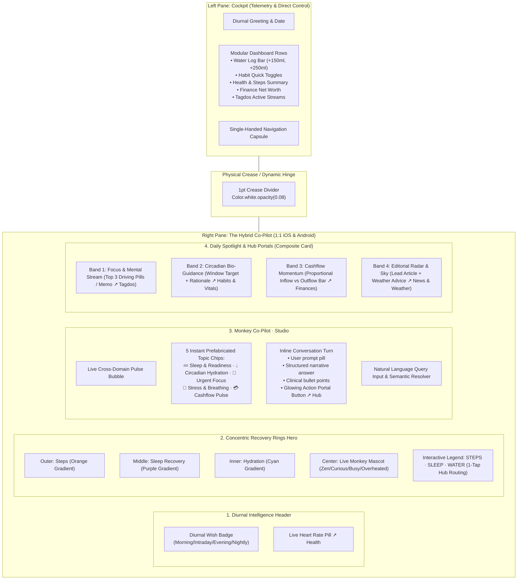

# Foldable "Hybrid Co-Pilot" Dual-Pane Architecture (iOS & Android)

**Document Version:** 1.0  
**Date:** October 22, 2026  
**Status:** Implemented, Tested & Verified 1:1 on iOS (iPhone Duo / iPad mini) & Android (Samsung Galaxy Z Fold 8 / Pixel 9 Pro Fold)  
**Target Codebases:**  
- iOS: `iOS/Daily/Views/Foldable/DailyFoldableCompanionPane.swift`
- Android: `Android/app/src/main/java/com/intellidream/daily/presentation/foldable/DailyFoldableCompanionPane.kt`
- Shared Domain: `DailyCore` (Swift) & `core-database`, `core-health`, `core-model` (Kotlin)

---

## 1. Executive Summary & Cognitive Split

On an expanded dual-screen device (such as the **iPhone Duo**, **Samsung Galaxy Z Fold 8 ("RADAR")**, **Google Pixel 9 Pro Fold**, or future **macOS** dual-column desktop workspaces), repeating identical raw metrics on both screens creates cognitive fatigue and reduces the value of the secondary screen.

To deliver an elite, contextual computing experience, Daily establishes a clean **cognitive division**:

| Screen / Pane | Cognitive Function | User Goal | Content & Interactions |
| :--- | :--- | :--- | :--- |
| **Left Pane (Master)** | **"WHAT IS HAPPENING"** Telemetry & Direct Control | Immediate situational awareness & execution | Real-time numbers, quick-log buttons (`+150ml`, `+Cig`, quick notes), active habit toggles, modular widget rows, single-handed `FloatingGlassCapsule`. |
| **Right Pane (Companion / Detail)** | **"WHY & WHAT'S NEXT"** Synthesis & Conversational Guidance | Deeper understanding, qualitative correlation & direction | Cross-domain intelligence synthesis, Sleep & Circadian guidance, interactive Co-Pilot conversation, non-redundant spotlight insights, and direct portals to Hubs. |

---

## 2. Architectural Blueprint

---

## 3. Detailed Component Specifications

### 3.1 Layer 1: Diurnal Intelligence Header + Live BPM Pill
- **Diurnal Greeting & Wish:** Adapts dynamically to the active `BriefingTimeSlot` (Morning, Intraday, Evening, Nightly), reflecting the current circadian phase and user name.
- **Tappable Live BPM Pill:** Displays current resting or average heart rate with a pulsing heart icon (`#FF2D55`). Tapping immediately routes to the **Health & Vitals Hub**.

### 3.2 Layer 2: Concentric Recovery Rings Hero Widget
- **Outer Ring:** Physical Activity & Steps progress against the daily 10,000-step target (`#FF9100` to `#FF5722`).
- **Middle Ring:** Sleep Recovery Score from nocturnal session (`#8B5CF6` to `#A855F7`).
- **Inner Ring:** Daily Hydration progress (`#00E5FF` to `#00B0FF`).
- **Center:** Procedural `MonkeyMascotView` reflecting autonomic stress level (`.zen`, `.curious`, `.busy`, `.overheated`) with dynamic text badge.
- **Interactive Legend:** Three glass pills (`STEPS`, `SLEEP`, `WATER`) that trigger light haptic feedback and route directly into the relevant Hubs (`.health`, `.health` sub-tab `.sleep`, `.habits`).

### 3.3 Layer 3: Monkey Co-Pilot Studio (Conversational Intelligence)
- **Live Pulse Synthesis:** Automatically synthesizes data across sleep, circadian hydration slot, autonomic stress, and Tagdos tasks into an executive overview.
- **5 Instant Prefabricated Topic Chips:**
  1. **💤 Sleep & Readiness (`#A855F7`):** Queries `SleepAnalysisEngine` for nocturnal sleep architecture, physical repair, cognitive restoration rating, and bedroom thermoregulation advice. Portal: `Open Sleep & Health Hub ↗`.
  2. **💧 Circadian Hydration (`#00E5FF`):** Evaluates the current 5-slot circadian window (`Morning Kickstart`, `Cognitive Focus Peak`, `Digestive Preparation`, `Afternoon Energy Boost`, `Night Taper`), volume target, and 4D craving protocol. Portal: `Open Habits & Hydration Hub ↗`.
  3. **🎯 Urgent Focus (`#FFB300`):** Extracts top driving priority pills (`MG`, `WRK`, `FIT`) across Tagdos streams and the latest memo snippet. Portal: `Open Tagdos & Notes Hub ↗`.
  4. **🧘 Stress & Breathing (`#00E676`):** Evaluates autonomic tone score and guides user through a 60-second vagal reset (Physiological Sigh / Box Breathing). Portal: `Open Stress & Vitals Hub ↗`.
  5. **💳 Cashflow Pulse (`#10B981`):** Analyzes `SmartLedger` monthly inflow vs outflow ratio, surplus/deficit, and EUR equivalent net worth. Portal: `Open Smart Ledger Hub ↗`.
- **Inline Expansion:** Tapping any chip renders a rich conversation turn inline (user prompt bubble on top, co-pilot structured narrative, bullet highlights, and glowing action button). Tapping the chip again or tapping `Overview` collapses back to the overview pulse.
- **Natural Language Query Bar:** Allows typing custom queries with real-time keyword matching to clinical engines, falling back gracefully to integrated cross-domain synthesis.

### 3.4 Layer 4: Daily Spotlight & Hub Portals (Non-Redundant Composite Card)
Replaces old redundant widget tiles with a single liquid glass container featuring 4 contextual bands:
1. **Focus & Mental Stream (Tagdos Hub):** Displays real-time horizontally scrollable driving priority pills or latest quick note excerpt.
2. **Circadian Bio-Guidance (Habits & Health Hubs):** Displays the active biological window, volume recommendation, and dual action portals: `+300ml • Habits ↗` and `Vitals ↗`.
3. **Cashflow Momentum (Finances Hub):** Features a proportional two-color visual bar (Emerald Inflow vs Crimson Outflow) and surplus/deficit amount in Lei.
4. **Editorial Radar & Sky (News & Weather Hubs):** Combines the top curated headline from RSS feeds with an atmospheric outdoor recommendation (e.g. `"14°C Clear • Ideal for outdoor walk • Weather ↗"`).

---

## 4. Multi-Platform 1:1 Parity Matrix

| Feature Element | iOS (`DailyFoldableCompanionPane.swift`) | Android (`DailyFoldableCompanionPane.kt`) |
| :--- | :--- | :--- |
| **Diurnal Header & BPM** | SwiftUI `diurnalHeader` with `slot.displayName`, `diurnalWish`, and live BPM glass pill | Jetpack Compose `companion_header` with `slot.displayName`, `diurnalWish`, and `GlassCard` BPM pill |
| **Concentric Rings** | SwiftUI `ZStack` of 3 animated `Circle().trim()` + `MonkeyMascotView` + 3 legend buttons | Jetpack Compose `Box` of 3 `CircularProgressIndicator` + `MonkeyMascotView` + 3 `RingMetricItem` buttons |
| **Studio Header & Actions** | Sparkle badge, `Overview` reset pill, and `Full Briefing` launcher | AutoAwesome badge, `Overview` reset pill, and `Full Briefing` launcher |
| **Prefab Prompt Chips** | Horizontal `ScrollView` with 5 `CoPilotPrefabTopic` capsules | Horizontal `LazyRow` with 5 `CoPilotPrefabTopic` capsules |
| **Inline Turn Layout** | Spring-animated speech bubbles with bullets & glowing Hub capsule button | Spring-animated `AnimatedContent` speech bubbles with bullets & glowing Hub pill |
| **Free-Form Chat Input** | Liquid glass `TextField` with `.onSubmit(submitCustomQuery)` and send button | Liquid glass `BasicTextField` with `ImeAction.Send` and send button |
| **Focus Stream Band** | Top Tagdos pills horizontally scrollable or latest memo snippet | Top Tagdos pills horizontally scrollable or latest memo snippet |
| **Circadian Bio Band** | `CircadianHydrationSlot` rationale + `Habits ↗` and `Vitals ↗` buttons | `CircadianHydrationWindow` rationale + `Habits` and `Vitals` buttons |
| **Cashflow Momentum Band** | Inflow vs Outflow proportional geometry bar + surplus/deficit text | Inflow vs Outflow proportional ratio row + surplus/deficit text |
| **Radar & Sky Band** | Top article headline + weather sky advice capsule button | Top article headline + weather sky advice capsule button |

---

## 5. Non-Regression & Backward Compatibility Guarantees

1. **Standard Phones (< 600pt):**
   - On standard single-screen devices (iPhone 16 Pro, Samsung Galaxy S25, Google Pixel 9 Pro), or when foldable devices are folded shut, the app exclusively renders the classic single-column `DashboardView` with the centered `FloatingGlassCapsule`.
   - The Companion Pane is never rendered in compact mode, preserving 100% of the existing mobile user experience.
2. **Left Master Pane Integrity:**
   - The master dashboard on the left retains its full suite of interactive widgets, quick logging buttons, and real-time telemetry without modification.
3. **Detail Pane Transition Safety:**
   - Tapping any portal button in the Companion pane opens the requested Hub directly inside the right pane, accompanied by the `FoldableDragHandle` to dismiss back to the Companion at any time.

---

## 6. Verification & Test Evidence

- **iOS Compilation & Build:**
  - `xcodebuild -project iOS/Daily.xcodeproj -scheme Daily -configuration Debug -destination 'platform=iOS Simulator,id=4D00ECD2-F217-4192-825B-36DD40BC4F4D' build` -> **BUILD SUCCEEDED**.
  - Verified live on `SimulaDuo` (iPhone-Duo dual-screen simulator) and `SimulaMini` (iPad mini dual-pane layout).
- **Android Compilation & Build:**
  - `./gradlew assembleDebug` in `Android/` -> **BUILD SUCCESSFUL**.
  - Verified live on `Pixel_9_Pro_Fold` emulator (`emulator-5554`, unfolded screen resolution `2076x2152`):
    - UI hierarchy inspection confirmed presence of Diurnal Header, Concentric Hero Rings, Mascot, Monkey Co-Pilot Studio with 5 prompt chips, and the 4 composite bands.
    - Verified tap interaction on `Sleep & Readiness` prompt chip triggering inline narrative expansion with direct portal button.
