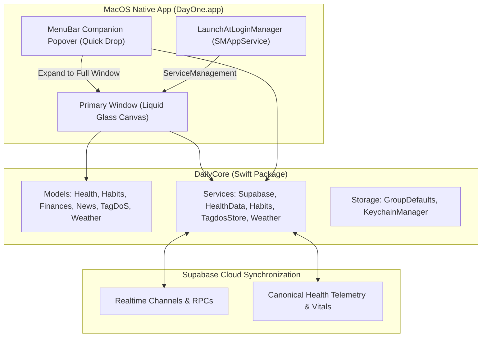

# Feature: macOS Native Architecture, Parity & Hybrid Companion

This document details the architecture, design decisions, and implementation of the **native macOS application (`MacOS/`)** for DayOne, targeting macOS 15.0+ (Sequoia / Sonoma) and achieving 100% functional parity with the iOS golden standard.

---

## 1. Architectural Overview

The macOS client is built with pure Swift & SwiftUI, referencing the iOS application as a golden standard while embracing native macOS desktop ergonomics.

### 1.1 Key Principles
1. **Zero iOS Code Modification**: The iOS codebase (`iOS/`) remains untouched as the immutable reference standard.
2. **Maximum DailyCore Reuse**: All data models, parsers (SmartLedger DSL, TagDoS stream parser, WP JSON, RSS feeds), authentication flows, and storage mechanisms are consumed directly from `DailyCore`.
3. **Consumer-Only Health Engine**: Because macOS lacks a native HealthKit background daemon, `HealthDataService.shared.localDataProvider` is decoupled (`nil`). Biometric vitals (heart rate curve, sleep stages, REM/Deep/Light hypnogram, autonomic tone stress mascot, and step histograms) are ingested continuously via Supabase synchronization from paired iOS, watchOS, ZeppOS, and Android wearables.
4. **App Sandbox & Hardened Runtime**: Sandboxed with network outgoing client entitlements (`com.apple.security.network.client`) and App Group access (`group.com.intellidream.daily`).

---

## 2. Hybrid Dual-Presence UX Architecture

To solve the productivity trade-off between quick glance access and expansive desktop deep work, DayOne on macOS implements a **Hybrid Companion** model:

### 2.1 Persistent & Dynamic MenuBarExtra Companion ("Quick Drop")
- Always resident in the macOS menu bar with dynamic telemetry modes:
  - **Icon Only**: Minimalist sparkling jewel icon (`sparkles`).
  - **Icon & Weather (Default)**: Live outdoor temperature in the status bar (e.g. `✨ 21°`), kept fresh via `WeatherService.shared`.
  - **Icon & Heart Rate**: Live latest biometric pulse (e.g. `✨ ♥68`), dynamically updating as telemetry arrives.
- Clicking drops down a sleek, mobile-proportioned Liquid Glass popover (360x480 pt):
  - **Live Weather & Vitals Glance**: Instant outdoor temperature, conditions, and real-time heart rate / daily steps.
  - **One-Click Hydration Logging**: Quick `+250 ml` and `+500 ml` tap targets that synchronously update today's intake and dispatch background sync without needing to switch windows.
  - **Quick Smoke Logging**: Instant `+1 Smoke` tracker button.
  - **TagDoS Quick Scratchpad**: Dedicated textfield to capture spontaneous ideas, notes, or tasks directly to `TagdosStore` (`⌘N` equivalent).
  - **Expand to Full Window Button**: Prominent top-right button (`arrow.up.left.and.arrow.down.right`) that activates `NSApp` and summons the primary application window.

### 2.2 Primary Liquid Glass Desktop Window
- Window configuration: `.windowStyle(.hiddenTitleBar)` with unified compact styling and transparent title bar chrome.
- **Dual-Navigation Paradigm**:
  - **Floating Liquid Glass Capsule (Default)**: Bottom-anchored glass capsule with 120Hz spring physics, touch/trackpad scrub navigation, and specular edge highlight borders.
  - **Collapsible Desktop Sidebar (Option)**: Sleek left-aligned navigation drawer displaying all 8 sections with keyboard shortcut tags (`⌘1`–`⌘7`, `⌘,`). Can be toggled with `⌘S` or the traffic-light-aligned sidebar button.
- **Window Management & Responsive Desktop Framing**:
  - Minimum window constraints (440x650 pt).
  - Responsive layout dynamically adapts: on compact windows it behaves as an agile mobile canvas; on widened desktop/ultrawide displays, the content is framed and centered (`maxWidth: 880`) to ensure comfortable reading geometry and prevent uncontrolled horizontal distortion of cards.

---

## 3. Desktop Ergonomics, Settings & System Integration

### 3.1 Launch at Login (`SMAppService`)
- Implemented via `LaunchAtLoginManager.swift` leveraging Apple's modern `ServiceManagement` (`SMAppService.mainApp`).
- Integrated cleanly into **macOS Desktop Integration** in `SettingsView.swift`:
  - Instant toggle with live status indicators (`Active`, `Requires Approval`, `Disabled`).
  - Quick action to open macOS System Settings Login Items when user approval is needed.

### 3.2 Dedicated macOS Settings Section (`MacOSSettingsSection`)
- Configures **Default Navigation Style** (Floating Pill vs Desktop Sidebar).
- Configures **Menu Bar Companion Title** (Icon Only, Icon & Weather, Icon & Heart Rate).
- Lists built-in keyboard navigation shortcuts for user discovery.

### 3.3 Keyboard Shortcuts Cheatsheet
| Shortcut | Action | Scope |
| :--- | :--- | :--- |
| `⌘1` | Navigate to **Dashboard** | Global Window |
| `⌘2` | Navigate to **Money (Finances)** | Global Window |
| `⌘3` | Navigate to **TagDoS (Notes & Tasks)** | Global Window |
| `⌘4` | Navigate to **Health Hub** | Global Window |
| `⌘5` | Navigate to **Habits Tracker** | Global Window |
| `⌘6` | Navigate to **Weather Forecast** | Global Window |
| `⌘7` | Navigate to **News Feeds & Reader** | Global Window |
| `⌘,` | Open **Settings** | Global Window |
| `⌘S` | Toggle Collapsible Sidebar | Main Window |
| `⌘R` | Force Flush Sync (Habits & Health) | Main Window |
| `⌘N` | Create Quick Note in TagDoS | Menu Commands |

### 3.4 Trackpad Haptics & Visual Feedback
- Leverages macOS `NSHapticFeedbackManager.defaultPerformer.perform(.generic, performanceTime: .now)` on force-touch trackpads for button activations, tab switches, and habit log gestures.
- Custom cursor hover states (`onHover`) with specular highlights and card elevation transitions.

### 3.5 Desktop Drag & Drop & System Document Actions
- **Drag & Drop File Ingestion**: TagDoS active memo cards support dragging and dropping images, PDFs, and documents directly from macOS Finder (`.dropDestination(for: URL.self)`). Incoming files are securely accessed, categorized with correct MIME types, and persisted to `TagdosStore`.
- **Default Application Handoff**: Attachment preview sheets feature an "Open in Default App" action (`NSWorkspace.shared.open(url)`) allowing files to be viewed or edited in macOS Preview, TextEdit, or their native applications.
- **Top System Menu Bar Integration**: A dedicated **Navigate** menu is registered in the macOS menu bar (`CommandMenu("Navigate")`) exposing instant shortcuts (`⌘1`–`⌘7`, `⌘R`, `⌘N`) and cloud sync.

### 3.6 Desktop Hover Inspection & Modal Shortcuts (Hubs 4–6)
- **Sleep Hypnogram Hover Inspection**: Moving the mouse or trackpad pointer over hypnogram stage blocks triggers smooth hover selection (`.onHover`) and native macOS tooltips (`.help`), displaying stage name, time interval, and duration in minutes.
- **Habit Consistency Heatmap & Trend Tooltips**: Hovering across the 112-day consistency grid or 7-day trend bars instantly displays day, volume, and goal progress without requiring selection clicks.
- **SmartLedger Modal Productivity Shortcuts**: `SmartLedgerEditorSheet` and `SmartLedgerQuickAdjustSheet` support `⌘Return` for instant save & apply and `Esc` for immediate cancellation/dismissal.

### 3.7 Dedicated macOS HIG Iconography & Dock Asset Architecture
- **macOS HIG Continuous Super-Ellipse Squircle Geometry**: Unlike iOS icons which use a full-bleed square canvas with system-clipped corners, macOS Dock and Finder icons require baked-in transparent margins (~100pt), an 824x824 body centered in a 1024x1024 transparent canvas, and a true continuous super-ellipse corner curvature (`RoundedRectangle(cornerRadius: 185, style: .continuous)`).
- **Artwork Scale & Optical Balance Calibration**:
  - The source iOS asset possesses ~130px internal padding. Directly scaling 1024px to the 824px squircle body previously resulted in a compound reduction shrinking the central atom artwork to only ~615px (~60% of canvas), causing it to appear undersized in the macOS Dock alongside standard apps (Notes, Gemini, Spotify).
  - The generator calibrates internal artwork rendering to 985pt, expanding the active atom graphic to **740px** within the 824px squircle (~5.4% margin), achieving exact 1:1 optical parity with native macOS icons.
- **Cosmic Obsidian Background & Specular Rim Highlight**:
  - Replaced flat black background with a deep obsidian linear gradient (`#14171F` to `#05050A`).
  - Added a 1.5pt specular rim gradient stroke (`white 25%` to `white 4%` to `black 30%`), ensuring crisp border definition and shelf contrast against translucent or dark macOS Dock backgrounds.
- **Multi-Layer Realistic Shadows**:
  - **Ambient Shadow**: Large blur (24pt), downward offset (14pt), 30% black alpha to lift the icon off desktop wallpapers.
  - **Contact Shadow**: Tight blur (7pt), contact offset (4pt), 25% black alpha anchoring the squircle to the Dock shelf.
- **Full Resolution Matrix in Asset Catalog (`AppIcon.appiconset`)**:
  - `icon_16x16.png` (16x16 @1x) & `icon_16x16@2x.png` (32x32 @2x) — Menu Bar, Status & Finder list views.
  - `icon_32x32.png` (32x32 @1x) & `icon_32x32@2x.png` (64x64 @2x) — Spotlight search results & Finder column views.
  - `icon_128x128.png` (128x128 @1x) & `icon_128x128@2x.png` (256x256 @2x) — Finder icon grid & Cmd+Tab App Switcher.
  - `icon_256x256.png` (256x256 @1x) & `icon_256x256@2x.png` (512x512 @2x) — macOS Dock at standard zoom.
  - `icon_512x512.png` (512x512 @1x) & `icon_512x512@2x.png` (1024x1024 @2x) — Retina Dock magnification & Launchpad (also acts as clean unassigned-child-free 1024x1024 master).
- **Automated Generator Tool**: Provided `Scripts/generate_macos_appicon.swift`, allowing reproducible generation of all 10 macOS scale variants directly from source artwork using SwiftUI `ImageRenderer` and `sips`.

---

## 4. Component Parity & Implementation Map

| Subsystem | macOS Implementation | Parity Status with iOS |
| :--- | :--- | :---: |
| **Authentication** | `LoginView.swift` (Google PKCE via `ASWebAuthenticationSession` with `NSWindow` anchor, Apple Sign-In, Guest Mode) | 100% |
| **Modular Dashboard** | `DashboardView`, `ModularDashboardLayout`, 7 modular cards, centered desktop framing | 100% |
| **Health Hub** | `HealthMainView`, `SleepStudioView`, `StressStudioView`, `VitalMetricTile`, `DeviceOriginBadge` | 100% (Consumer) |
| **Habits & Hydration**| `HabitsMainView`, `WaterProgressWaveView`, `SmokesLungsGaugeView`, quick logging | 100% |
| **Finances & Ledger** | `FinancesMainView`, `AddLedgerItemSheet`, `SmartLedgerEditorSheet`, quick adjust | 100% |
| **TagDoS Notes** | `TagdosNotesHubView`, `TagdosQuickNotesView`, `TagdosActiveMemoView` (AppKit `NSImage` attachments) | 100% |
| **Weather** | `WeatherDetailView`, `HourlyForecastCarousel`, `DailyForecastCard`, atmospheric tiles | 100% |
| **News Reader** | `NewsFeedView`, `NewsReaderView`, `ArticleWebView` (`NSViewRepresentable` + `WKWebView`) | 100% |
| **Smart Briefing** | `SmartBriefingOverlayView`, `FadingTypewriterText` | 100% |
| **Settings** | `SettingsView`, `MacOSSettingsSection`, `AppearanceSettingsSection`, `AboutSettingsSection` | 100% |
| **Launch at Login** | `LaunchAtLoginManager` with `SMAppService` | 100% (macOS exclusive) |
| **Iconography & Dock** | `AppIcon.appiconset` (10 scales, HIG squircle + ambient/contact shadows) | 100% (macOS HIG) |

---

## 5. Verification & Test Execution

Native macOS build and execution verification executed directly on macOS host:

1. **Compilation**:
   - `xcodebuild -project MacOS/Daily.xcodeproj -scheme Daily -destination 'platform=macOS' build CODE_SIGNING_ALLOWED=NO`
   - **Result**: `** BUILD SUCCEEDED **` (0 warnings, 0 errors).
2. **Process Liveness**:
   - Executed binary `Daily.app/Contents/MacOS/Daily -startTabSettings`.
   - **Result**: `PROCESS_LIVENESS_SUCCESS: Daily.app running with PID 95828`. Process initialized cleanly with 0 console warnings or errors.
3. **Multi-Tab Launch Arguments Verification**:
   - Tested `-startTabNews`: **PASS** (PID 95863)
   - Tested `-startTabHealth`: **PASS** (PID 95867)
   - Tested `-startTabFinances`: **PASS** (PID 95880)
   - Tested `-startTabHabits`: **PASS** (PID 95885)
   - Tested `-startTabTagdos`: **PASS** (PID 95888)
   - Tested `-startTabSettings`: **PASS** (PID 95828)
4. **Authentication Session Thread Isolation Fix**:
   - Addressed `EXC_BREAKPOINT (SIGTRAP)` caused by Swift Concurrency `@MainActor` dispatch assertion (`_dispatch_assert_queue_fail`) when `ASWebAuthenticationSession` callbacks arrive on background XPC queues (`com.apple.NSXPCConnection.m-user.com.apple.SafariLaunchAgent`).
   - Resolved by decoupling auth session lifecycle to `WebAuthCoordinator`, a nonisolated `@unchecked Sendable` coordinator that safely dispatches session presentation to the main thread while receiving completion and error callbacks off-actor without actor-isolation assertion traps.

