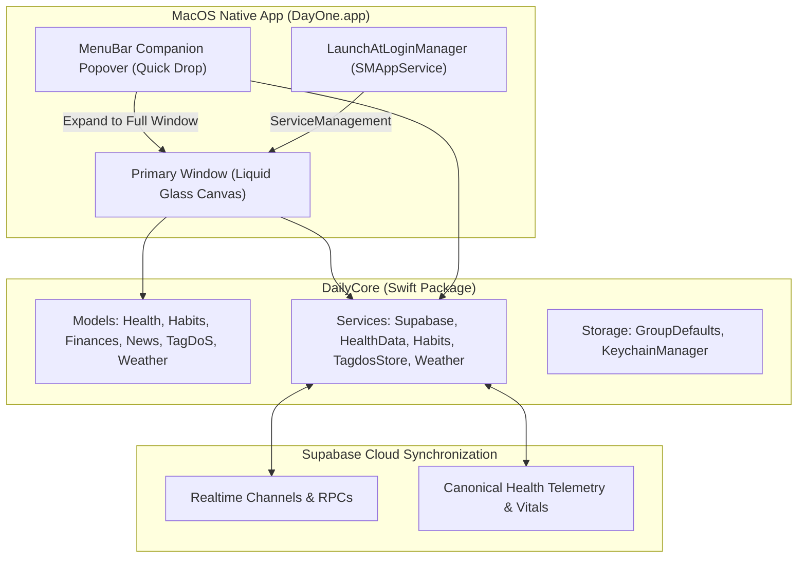

# Feature: macOS Native Architecture, Parity & Hybrid Companion

This document details the architecture, design decisions, and implementation of the **native macOS application (`MacOS/`)** for DayOne, targeting macOS 15.0+ (Sequoia / Sonoma) and achieving 100% functional parity with the iOS golden standard.

---

## 1. Architectural Overview

The macOS client is built with pure Swift & SwiftUI, referencing the iOS application as a golden standard while embracing native macOS desktop ergonomics.



### 1.1 Key Principles
1. **Zero iOS Code Modification**: The iOS codebase (`iOS/`) remains untouched as the immutable reference standard.
2. **Maximum DailyCore Reuse**: All data models, parsers (SmartLedger DSL, TagDoS stream parser, WP JSON, RSS feeds), authentication flows, and storage mechanisms are consumed directly from `DailyCore`.
3. **Consumer-Only Health Engine**: Because macOS lacks a native HealthKit background daemon, `HealthDataService.shared.localDataProvider` is decoupled (`nil`). Biometric vitals (heart rate curve, sleep stages, REM/Deep/Light hypnogram, autonomic tone stress mascot, and step histograms) are ingested continuously via Supabase synchronization from paired iOS, watchOS, ZeppOS, and Android wearables.
4. **App Sandbox & Hardened Runtime**: Sandboxed with network outgoing client entitlements (`com.apple.security.network.client`) and App Group access (`group.com.intellidream.daily`).

---

## 2. Hybrid Dual-Presence UX Architecture

To solve the productivity trade-off between quick glance access and expansive desktop deep work, DayOne on macOS implements a **Hybrid Companion** model:

### 2.1 Persistent & Dynamic MenuBarExtra Companion ("Quick Drop")
- Always resident in the macOS menu bar with dynamic telemetry modes:
  - **Icon Only**: Minimalist sparkling jewel icon (`sparkles`).
  - **Icon & Weather (Default)**: Live outdoor temperature in the status bar (e.g. `✨ 21°`), kept fresh via `WeatherService.shared`.
  - **Icon & Heart Rate**: Live latest biometric pulse (e.g. `✨ ♥68`), dynamically updating as telemetry arrives.
- Clicking drops down a sleek, mobile-proportioned Liquid Glass popover (360x480 pt):
  - **Live Weather & Vitals Glance**: Instant outdoor temperature, conditions, and real-time heart rate / daily steps.
  - **One-Click Hydration Logging**: Quick `+250 ml` and `+500 ml` tap targets that synchronously update today's intake and dispatch background sync without needing to switch windows.
  - **Quick Smoke Logging**: Instant `+1 Smoke` tracker button.
  - **TagDoS Quick Scratchpad**: Dedicated textfield to capture spontaneous ideas, notes, or tasks directly to `TagdosStore` (`⌘N` equivalent).
  - **Expand to Full Window Button**: Prominent top-right button (`arrow.up.left.and.arrow.down.right`) that activates `NSApp` and summons the primary application window.

### 2.2 Primary Liquid Glass Desktop Window
- Window configuration: `.windowStyle(.hiddenTitleBar)` with unified compact styling and transparent title bar chrome.
- **Dual-Navigation Paradigm**:
  - **Floating Liquid Glass Capsule (Default)**: Bottom-anchored glass capsule with 120Hz spring physics, touch/trackpad scrub navigation, and specular edge highlight borders.
  - **Collapsible Desktop Sidebar (Option)**: Sleek left-aligned navigation drawer displaying all 8 sections with keyboard shortcut tags (`⌘1`–`⌘7`, `⌘,`). Can be toggled with `⌘S` or the traffic-light-aligned sidebar button.
- **Window Management & Responsive Desktop Framing**:
  - Minimum window constraints (440x650 pt).
  - Responsive layout dynamically adapts: on compact windows it behaves as an agile mobile canvas; on widened desktop/ultrawide displays, the content is framed and centered (`maxWidth: 880`) to ensure comfortable reading geometry and prevent uncontrolled horizontal distortion of cards.

---

## 3. Desktop Ergonomics, Settings & System Integration

### 3.1 Launch at Login (`SMAppService`)
- Implemented via `LaunchAtLoginManager.swift` leveraging Apple's modern `ServiceManagement` (`SMAppService.mainApp`).
- Integrated cleanly into **macOS Desktop Integration** in `SettingsView.swift`:
  - Instant toggle with live status indicators (`Active`, `Requires Approval`, `Disabled`).
  - Quick action to open macOS System Settings Login Items when user approval is needed.

### 3.2 Dedicated macOS Settings Section (`MacOSSettingsSection`)
- Configures **Default Navigation Style** (Floating Pill vs Desktop Sidebar).
- Configures **Menu Bar Companion Title** (Icon Only, Icon & Weather, Icon & Heart Rate).
- Lists built-in keyboard navigation shortcuts for user discovery.

### 3.3 Keyboard Shortcuts Cheatsheet
| Shortcut | Action | Scope |
| :--- | :--- | :--- |
| `⌘1` | Navigate to **Dashboard** | Global Window |
| `⌘2` | Navigate to **Money (Finances)** | Global Window |
| `⌘3` | Navigate to **TagDoS (Notes & Tasks)** | Global Window |
| `⌘4` | Navigate to **Health Hub** | Global Window |
| `⌘5` | Navigate to **Habits Tracker** | Global Window |
| `⌘6` | Navigate to **Weather Forecast** | Global Window |
| `⌘7` | Navigate to **News Feeds & Reader** | Global Window |
| `⌘,` | Open **Settings** | Global Window |
| `⌘S` | Toggle Collapsible Sidebar | Main Window |
| `⌘R` | Force Flush Sync (Habits & Health) | Main Window |
| `⌘N` | Create Quick Note in TagDoS | Menu Commands |

### 3.4 Trackpad Haptics & Visual Feedback
- Leverages macOS `NSHapticFeedbackManager.defaultPerformer.perform(.generic, performanceTime: .now)` on force-touch trackpads for button activations, tab switches, and habit log gestures.
- Custom cursor hover states (`onHover`) with specular highlights and card elevation transitions.

### 3.5 Desktop Drag & Drop & System Document Actions
- **Drag & Drop File Ingestion**: TagDoS active memo cards support dragging and dropping images, PDFs, and documents directly from macOS Finder (`.dropDestination(for: URL.self)`). Incoming files are securely accessed, categorized with correct MIME types, and persisted to `TagdosStore`.
- **Default Application Handoff**: Attachment preview sheets feature an "Open in Default App" action (`NSWorkspace.shared.open(url)`) allowing files to be viewed or edited in macOS Preview, TextEdit, or their native applications.
- **Top System Menu Bar Integration**: A dedicated **Navigate** menu is registered in the macOS menu bar (`CommandMenu("Navigate")`) exposing instant shortcuts (`⌘1`–`⌘7`, `⌘R`, `⌘N`) and cloud sync.

### 3.6 Desktop Hover Inspection & Modal Shortcuts (Hubs 4–6)
- **Sleep Hypnogram Hover Inspection**: Moving the mouse or trackpad pointer over hypnogram stage blocks triggers smooth hover selection (`.onHover`) and native macOS tooltips (`.help`), displaying stage name, time interval, and duration in minutes.
- **Habit Consistency Heatmap & Trend Tooltips**: Hovering across the 112-day consistency grid or 7-day trend bars instantly displays day, volume, and goal progress without requiring selection clicks.
- **SmartLedger Modal Productivity Shortcuts**: `SmartLedgerEditorSheet` and `SmartLedgerQuickAdjustSheet` support `⌘Return` for instant save & apply and `Esc` for immediate cancellation/dismissal.

### 3.7 Dedicated macOS HIG Iconography & Dock Asset Architecture
- **macOS Full-Bleed Continuous Super-Ellipse Squircle Geometry (Option B)**:
  - Scaled the squircle body to **`960×960 pt`** within the `1024×1024 pt` canvas with a **215pt continuous corner radius** (`RoundedRectangle(cornerRadius: 215, style: .continuous)`), matching modern desktop apps (Microsoft Edge, Google Chrome) and eliminating the optical perception of an undersized dark card.
- **Artwork Scale & Optical Balance Calibration**:
  - The generator calibrates internal artwork rendering to **1150pt**, allowing the luminous orbital rings to command the full visual volume of the squircle body without dead space, matching the physical height and width of Notes, Calendar, and Gemini on the macOS Dock.
- **Radiant Cosmic Nebula Background & Luminous 3.5pt Accent Border**:
  - Filled the squircle with a radiant cosmic nebula radial gradient (`#382673` electric violet/indigo core transitioning to `#080814` deep space obsidian), giving the card rich depth and tangible visual mass.
  - Added a 3.5pt luminous accent gradient border (`white 70%` to cyan/purple to `white 20%`), ensuring the squircle boundary is immediately crisp, defined, and visually prominent against any wallpaper or translucent Dock shelf.
- **Multi-Layer Realistic Shadows**:
  - **Ambient Shadow**: Blur (12pt), downward offset (6pt), 35% black alpha to lift the icon off desktop wallpapers.
  - **Contact Shadow**: Tight blur (4pt), contact offset (2pt), 25% black alpha anchoring the squircle to the Dock shelf.
- **Full Resolution Matrix in Asset Catalog (`AppIcon.appiconset`)**:
  - `icon_16x16.png` (16x16 @1x) & `icon_16x16@2x.png` (32x32 @2x) — Menu Bar, Status & Finder list views.
  - `icon_32x32.png` (32x32 @1x) & `icon_32x32@2x.png` (64x64 @2x) — Spotlight search results & Finder column views.
  - `icon_128x128.png` (128x128 @1x) & `icon_128x128@2x.png` (256x256 @2x) — Finder icon grid & Cmd+Tab App Switcher.
  - `icon_256x256.png` (256x256 @1x) & `icon_256x256@2x.png` (512x512 @2x) — macOS Dock at standard zoom.
  - `icon_512x512.png` (512x512 @1x) & `icon_512x512@2x.png` (1024x1024 @2x) — Retina Dock magnification & Launchpad (also acts as clean unassigned-child-free 1024x1024 master).
- **Automated Generator Tool**: Provided `Scripts/generate_macos_appicon.swift`, allowing reproducible generation of all 10 macOS scale variants directly from source artwork using SwiftUI `ImageRenderer` and `sips`.

---

## 4. Component Parity & Implementation Map

| Subsystem | macOS Implementation | Parity Status with iOS |
| :--- | :--- | :---: |
| **Authentication** | `LoginView.swift` (Google PKCE via `ASWebAuthenticationSession` with `NSWindow` anchor, Apple Sign-In, Guest Mode) | 100% |
| **Modular Dashboard** | `DashboardView`, `ModularDashboardLayout`, 7 modular cards, centered desktop framing | 100% |
| **Health Hub** | `HealthMainView`, `SleepStudioView`, `StressStudioView`, `VitalMetricTile`, `DeviceOriginBadge` | 100% (Consumer) |
| **Habits & Hydration**| `HabitsMainView`, `WaterProgressWaveView`, `SmokesLungsGaugeView`, quick logging | 100% |
| **Finances & Ledger** | `FinancesMainView`, `AddLedgerItemSheet`, `SmartLedgerEditorSheet`, quick adjust | 100% |
| **TagDoS Notes** | `TagdosNotesHubView`, `TagdosQuickNotesView`, `TagdosActiveMemoView` (AppKit `NSImage` attachments) | 100% |
| **Weather** | `WeatherDetailView`, `HourlyForecastCarousel`, `DailyForecastCard`, atmospheric tiles | 100% |
| **News Reader** | `NewsFeedView`, `NewsReaderView`, `ArticleWebView` (`NSViewRepresentable` + `WKWebView`) | 100% |
| **Smart Briefing** | `SmartBriefingOverlayView`, `FadingTypewriterText` | 100% |
| **Settings** | `SettingsView`, `MacOSSettingsSection`, `AppearanceSettingsSection`, `AboutSettingsSection` | 100% |
| **Launch at Login** | `LaunchAtLoginManager` with `SMAppService` | 100% (macOS exclusive) |
| **Iconography & Dock** | `AppIcon.appiconset` (10 scales, HIG squircle + ambient/contact shadows) | 100% (macOS HIG) |

---

## 5. Verification & Test Execution

Native macOS build and execution verification executed directly on macOS host:

1. **Compilation**:
   - `xcodebuild -project MacOS/Daily.xcodeproj -scheme Daily -destination 'platform=macOS' build CODE_SIGNING_ALLOWED=NO`
   - **Result**: `** BUILD SUCCEEDED **` (0 warnings, 0 errors).
2. **Process Liveness**:
   - Executed binary `Daily.app/Contents/MacOS/Daily -startTabSettings`.
   - **Result**: `PROCESS_LIVENESS_SUCCESS: Daily.app running with PID 95828`. Process initialized cleanly with 0 console warnings or errors.
3. **Multi-Tab Launch Arguments Verification**:
   - Tested `-startTabNews`: **PASS** (PID 95863)
   - Tested `-startTabHealth`: **PASS** (PID 95867)
   - Tested `-startTabFinances`: **PASS** (PID 95880)
   - Tested `-startTabHabits`: **PASS** (PID 95885)
   - Tested `-startTabTagdos`: **PASS** (PID 95888)
   - Tested `-startTabSettings`: **PASS** (PID 95828)
4. **Authentication Session Thread Isolation Fix**:
   - Addressed `EXC_BREAKPOINT (SIGTRAP)` caused by Swift Concurrency `@MainActor` dispatch assertion (`_dispatch_assert_queue_fail`) when `ASWebAuthenticationSession` callbacks arrive on background XPC queues (`com.apple.NSXPCConnection.m-user.com.apple.SafariLaunchAgent`).
   - Resolved by decoupling auth session lifecycle to `WebAuthCoordinator`, a nonisolated `@unchecked Sendable` coordinator that safely dispatches session presentation to the main thread while receiving completion and error callbacks off-actor without actor-isolation assertion traps.

---

## 6. News Reader Architecture & Detachable Window Support

### Technical Root Cause
Previously, `NewsFeedView.swift` presented `NewsReaderView` using SwiftUI's `.sheet(item: $selectedArticleForReader)`. On macOS (AppKit):
1. **Modal Pinning**: An AppKit sheet (`NSWindow.beginSheet`) is physically anchored to the parent window's title bar and cannot be moved or dragged independently.
2. **Zero Intrinsic Content Size**: `NewsReaderView` embeds `ArticleWebView` (`NSViewRepresentable` wrapping `WKWebView`). Web views do not report intrinsic content size to SwiftUI layout engine. Without explicit frame bounds, macOS collapsed the modal sheet to minimal alert dialog dimensions without window resize handles.

### Hybrid Architectural Solution
To match the ergonomics of premier macOS desktop reading applications (Apple News, Safari Reader, NetNewsWire):

1. **Default In-Place Full Window Reading Canvas**:
   - Tapping an article card in `NewsFeedView` smoothly transitions in-place into `NewsReaderView` taking up 100% of the main window's width and height.
   - Naturally resizes and moves with the user's primary application window.
   - Includes a "Back to Stories" capsule button (`chevron.left`, `Esc` shortcut) to effortlessly return to the feed.
   - Features adaptive bottom spacing: `bottomRecommendationsBar` uses `padding(.bottom, 80)` to sit cleanly above `FloatingGlassCapsule`, while `ArticleWebView` CSS `.article-wrap` bottom padding is set to `160px` ensuring zero text clipping when scrolling to the bottom.

2. **Detachable Floating Window (`ArticleWindowManager`)**:
   - A dedicated toolbar button (`macwindow.badge.plus`, tooltip, and `⌘O` shortcut) allows detaching the article into an independent native macOS window.
   - `ArticleWindowManager.swift` instantiates and manages an `NSWindowController` with style mask `[.titled, .closable, .miniaturizable, .resizable, .fullSizeContentView]`, centered with a default size of `1050x780` and `minSize: 680x520`.
   - Detaching automatically dismisses the in-place reader so users can continue browsing the feed while reading articles in dedicated windows across any display.
   - In separate window mode (`isInSeparateWindow: true`), the toolbar automatically reserves 68pt leading clearance for macOS traffic light buttons and exposes a native Close button.

3. **Auxiliary Sheet Framing**:
   - `NewsFeedsManagementSheet` explicitly framed with `.frame(minWidth: 540, idealWidth: 620, minHeight: 480, idealHeight: 620)` to ensure proper desktop proportions.

4. **News Feed Header Clearance & Tab Pinning**:
   - Resolved vertical crowding under macOS window chrome / traffic light buttons by expanding top clearance to `.padding(.top, 28)`.
   - Pinned `subTabSwitcher` (Live Feed, Read Later, Favorites) and `feedPickerRow` (Source selector) directly in the top header hierarchy above `ScrollView`, guaranteeing persistent access without scrolling away.

---

## 7. Retractable Right-Docked Action Bubbles (Distraction-Free Reading)

### Problem & Ergonomic Requirement
When reading an article in `NewsReaderView` (both within the main window and in a detached window), persistent navigation and recommendation chrome across the bottom—such as the `bottomRecommendationsBar` carousel and the global `FloatingGlassCapsule`—can visually clutter the reading canvas and obstruct text flow.

### Architectural Solution: Dual Docked Liquid Glass Bubbles
To preserve focus while retaining quick access to navigation and related content:

1. **Automatic Initial Retraction**:
   - Opening an article in `NewsFeedView` immediately updates `$isReadingArticleInNews = true`.
   - Both the **Related Stories Carousel** and the **Dashboard Navigation Capsule** automatically start in a compact, retracted "bubble" state docked at the bottom-right of the viewport.

2. **Visual Hierarchy & Dock Stacking**:
   - **Suggestions Bubble (`recommendationsBubble`)**:
     - Docked at `alignment: .bottomTrailing`, `padding(.trailing, 20)`.
     - In detached windows: positioned at `padding(.bottom, 24)`.
     - In main window: positioned at `padding(.bottom, 76)` to sit stacked cleanly above the navigation bubble.
     - Displays `Image(systemName: "sparkles")` with a cyan count badge (`Text("\(recommendations.count)")`).
     - Expands on hover with `.spring()` animation to reveal the "Related" label.
     - Tapping with trackpad haptic feedback expands into the full horizontal `expandedRecommendationsBar`, complete with a dedicated "Retract" button (`chevron.down.circle.fill`) to collapse back.
   - **Navigation Capsule Bubble (`navigationBubble`)**:
     - Docked at `alignment: .bottomTrailing`, `padding(.trailing, 20)`, `padding(.bottom, 24)`.
     - Styled in Liquid Glass with `ThemeColors.accentBlue`, displaying the active tab's icon (`selectedTab.iconName`).
     - Expands on hover to show the active tab's title (e.g. "News").
     - Tapping smoothly springs open the full `FloatingGlassCapsule` with an adjacent "Retract" pill (`chevron.right.circle.fill`) allowing on-demand collapse back into the bubble.

3. **Seamless Automatic Restoration**:
   - Closing the reader (via "Stories" back button, `Esc` keyboard shortcut, or detaching to a separate window via `⌘O`) sets `isReadingArticleInNews = false`.
   - `RootView`'s `.onChange(of: isReadingArticleInNews)` automatically resets `isNavCapsuleExpandedWhileReading = false` and smoothly animates `FloatingGlassCapsule` back to its normal bottom-center position in the news feed.

---

## 8. Desktop Titlebar Optimization & Sync Action Integration

### Problem & Layout Critique
In earlier builds, `RootView` contained an artificial 38px top chrome strip across the entire window. Its sole purpose was to host a custom sidebar toggle button on the left and a small text "Sync" button on the right. This design had two significant drawbacks on macOS:
1. **Vertical Space Penalty**: It consumed 38px of prime vertical canvas across every single tab (`Dashboard`, `News`, `Weather`, `Health`, `Habits`, `Finances`, `TagDos`, `Settings`), pushing content downwards and creating an awkward two-tier top bar below the native macOS window frame.
2. **Disconnected Sync Context**: Placing a raw text "Sync" button in the titlebar felt detached from the main dashboard data cards where the telemetry and widgets actually live.

### Architectural Solution: Native Toolbar + Hero Card Cluster

```
+---------------------------------------------------------------------------------+
|  [● ● ●]  [sidebar.left]                                                       |  <- Native Titlebar (0px vertical penalty)
+---------------------------------------------------------------------------------+
|                                                                                 |
|   +-------------------------------------------------------------------------+   |
|   |  [Avatar]  Hi, Mihai!                    [ 🔄 Sync ] [ 🎛️ ] [ ⚙️ ]      |   |  <- Hero Greeting Card
|   +-------------------------------------------------------------------------+   |
|                                                                                 |
|   [ Weather Card ]                          [ News Spotlight Card ]             |
|                                                                                 |
+---------------------------------------------------------------------------------+
```

1. **Native Titlebar Placement via `.toolbar`**:
   - The artificial 38px top strip in `RootView` was entirely eliminated.
   - The sidebar toggle was converted into a first-class macOS window titlebar action using SwiftUI's `.toolbar { ToolbarItem(placement: .navigation) { ... } }`.
   - This aligns the sidebar toggle (`sidebar.left`) directly on the exact horizontal axis of the native macOS traffic lights (Close, Minimize, Zoom), reclaiming 38 vertical pixels for actual content.
   - The button retains native hover states, tooltips (`"Hide Sidebar (⌘S)"` / `"Show Sidebar (⌘S)"`), and trackpad haptic feedback.

2. **Hero Greeting Card Action Cluster (Sync Integration)**:
   - Relocated the Sync action into `HeaderGreetingView`, placing it alongside the existing Customize (`slider.horizontal.2.square`) and Settings (`gearshape.fill`) buttons.
   - Styled as a 40x40 Liquid Glass circular button with `arrow.triangle.2.circlepath`, featuring subtle depth borders, drop shadows, and active state cyan illumination.
   - When triggered, it executes a continuous 360-degree rotation animation and triggers trackpad haptics.
   - Coordinates a parallel `async let` refresh across all underlying services:
     - `WeatherService.shared.refreshWeather(force: true)`
     - `HealthDataService.shared.loadDataForSelectedDate(forceRefresh: true)`
     - `HabitsService.shared.loadDataForSelectedDate(forceRefresh: true)`
     - `NewsService.shared.loadFeed(..., forceRefresh: true)`
     - `FinanceService.shared.loadFinanceData(forceRefresh: true)`
     - `SavedArticlesService.shared.syncWithSupabase()`
   - Global keyboard shortcut `⌘R` in `RootView` triggers this same parallel sync sequence with trackpad haptics.

3. **Standardized Content Top Clearance**:
   - With the artificial chrome removed, top padding across `DashboardView`, `NewsFeedView`, and `MacOSSidebarView` was standardized to `.padding(.top, 28)`.
   - This provides perfect Apple HIG breathing room under the native traffic light line without any vertical crowding or overlapping.

---

## 9. Universal Tab Hit-Testing & Segment Switcher Architecture

### Problem & Platform Hit-Testing Root Cause
In SwiftUI on macOS, using `.buttonStyle(.plain)` on buttons within custom segmented controls (e.g. "Bubbles" vs. "Smokes" in Habits, the 5 sub-tabs in Health, the 3 sub-tabs in Finances, News feed filters, and TagDoS pill filters) caused an ergonomic usability issue:
- In macOS AppKit, plain button styles on elements with `.frame(maxWidth: .infinity)` and clear/glass backgrounds hit-test **only the non-transparent glyph/character pixels** by default unless an explicit bounding shape is declared.
- Consequently, clicking in the ample padding area around the tab text failed to trigger tab switches; users were forced to click with surgical precision directly on the character glyphs.
- Furthermore, small drag gestures on trackpads or magic mice could inadvertently be caught as drag/scroll gestures if threshold minimum distances were too low (e.g. 5-10pt).

### Architectural Solution: Explicit Content Shapes & Gesture Guards
1. **Explicit `.contentShape()` declarations across all Sub-Tabs**:
   - `HabitsMainView`: Bound both the "Bubbles" and "Smokes" tab buttons with `.contentShape(Rectangle())` extending across the entire calculated tab width (`(geometry.size.width - 4) / 2`).
   - `HealthMainView`: Enclosed `subTabSwitcher` (Overview, Sleep, Stress, Vitals, Trends) with `.contentShape(Rectangle())` over each tab's `.frame(maxWidth: .infinity, minHeight: 32)`.
   - `FinancesMainView`: Added `.contentShape(Rectangle())` to `subTabSwitcher` (World, Stocks, Money) and `.contentShape(Capsule())` to the transaction `filterChip` controls.
   - `NewsFeedView`: Added `.contentShape(Rectangle())` to `subTabSwitcher` (Live Feed, Read Later, Favorites).
   - `TagdosNotesHubView`: Added `.contentShape(Capsule())` and `.buttonStyle(.plain)` across all stream navigation pills and the Notes tab button.
   - `FloatingGlassCapsule`: Added `.contentShape(Capsule(style: .continuous))` to all 5 navigation tabs.
   - `MenuBarCompanionView`: Added `.contentShape(RoundedRectangle(cornerRadius: 10))` across all quick jump destination buttons.

2. **Trackpad Drag Gesture Threshold Guard**:
   - In `HabitsMainView` and `HealthMainView`, horizontal swipe-between-tabs gestures (`DragGesture`) were calibrated from a tight `minimumDistance: 10` to `minimumDistance: 30`.
   - This prevents micro-movements on macOS trackpads during a click from canceling the button action.

---

## 10. Menu Bar Companion & Glance HUD Architecture

### Menu Bar Truncation Diagnosis on Crowded macOS Displays
During investigation into why `MenuBarExtra` appeared missing from the system menu bar:
- macOS System Events inspection revealed that the `Daily` menu bar status item was actually successfully registered and running:
  - `status item: Sparkle, position: {-4838, 3}, size: {33, 24}`
- However, on macOS systems with crowded status bars (e.g. Microsoft Outlook displaying full calendar meeting titles occupying hundreds of horizontal points, Control Center with 30+ items, and MacBook displays with hardware camera notches), AppKit **pushes overflowing status items off-screen into negative X coordinates**.
- Other background apps (e.g. Microsoft Teams at `-3239`, Antigravity at `-3350`) were also pushed off-screen due to the same native macOS menu bar space starvation.

### Multi-Surface Companion Architecture
To guarantee persistent, instant access to companion telemetry regardless of menu bar crowding:

```
+---------------------------------------------------------------------------------+
|  Hero Greeting Card              [ 🔄 Sync ] [ ✨ Glance ] [ 🎛️ ] [ ⚙️ ]       |
+---------------------------------------------------------------------------------+
                                         |
                                         v
                         +-----------------------------------+
                         |         DayOne Glance HUD         |  <- Window("glance")
                         |        (Floating 360 x 540)       |     or ⌘0 Shortcut
                         +-----------------------------------+
                         |  🌤️ 17°C Partly Cloudy            |
                         |  ❤️ 68 bpm   👣 8,420 steps       |
                         |  💧 Water: 1,750 / 2,500 mL       |
                         |  📝 Quick Scratchpad              |
                         |  🚀 Jump: News | Habits | Health  |
                         +-----------------------------------+
```

1. **`MenuBarExtra` Window Sizing Hardening**:
   - In `DailyMacOSApp.swift`, `MenuBarCompanionView` inside `.menuBarExtraStyle(.window)` is explicitly framed with `.frame(width: 360, height: 560)` inside a scrollable glass canvas to guarantee complete readability and zero content clipping.

2. **Dedicated On-Demand HUD Window (`DayOne Glance`)**:
   - Defined `Window("DayOne Glance", id: "glance")` in `DailyMacOSApp.swift` with `.windowStyle(.hiddenTitleBar)` and `.frame(width: 360, height: 560)`.
   - Styled with macOS frosted vibrancy (`.background(.ultraThinMaterial)`), rounded corners (20pt), and specular highlight borders.
   - Hosts the complete redesigned `MenuBarCompanionView`, providing:
     - **Live Weather & Vitals Glance**: Weather card with outdoor temperature, location name, and condition icon + Health Vitals card with live heart rate (BPM) and step count.
     - **Water & Hydration Tile (Bubbles)**: Full parity with iOS widgets:
       - `100 ml` Water (Cyan)
       - `150 ml` Coffee (Warm Amber `#F59E0B`, `cup.and.saucer.fill`)
       - `300 ml` Water (Cyan, `drop.fill`)
       - Live progress bar against `habitsService.waterGoal`.
     - **Dedicated Smokes & Tobacco Tile (Smokes)**: Completely separated from hydration:
       - Displays today total against daily baseline (`todayTotal / baseline`).
       - Gradient progress indicator.
       - Quick action buttons with iOS widget parity: **`Cig`** (`#EF4444`, combustible cigarette) and **`Heat`** (`#3B82F6`, heated tobacco stick).
     - **TagDoS Quick Entry Tile (Dual-Mode Note vs TagDo)**:
       - **`Quick Note` mode**: Creates a note via `tagdosStore.createQuickNote`, saving directly to the **TagDoS Notes Tab (⌘3 -> Notes)** and syncing across devices via Supabase.
       - **`TagDo` mode**: Adds an active mental task pill into **TagDoS Stream 1 (⌘3)** via `tagdosStore.addPill`.
       - Transparent destination helper subtitles and direct `Hub (⌘3) ↗` jump link.
     - **Quick Jump Navigation Grid**: Instant one-click routing to Money (`⌘2`), Health (`⌘4`), Habits (`⌘5`), TagDoS (`⌘3`), and News (`⌘7`).

3. **Configurable Menu Bar Icon & Telemetry Modes**:
   - Supported options under **Settings -> macOS Desktop Integration**:
     - **Monochrome App Icon (`monochrome`)**: Dynamic template rendering (`sparkles`) adapting automatically to dark and light macOS system appearance.
     - **Weather & Temperature (`weather`)**: Dynamic weather condition SF symbol (sun/rain/cloud) + current outdoor temperature (e.g. `⛅ 17°`).
     - **Heart Rate (`heartRate`)**: Biometric pulse icon + live heart rate (e.g. `♥ 68`).
     - **Icon + Weather (`iconAndWeather`)**: DayOne sparkles icon + outdoor temperature.
     - **Icon + Heart Rate (`iconAndVitals`)**: DayOne sparkles icon + live heart rate.

4. **Global Shortcuts & Dedicated Activation**:
   - **Keyboard Shortcut**: `⌘0` registered globally in `RootView.swift` and in the macOS application menu (`CommandMenu("Navigate")`).
   - **Menu Bar Resident**: Resident in macOS status bar via `MenuBarExtra` with customizable telemetry (sparkles icon, weather, heart rate).
   - **Hero Greeting Card Polish**: Removed the redundant Glance button from the Hero card cluster to preserve clean dashboard hierarchy (`[ 🔄 Sync ] [ 🎛️ Customize ] [ ⚙️ Settings ]`), keeping Glance solely in the menu bar and accessible via `⌘0`.
   - **Settings Integration**: `MacOSSettingsSection` includes a direct preview button (`"Open Glance Companion (⌘0)"`) and telemetry display picker.

---

## 11. Single-Instance Window Architecture & Menu Bar Persistence

### 11.1 The Multi-Window Spawning Problem & Diagnosis
Under macOS SwiftUI:
1. `WindowGroup(id: "main")` defines a scene that allows multiple window instances. When external deep link URLs (`daily://...`) were dispatched via `NSWorkspace.shared.open`, macOS LaunchServices routed the event back into SwiftUI as a request to create a new window instance.
2. If the user minimized `DayOne` into the Dock, invoking `openWindow(id: "main")` failed to de-miniaturize the window; instead, SwiftUI opened an additional, separate window instance.
3. Repeated navigation actions inside Glance spawned further duplicate windows.

### 11.2 Centralized `MacOSWindowManager`
To guarantee single-instance desktop semantics and reliable de-miniaturization, `MacOSWindowManager.swift` was introduced:
- **`activateMainWindow(selectingTab:)`**:
  - Scans `NSApp.windows` for the primary DayOne window.
  - If `window.isMiniaturized`, invokes `window.deminiaturize(nil)` to immediately restore it from the Dock.
  - Calls `window.makeKeyAndOrderFront(nil)` and `window.orderFrontRegardless()` to focus it.
  - If the window was closed via the red close button, summons it via `openWindowAction?(id: "main")`.
  - Dispatches an in-process `NotificationCenter.default.post(name: .dailySelectTab, object: tab)` rather than external URL handlers.
- **SwiftUI Scene Transition**:
  - Replaced `WindowGroup(id: "main")` with `Window("DayOne", id: "main")`, strictly enforcing single-window instantiation at the SwiftUI engine level.
- **`AppDelegate` Lifecycle**:
  - Added `@NSApplicationDelegateAdaptor(AppDelegate.self)` implementing `applicationShouldHandleReopen(_:hasVisibleWindows:)` to automatically restore/un-minimize the main window whenever the user clicks the Dock icon.

### 11.3 Menu Bar Persistence & Process Lifecycle ("App Oprită")
On macOS, process lifecycle is strictly governed by the OS WindowServer:
1. **Closing the Window (Red X / ⌘W)**:
   - Does **not** terminate the DayOne process.
   - The app remains active in the background, and `MenuBarExtra` remains 100% resident and interactive in the macOS menu bar.
   - The user can log water, log smokes, record TagDoS notes, check weather, and jump into hubs directly from the menu bar even when no main window is visible.
2. **Quitting the App (⌘Q / "Quit Daily")**:
   - Explicitly terminates the process (`SIGTERM`). By macOS security architecture, when a process terminates, macOS unregisters and removes all its status items from the menu bar. No application can show an interactive menu bar item while completely dead.
3. **Continuous Background Presence via Launch at Login**:
   - To make the companion effectively always-present on the Mac, `LaunchAtLoginManager` (`SMAppService.mainApp`) automatically starts DayOne upon system boot/login into the background with the menu bar companion ready to use.


