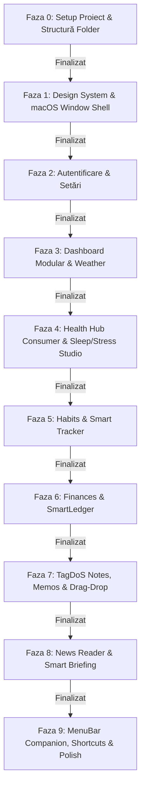

# DayOne macOS: Master Implementation Plan & Parity Roadmap

Acest document conține planul inițial exhaustiv stabilit la debutul proiectului pentru aplicația nativă macOS (`MacOS/`), deciziile luate în urma consultării și stadiul de implementare pentru fiecare fază în parte.

---

## 1. Viziune și Decizii de Arhitectură (Consultare Inițială)

| Aspect Decis | Direcție Stabilită | Implementare |
| :--- | :--- | :--- |
| **Model de Prezență** | **Arhitectură Hibridă (Dual-Presence)**: Fereastră principală Liquid Glass + persistent `MenuBarExtra` companion popover în meniul de sus al Mac-ului. | `DailyMacOSApp.swift` (`WindowGroup` + `MenuBarExtra`) |
| **Navigare Fereastră** | **Pill Nav implicit + Sidebar Opțional**: Floating Liquid Glass capsule ca default, cu drawer lateral desktop pliabil (`⌘S`) și shortcut-uri rapide (`⌘1`–`⌘7`). | `FloatingGlassCapsule.swift` + `MacOSSidebarView.swift` |
| **Health Engine** | **Consumer-Only**: Fără daemon HealthKit pe Mac; consumă telemetria completă (somn, puls, stres, pași) sincronizată din Supabase de pe iOS, watchOS, ZeppOS și Android. | `HealthDataService.shared.localDataProvider = nil` |
| **Pornire la Login** | **Launch at Login integrat**: Activare opțională la pornirea Mac-ului via Apple `ServiceManagement` (`SMAppService.mainApp`). | `LaunchAtLoginManager.swift` |
| **Design System** | **Liquid Glass nativ macOS**: `.ultraThinMaterial`, ferestre fără bară standard (`.hiddenTitleBar`), hover states, haptic feedback pe trackpad (`NSHapticFeedbackManager`). | `MacOS/Daily/DesignSystem/` |

---

## 2. Planul de Implementare pe Faze & Stadiul Curent

---

###  Faza 0: Setup Proiect & Structură Folder (Status: 100% Finalizat)
- [x] Creat folderul `MacOS/` la rădăcina repository-ului.
- [x] Generat proiectul Xcode `MacOS/Daily.xcodeproj` cu target nativ macOS 15.0+ (Sequoia / Sonoma).
- [x] Legat pachetul local `DailyCore` (`../DailyCore`).
- [x] Configurat App Sandbox, Entitlements (`Daily.entitlements`: client de rețea, App Group `group.com.intellidream.daily`).
- [x] Configurat `Info.plist` (URL scheme `daily://`, descrieri permisiuni) și `Assets.xcassets` (AppIcon universal/macOS, culori, logo-uri).

---

###  Faza 1: Design System macOS & Arhitectura Ferestrei (Status: 100% Finalizat)
- [x] Portat și adaptat componentele de UI din `iOS/Daily/DesignSystem`:
  - `ThemeColors` (culori accent, gradiente, teme).
  - `LiquidGlassBackground` și `GlassCard` (blending nativ `.ultraThinMaterial` specific ferestrelor macOS).
  - `GlassButton` (cu suport `NSHapticFeedbackManager` pe Trackpad și stări de `onHover`).
  - `CachedAsyncImage` (cu decodare și cache în memorie pe bază de `NSImage`).
  - `FloatingGlassCapsule` (navigare plutitoare la bază cu arc de selecție și animații spring 120Hz).
- [x] Universal shims în `View+CrossPlatform.swift` (`navigationBarTitleDisplayMode`, `keyboardType`, `UIPasteboard`, `UIImpactFeedbackGenerator`, `UIImage = NSImage`).
- [x] Structurat `DailyMacOSApp`: `WindowGroup` principal cu `.hiddenTitleBar` + `MenuBarExtra` companion.

---

###  Faza 2: Autentificare & Setări (Status: 100% Finalizat)
- [x] `LoginView`: Login cu Supabase, mod Guest, Google PKCE (`ASWebAuthenticationSession` cu ancoră `NSWindow`), Apple Sign-In.
- [x] `SettingsView`: Setări cont, profil, temă (Light/Dark/System), intensitate Liquid Glass, configurare Smart Briefing, surse de date, integrare DayOne Orbit.
- [x] `MacOSSettingsSection`:
  - Toggle **Launch at Login** (`LaunchAtLoginManager` cu `SMAppService.mainApp`).
  - Comutator **Stil de Navigare Implicit** (Floating Pill vs Desktop Sidebar).
  - Selector **Menu Bar Companion Display Mode** (Icon Only, Icon & Weather `☀️ 21°`, Icon & Heart Rate `♥ 68`).
  - Cheatsheet nativ pentru comenzi rapide de tastatură (`⌘1`–`⌘7`, `⌘S`, `⌘R`, `⌘,`, `⌘N`).

---

###  Faza 3: Dashboard Modular & Weather (Status: 100% Finalizat)
- [x] Adaptat `ModularDashboardLayout`:
  - Pe ecrane desktop mari / ultrawide: centrare optimă (`maxWidth: 880`) pentru ergonomie vizuală impecabilă.
  - Pe ferestre compacte: păstrează aspectul mobil dinamic fără compresie.
- [x] Toate cele 7 carduri modulare pe Dashboard: Weather, Habits, Health, Finances, News, TagDoS, Stress.
- [x] `WeatherDetailView`:
  - Hero card cu temperatură, vânt, umiditate, descriere condiții.
  - Prognoză orară pe 24h (`HourlyForecastCarousel`).
  - Prognoză pe 5/10 zile (`DailyForecastCard`).
  - Grid 2x3 metrici atmosferice (presiune, indice UV, vizibilitate, apus/răsărit).

---

###  Faza 4: Health Hub (Consumer Mode) & Sleep/Stress Studio (Status: 100% Finalizat)
- [x] `HealthMainView` cu cele 5 sub-tab-uri: Overview, Sleep, Stress, Vitals, Trends.
- [x] `SleepStudioView`: Hipnogramă detaliată (stadii REM, Deep, Light, Awake), durată somn, scor calitativ, îndrumări AI.
- [x] `StressStudioView`: Mascottă animată Daily Monkey (`MonkeyMascotView`), scor autonom de stres, analiză intraday.
- [x] `VitalMetricTile` & `DeviceOriginBadge`: Badge-uri vizuale care indică originea telemetriei (Apple Watch, Pixel Watch, Amazfit).

---

###  Faza 5: Habits & Smart Tracker (Status: 100% Finalizat)
- [x] `HabitsMainView`:
  - Animație fluidă de val pentru apă (`WaterProgressWaveView`).
  - Indicator grafic anatomic pentru fumat (`SmokesLungsGaugeView`).
  - Grid acțiuni rapide de logare (`HabitQuickActionGrid`).
- [x] Analitică avansată: grafic de trend pe 7 zile și heatmap de consistență pe 112 zile (`HabitHistoryAndHeatmapView`).
- [x] Logare rapidă direct din MenuBar popover (`+250ml`, `+500ml`, `+1 Smoke`).

---

###  Faza 6: Finances & SmartLedger (Status: 100% Finalizat)
- [x] `FinancesMainView`: cele 3 secțiuni Money, Stocks, World.
- [x] SmartLedger: Parsare și afișare DSL, cashflow, bugete, solduri pe conturi.
- [x] Sheet-uri de Quick Adjust și editor complet (`SmartLedgerEditorSheet`).

---

###  Faza 7: TagDoS Notes, Memos & Desktop Drag-and-Drop (Status: 100% Finalizat)
- [x] `TagdosNotesHubView`: Stream-uri 1–5, notițe rapide, active memos, tag-uri, mod raw editor vs canvas interactiv.
- [x] **Desktop Drag & Drop**: Suport `.dropDestination(for: URL.self)` pentru tragerea de fișiere direct din Finder pe stream.
- [x] **Default App Handoff**: Butonul „Open in Default App” (`NSWorkspace.shared.open`) pentru deschiderea PDF-urilor sau imaginilor direct în Preview / Acrobat.

---

###  Faza 8: News & Smart Briefing (Status: 100% Finalizat)
- [x] `NewsFeedView` & `NewsReaderView`: Reader distraction-free cu template Liquid Glass, control dimensiune font, favorite și read later.
- [x] `ArticleWebView`: Container `WKWebView` bazat pe `NSViewRepresentable` cu fundal transparent și randare fluidă.
- [x] `SmartBriefingOverlayView`: Sumar AI cu efect de scriere la mașină (`FadingTypewriterText`) și recomandări proactive.

---

###  Faza 9: MenuBar Companion, Shortcut-uri & Polish Nativ (Status: 100% Finalizat)
- [x] Popover `MenuBarExtra` resident în meniul Mac-ului cu titlu dinamic (Meteo / Puls / Icon).
- [x] Buton dedicat „Full App” care activează și aduce în prim-plan fereastra principală.
- [x] Meniul de sistem **Navigate** (`CommandMenu("Navigate")`) cu shortcut-uri `⌘1`–`⌘7`, `⌘R`, `⌘N`.
- [x] Documentație completă salvată în `Docs/Features/`.
