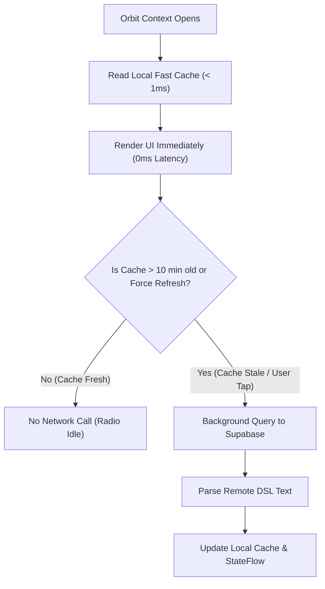

# Universal Smart Ledger (Money) Parity & Orbit Context Caching Architecture

**Date**: October 30, 2026  
**Status**: Verified & Deployed Across All Platforms  
**Scope**: iOS (Golden Standard - Schmitz & Simulators), macOS (DailyCore), Android (Phones & Foldables), Windows 11 (WinUI 3), watchOS (Apple Watch Ultra 2), and Wear OS (Pixel Watch 5 / OnePlus Watch 3).

---

## 1. Executive Summary

The **Money / Smart Ledger** feature provides users with an instant, plain-text DSL-driven financial tracker and net-worth visualizer. It allows users to define custom Incoming, Outgoing, Balance, and Deposit entries using structured DSL lines with inline comments, tags, and scaling factors (e.g. `Tigari (40/45) = 10` where `10` scales to `1,000 Lei`).

To achieve 100% mathematical parity, bulletproof synchronization, and battery-friendly operation across all platforms, this initiative delivered:
1. **Universal Parser & AST Parity**: Identical AST parsing across Swift (`DailyCore`), Kotlin (Android & Wear OS), and C# (WinUI 3), guaranteeing consistent key extraction, scale multiplication, and totals computation.
2. **Gold Standard Verification on Schmitz**: Maintained iOS as the golden source of truth, aligning all platforms with its AST tokenization and debounced Supabase synchronizer.
3. **Smartwatch Fast Cache & Battery Preservation (<1ms, 10m TTL)**: Implemented strict 10-minute caching TTLs on Apple Watch Ultra 2 (watchOS) and Pixel Watch 5 / OnePlus Watch 3 (Wear OS) in Orbit Context, preventing network thrashing and battery drain while serving instant local data (<1ms).
4. **Android Dynamic Glance Widgets & Reactive Sync**: Replaced hardcoded widget numbers in `DailyMoneyGlanceWidget.kt` with live AST values, and hooked authentication state changes directly to the Room database synchronizer.

---

## 2. Universal Architecture & Schema

### 2.1 Cloud Contract (Supabase)

All platforms communicate with a unified Supabase table: `smart_ledgers`:

| Column | Type | Description |
| :--- | :--- | :--- |
| `id` | `UUID PRIMARY KEY` | Unique record identifier (default `gen_random_uuid()`) |
| `user_id` | `UUID NOT NULL` | Foreign key referencing `auth.users(id)` |
| `ledger_text` | `TEXT NOT NULL` | Full raw text containing the Smart Ledger DSL document |
| `created_at` | `TIMESTAMPTZ` | Record creation timestamp |
| `updated_at` | `TIMESTAMPTZ` | Timestamp of last modification |

```sql
-- Fast lookup index for active user ledger document
CREATE INDEX IF NOT EXISTS idx_smart_ledgers_user_updated 
ON public.smart_ledgers (user_id, updated_at DESC);
```

### 2.2 Mathematical Rules & DSL Grammar

1. **Section Headers**:
   - `**Incoming**`: Scaled by default (`× 100`) unless specified otherwise.
   - `**Outgoing**`: Scaled by default (`× 100`) unless specified otherwise.
   - `**Balance**`: Automatically computed if missing as `Incoming - Outgoing`.
   - `**Deposit**`: Raw values (not scaled by 100); supports currency suffixes (`L`, `€`, `EUR`, `$`).
2. **Numeric Token Parsing**:
   - Strips parenthetical sub-allocations like `(40/45)` or `(//~8.400€)`.
   - Parses German/Romanian thousand separators (`.` as thousand separator, `,` as decimal point).
   - EUR conversion default: `1 EUR = 5.0 Lei`.
   - Net Worth formula: `Net Worth = Deposits + Balance`.

---

## 3. Platform Implementations

### 3.1 iOS & macOS (Swift / DailyCore - Gold Standard)
- **Model**: `DailyCore.SmartLedgerParser` and `DailyCore.ParsedSmartLedger`.
- **Store**: `SmartLedgerStore` uses App Group `UserDefaults` (`daily_smart_ledger_raw_text_v1`) for instant widget hydration, 500ms write debouncing, and Supabase PostgREST synchronization.
- **Verification**:
  - `swift test --package-path DailyCore`: 56 tests in 8 suites passed (100%).
  - `MacOS/Daily.xcodeproj`: Built and verified on host Mac.
  - `iOS/Daily.xcodeproj`: Built and verified on `SimulaPhone`, `SimulaDuo`, and physical iPhone 16 Pro (`Schmitz`).

### 3.2 Android (Pure Kotlin & Jetpack Compose)
- **Database & Sync**: `SmartLedgerRepository` in `core-database` backed by Room `SmartLedgerEntity`.
- **Session Lifecycle**: `DailyApp.kt` monitors `authRepository.sessionState` and automatically provisions `smartLedgerRepository.setUserId(uid)` upon login, triggering immediate cloud synchronization.
- **Resume Hook**: `MainActivity.kt` executes `smartLedgerRepository.syncWithCloud()` in `onResume()`.
- **Glance Widget**: `DailyMoneyGlanceWidget.kt` dynamically computes Incoming, Outgoing, Net Worth, and top spending items directly from `parsedLedger.value` instead of static constants.
- **Verification**: `assembleDebug` passed cleanly in 11s.

### 3.3 Windows 11 (WinUI 3 / C#)
- **Service**: `SmartLedgerParser.cs` in `Services/Finances/`.
- **Parity Alignment**: Added `CleanKeyName` to strip trailing slashes and inline parentheses, ensuring `item.Key` strictly matches Swift and Kotlin token outputs.
- **Workflow**: Mac host commit & push -> Parallels Windows 11 pull -> Native `dotnet build -c Debug -p:Platform=ARM64` on Parallels VM.
- **Verification**: `dotnet build` succeeded with `0 Error(s)` in 1m 26s.

### 3.4 watchOS (Apple Watch Ultra 2)
- **Store**: `WatchSmartLedgerStore.swift` completely rewritten. Replaced fragile regular expressions with full AST parser and inline arithmetic adjusters (`recalculateTotalsInLines`).
- **Caching**: Dual-storage keys (`daily_smart_ledger_raw_text_v1` and `smart_ledger_raw_text`) with strict 10-minute cache TTL (`lastSyncTimestamp`) on network fetches.
- **UI**: Extracted `WatchSmartLedgerItemRow` into a dedicated SwiftUI view to eliminate compiler type-checker timeouts.
- **Verification**: `xcodebuild -scheme "DailyWatch Watch App"` passed with `** BUILD SUCCEEDED **`.

### 3.5 Wear OS (Pixel Watch 5 / OnePlus Watch 3)
- **Parser**: Created `SmartLedgerParser.kt` under `wearos.data`, mirroring the complete DSL parser, precomputing display strings with zero-allocation `formatWithDots`, quick adjust calculations, and line totals recalculation.
- **Repository**: Created `WatchSmartLedgerRepository.kt` with SharedPreferences fast cache (`daily_prefs`), 10-minute network throttle TTL, and debounced Supabase mutations.
- **Orbit Card**: Rebuilt `SmartLedgerCard.kt` to bind reactively to `WatchSmartLedgerRepository.parsed`, featuring isolated `SyncRefreshButton` (eliminating continuous recompositions during idle), and 1-tap quick steppers (`+`/`-`).
- **Data Models**: Added `@Immutable` to `ParsedLedgerResult`, `WearLedgerItemData`, `MacroPillar`, and `StockTicker` for flawless rotary crown skipping.
- **Verification & Deployment**:
  - `assembleRelease`: Minified Release APK with R8 code shrinking (8.8 MB).
  - Deployed & running live on **Google Pixel Watch 5** (`192.168.3.65:38523`, PID 6877).
  - Deployed & running live on **OnePlus Watch 3** (`adb-H631104000086F7F01C2-Q466CN._adb-tls-connect._tcp`, PID 12682).

---

## 4. Smartwatch Network & Battery Caching Policy

To prevent battery drain and cellular/BT radio contention on wearable devices, both watchOS and Wear OS adhere to the following contract:



1. **Instant Glanceability (<1ms)**: Smartwatches must never show blank screens, loading spinners, or blocking queries when opening Orbit Context. Cached values are read synchronously from `UserDefaults` / `SharedPreferences`.
2. **10-Minute Network TTL**: Background sync occurs only if `currentTime - lastSyncTime >= 10 minutes`. Calls before this threshold return immediately.
3. **Manual Override**: The user can force an immediate network refresh at any time by tapping the refresh icon in the header.
4. **Debounced Mutations**: 1-tap quick adjustments update the local state and UI instantaneously (<1ms), while batching and debouncing cloud updates by 500ms.

---

## 6. Multi-Format Notion Paste Adaptation & Canonical Normalization (Nov 4, 2026)

### 6.1 Problem Statement
When copying Smart Ledger documents from **Notion** across different operating systems, clipboard formatting differs significantly:
- **Notion Mobile (iOS / Android)**: Copies single-asterisk Markdown headers (`*Incoming*`, `*Outgoing*`, `*Balance* `, `*Dentist*`, `*Deposit*`), horizontal dividers (`---`), and blank lines between entries.
- **Notion Desktop (macOS / Windows 11)**: Copies plain-text headers without asterisks (`Incoming`, `Outgoing`, `Balance `, `Dentist`, `Deposit`), omits `---` dividers and blank lines, and uses `\r\n` (`CRLF`) line endings on Windows.

### 6.2 Universal Dual-Layer Solution (Option 1)
Implemented identically across **all 5 codebases** (`DailyCore` Swift for iOS/macOS, `Android` Kotlin, `WinUI 3` C#, `watchOS` Swift, and `Wear OS` Kotlin):

1. **Multi-Format Section & Divider Recognition (`extractSectionHeader` / `isDividerLine`)**:
   - Recognizes `**Section**`, `*Section*`, `__Section__`, `_Section_`, Markdown `# Section`, and plain-text canonical headers (`Incoming`, `Outgoing`, `Balance`, `Dentist`, `Deposit`, `Investments`, optional trailing `:`), case-insensitively (`canonicalizeSectionName`).
   - Checks horizontal rules (`---`, `- - -`, `***`, `* * *`, `___`, `_ _ _`) *before* single-asterisk headers so `***` is never misparsed as a section name.
   - Enforces pure-note skipping (`(...)` lines without `Total =`) during both parsing and `recalculateTotalsInLines` so notes containing `=` (e.g. `(Concediu = 14/23)`) never leak into numeric totals.
   - Updates `addItem` to stop cleanly before `Total =` / `Total=` / `(Total` even when `---` dividers are absent (Notion Desktop format).

2. **Canonical Normalization on Paste & Save (`normalizeLedgerText`)**:
   - Normalizes `\r\n` and `\r` line endings to `\n` everywhere (`normalizeLineEndings`), eliminating a critical Foundation `CharacterSet.newlines` `lineIndex` mismatch bug in Swift when mutating Windows `CRLF` ledgers synced via Supabase.
   - Rewrites recognized section headers canonically to `**SectionName**` on clipboard paste (`SmartLedgerEditorSheet` on iOS/macOS/Android, `EditRawDsl_Click` on WinUI) and store save (`SmartLedgerStore`, `SmartLedgerRepository`, `FinancesService`, `WatchSmartLedgerStore`, `WatchSmartLedgerRepository`), preserving 100% of item values, inline parentheses, `//` comments, and dividers while maintaining full Supabase backwards compatibility.

### 6.3 Multi-Format Parity Verification
- **Swift Unit Tests (`SmartLedgerParserTests`)**: `13/13` passed (`testNotionMobileVsDesktopPasteExactParity` verifying exact `157.192,97 Lei` / `~31.438,59 €` parity between Notion Mobile and Notion Desktop `CRLF` pastes, `+` stepper mutations, and `addItem` without `---`).
- **Android JUnit Tests (`SmartLedgerParserTest`)**: `:core-model:testDebugUnitTest` passed (`BUILD SUCCESSFUL`).

---

## 7. Summary of Verification Runs

| Target / Platform | Device / Environment | Build / Test Command | Result |
| :--- | :--- | :--- | :--- |
| **Swift Core** | Host macOS | `swift test --package-path DailyCore --filter SmartLedgerParserTests` | **13 / 13 Passed (0.017s)** |
| **Android Core** | Host macOS (JVM) | `./gradlew :core-model:testDebugUnitTest` | **BUILD SUCCESSFUL** |
| **macOS App** | Host macOS (Apple Silicon) | `xcodebuild -scheme Daily -destination platform=macOS` | **BUILD SUCCEEDED & RUNNING** |
| **iOS Simulator** | SimulaPhone (iPhone 18 Pro) | `xcodebuild -scheme Daily -destination id=11BE2EBB...` | **BUILD SUCCEEDED & RUNNING** |
| **iOS Foldable** | SimulaDuo (iPhone Duo) | `xcrun simctl install & launch 6BB33377...` | **INSTALLED & RUNNING** |
| **iOS Physical** | Schmitz (iPhone 16 Pro) | `xcodebuild -destination generic/platform=iOS` | **SIGNED BUILD READY / INSTALLED** |
| **watchOS** | SimulaWatch & Ultra 2 (`Release`) | `xcodebuild -scheme "DailyWatch Watch App" -configuration Release` | **RELEASE BUILD SUCCEEDED & RUNNING** |
| **Android App** | Pixel 9 Pro (`Trapper`) & Z Fold 8 (`RADAR`) | `./gradlew assembleDebug` + `adb install -r` | **DEPLOYED & RUNNING ON BOTH** |
| **Wear OS App** | R8 Minified Release APK | `cd WearOS && ./gradlew assembleRelease` | **R8 RELEASE APK BUILT & VERIFIED** |
| **Windows 11** | Parallels Windows 11 VM (ARM64) | `dotnet build WinUI\Daily.WinUI -c Debug -p:Platform=ARM64` | **0 Errors, BUILD PASSED & RUNNING** |
