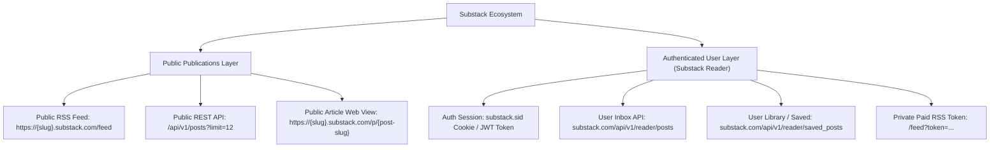
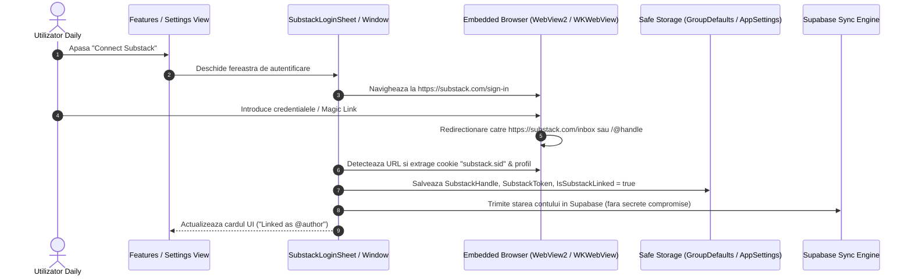

# Investigatie Tehnica Detaliata: Integrarea Substack in Daily News (WinUI, macOS, iOS, Android)

## 1. Executive Summary & Viziune de Produs

Daily integreaza in prezent un ecosistem de stiri hibrid, combinand fluxuri RSS/Atom conventionale, API-uri WordPress REST (`wp-json`) si o integrare profunda cu platforma **Medium** (autentificare cookie-sharing prin WebKit/WebView2, citire articole pentru membri, urmarire autori prin RSS si scraping compliant al Reading List-ului).

**Substack** reprezinta astazi platforma dominanta pentru newslettere independente, jurnalism de investigatie, analize financiare, tehnologie si opinii de autor. Spre deosebire de Medium (care utilizeaza un model de abonament global de tip "all-you-can-read"), Substack functioneaza pe baza unui model federat:
1. Fiecare publicatie/autor opereaza pe un subdomeniu propriu (`{publication}.substack.com`) sau pe un domeniu custom dedicat (`newsletter.pragmaticengineer.com`).
2. Fiecare autor isi stabileste propriul prag de monetizare: articole gratuite (accesibile public) si articole exclusive pentru abonati platitori (*paid subscribers*).
3. Substack ofera atat endpoint-uri RSS publice per publicatie, cat si un agregator centralizat (**Substack Reader / Inbox**) la nivel de cont de utilizator (`https://substack.com/inbox` sau `https://substack.com/library`).

Obiectivul acestei investigatii este proiectarea unei arhitecturi unitare, robuste si sigure care sa permita:
- **Descoperirea si abonarea** la orice publicatie sau autor Substack (atat manual, cat si cu un singur tap `+ Subscribe` direct din articole).
- **Lectura completa, distraction-free** a articolelor Substack gratuite si a celor platite (pentru utilizatorii autentificati cu abonament activ).
- **Sincronizarea listei de articole salvate (Bookmarks / Library / Read Later)**, integrata atat cu sistemul nativ Daily (SQLite + Supabase), cat si optional cu biblioteca Substack.
- **Suport cross-platform 100%**: WinUI 3 (Windows 11), macOS (SwiftUI + WKWebView), iOS (SwiftUI + WKWebView) si Android (Jetpack Compose + Android WebView).

---

## 2. Anatomia Tehnica a Platformei Substack



### 2.1 Endpoint-uri si Formate de Date Disponibile

#### A. Public Feed RSS 2.0 (Fara Autentificare)
- **URL**: `https://{subdomain}.substack.com/feed` sau `https://{custom-domain}/feed`
- **Format**: RSS 2.0 cu namespace-uri `dc:creator`, `content:encoded`, `enclosure`, `itunes` si `media`.
- **Continut**:
  - Pentru articole gratuite: Substack include intreg corpul articolului in `<content:encoded>` (HTML complet cu imagini pe CDN Substack, embed-uri, liste si subtitluri).
  - Pentru articole platite: Substack include un rezumat/preview si un link de paywall catre varianta integrala.
  - Imagini de coperta: Disponibile in tag-ul `<enclosure url="..." type="image/jpeg" />`.
  - Iconita publicatiei: `<image><url>...</url></image>`.

#### B. Public REST API Endpoint-uri
Substack expune un API JSON intern de mare viteza, neprotejat de chei API pentru publicatiile publice:
- **Arhiva articole**: `GET https://{subdomain}.substack.com/api/v1/archive?sort=new&limit=25&offset=0`
- **Articol individual**: `GET https://{subdomain}.substack.com/api/v1/posts/{post-slug}`
  - Returneaza titlul, autorul, data publicarii, `body_html`, metadata OpenGraph si indicatorul `audience` (`everyone` vs `only_paid`).
- **Cautare si Recomandari**: `GET https://substack.com/api/v1/publication/{id}/recommendations`

#### C. Authenticated Reader API (Substack Inbox & Library)
Cand un utilizator este autentificat pe `substack.com`:
- **Inbox Feed**: `GET https://substack.com/api/v1/reader/posts?limit=30`
  - Returneaza un feed unificat continand toate articolele publicatiilor la care utilizatorul este abonat (atat free, cat si paid).
- **Articole Salvate (Saved / Bookmarks)**: `GET https://substack.com/api/v1/reader/saved_posts`
  - Returneaza lista de articole pe care utilizatorul le-a marcat cu "Save" in Substack Reader.
- **Abonamente Active**: `GET https://substack.com/api/v1/subscriptions`
  - Returneaza lista tuturor publicatiilor la care userul are cont activ (gratuit sau platitor).

---

## 3. Comparatie: Arhitectura Medium vs. Substack in Daily

| Dimensiune | Integrare Medium (Implementata) | Integrare Substack (Propunere) |
| :--- | :--- | :--- |
| **Model de Acces** | Un singur abonament global (Medium Member) deblocheaza toate articolele | Abonament federat: contul Substack poate avea combinatii de abonamente gratuite si publicatii platite individual |
| **RSS Feeds** | `medium.com/feed/@username` (articole scurte/trunchiate, necesita scraping) | `{pub}.substack.com/feed` (articolele gratuite contin textul integral in `<content:encoded>`) |
| **Autentificare** | Login WebView -> redirect la `/@username` -> preluare username si cookie-uri | Login WebView la `substack.com/sign-in` -> capturare cookie sesiune (`substack.sid`) & username |
| **Reading List / Salvari** | Scraping via `BackgroundWebView` la `medium.com/@user/list/reading-list` | Apel JSON direct via cookie (`/api/v1/reader/saved_posts`) sau scraping DOM `substack.com/library` |
| **Urmarire Autor / Sursa** | Buton `+ Follow` -> abonare automata la feed-ul RSS `medium.com/feed/@{author}` | Buton `+ Subscribe` -> abonare la `{pub}.substack.com/feed` in categoria "Tech/News" |
| **Optimizare Imagini CDN** | Miro CDN rewrite: `v2/resize:fill:...` in `v2/resize:fit:800` | Substack CDN rewrite: `substackcdn.com/image/fetch/$s_...!...` cu `w_1200,f_auto,q_auto:good` |
| **Stil Reader View** | Liquid Glass CSS (serif/sans, font size scaler, blockquotes) | Acelasi Liquid Glass CSS, imbogatit cu suport pentru footnotes (`.footnote`), callouts si subtitluri |

---

## 4. Arhitectura de Autentificare si Gestionare a Sesiunilor

### 4.1 Fluxul de Conectare (Substack Login)
Substack permite conectarea atat prin **Email Magic Link**, cat si prin **Parola** sau **Google/Apple Sign-In**. Un flux exclusiv prin API extern ar fi fragil si ar incalca politicile de autentificare. Prin urmare, vom utiliza aceeasi strategie dovedita si bulletproof folosita la Medium:



### 4.2 Securitate si Sandbox Parity
- **WinUI**: WebView2 partajeaza containerul `%LocalAppData%\Daily.WinUI\WebView2`, astfel incat cookie-urile `substack.com` sunt disponibile atat ferestrei de login, cat si reader-ului si proceselor de background scraping.
- **macOS & iOS**: `WKWebsiteDataStore.default()` partajeaza cookie-urile intre `WKWebView` si cererile din `ArticleWebView` si `NewsService`. Stocarea token-ului de metadata se face in `GroupDefaults.shared.userDefaults` (App Group prefixat).
- **Android**: `CookieManager.getInstance()` partajeaza cookie-urile sesiunii intre fluxul de login si reader sheet-ul nativ Compose.

---

## 5. Citirea si Randarea Articolelor Substack

### 5.1 Strategia de Randare (Free vs Paid)
1. **Articole Gratuite**:
   - Daca utilizatorul deschide un link Substack dintr-un feed public, corpul din `<content:encoded>` este deja prezent in RSS.
   - SmartReader / Mozilla Readability curata eventualele butoane de "Subscribe" sau "Share this post" din subsol si randeaza instant continutul prin motorul Liquid Glass, cu zero latenta de retea suplimentara.
2. **Articole pentru Abonati Platitori (Paywalled Stories)**:
   - Daca un articol contine paywall (`audience == "only_paid"` sau selectorul `.paywall` este prezent in DOM), aplicatia detecteaza starea.
   - Daca utilizatorul este conectat la Substack in Daily, motorul foloseste calea fallback autentificata (WebView2 / WKWebView cu cookie-urile partajate). Pagina se incarca complet deblocata in motorul de scraping, iar extractorul Readability preia intregul text pentru reader view.
   - Daca utilizatorul nu este abonat la acea publicatie, reader view afiseaza preview-ul curat insotit de un badge elegant: `Substack Paid Story` si un buton rapid `Unlock on Substack`.

### 5.2 Rafinamente Vizuale pentru Substack
- **Substack CDN Images**: Imaginile Substack sunt servite prin `https://substackcdn.com/image/fetch/...`. Regula de optimizare va rescrie parametrii URL-ului pentru retina displays:
  ```
  substackcdn.com/image/fetch/w_1200,c_limit,f_auto,q_auto:good/...
  ```
- **Footnotes & Anchor Links**: Substack foloseste note de subsol (`<a class="footnote-anchor">`). In reader view, stilizam notele de subsol ca mici insule tactile rotunjite cu fundal translucid, pentru o interactiune tactila superioara.
- **Pullquotes & Blockquotes**: Substack utilizeaza citate mari centrate (`<blockquote class="pullquote">`). Acestea vor primi o linie laterala accent (`#00D2FF` / `#66B2FF`) si font cursiv Segoe/SF Pro.

---

## 6. Salvarea si Sincronizarea Articolelor

### 6.1 Integrare Unificata in Daily
Orice articol citit de pe Substack se bucura automat de toate capabilitatile existente in Daily:
- **Read Later & Favorites**: Salvare instantanee locala si sincronizare Supabase in tabela `rss_saved_articles` folosind GUID-ul deterministic bazat pe hash MD5 (`userId:url:type`).
- **Offline Cache**: Continutul extras este salvat in SQLite / Room pentru acces fara conexiune la internet.

### 6.2 Sincronizare Bidirectionala cu Substack Library (Optional / Advanced)
Pentru utilizatorii conectati cu cont Substack:
- In tab-ul de News, la fel cum avem "Medium Reading List", se introduce o intrare speciala: **"Substack Inbox"** sau **"Substack Library"**.
- Prin `GET https://substack.com/api/v1/reader/saved_posts` (folosind cookie-ul de sesiune) sau prin scraping-ul paginii `substack.com/library`, articolele salvate in Substack se populeaza direct in feed-ul dedicat din Daily.

---

## 7. Plan de Implementare Tehnica pe Platforme

### 7.1 Modificari WinUI 3 (Windows 11)
1. **Modele**: Adaugare `SubstackUsername` si `SubstackToken` in `AppSettings.cs`.
2. **Settings**: Extindere `FeaturesPage.xaml` cu o sectiune eleganta `SUBSTACK SETUP` (asemanatoare cardului Medium).
3. **Fereastra de Login**: Creare `SubstackLoginWindow.cs` cu DWM immersive dark mode, redimensionare 850x850, ascultare `SourceChanged` pe `https://substack.com`.
4. **Feed Source**: Adaugare sursa speciala `substack_inbox` in meniul de selectie feed-uri din `RssFeedDetailPage.xaml.cs`.
5. **Feed Item Actions**: Buton `+ Subscribe` afisat pe cardurile de articole provenite de pe Substack.

### 7.2 Modificari macOS & iOS (`DailyCore`)
1. **`NewsModels.swift`**: Adaugare proprietati helper `isSubstackItem`, `substackPublicationSlug`.
2. **`AppSettings.swift`**: Adaugare `newsSubstackUsername`, `newsSubstackLinked`.
3. **`NewsService.swift`**: Suport pentru agregarea Substack in `loadAllNews` si feed-ul `substackFeedSource`.
4. **UI SwiftUI**:
   - `SubstackLoginSheet.swift` in `MacOS/Daily/Views/Settings/` si `iOS/Daily/Views/Settings/`.
   - Card in `FeaturesSettingsSection.swift`.
   - Buton `+ Follow Publication` in `NewsArticleCard.swift` si `NewsReaderView.swift`.

### 7.3 Modificari Android (Kotlin + Jetpack Compose)
1. **`NewsRepository.kt`**: Integrare `loadSubstackFeed()` si suport pentru `FeedType.Substack`.
2. **`ArticleExtractor.kt`**: Reguli de deduplicare specifice newsletter-urilor Substack si optimizare imagini CDN.
3. **`NewsReaderSheet.kt`**: Badge de newsletter si buton de abonare la publicatie.
4. **`SubstackLoginActivity.kt`**: Fereastra de autentificare securizata pe Android cu `CookieManager`.

---

## 8. Concluzii si Recomandare de Executie

Integrarea Substack este **100% fezabila tehnic** si se aliniaza perfect cu fundatia arhitecturala existenta din Daily (Medium parity). Datorita faptului ca Substack ofera fluxuri RSS curate si complete pentru marea majoritate a articolelor, experienta de citire in Daily News va fi rapida, eleganta si complet integrata cu sistemul nostru de salvare si sincronizare.
