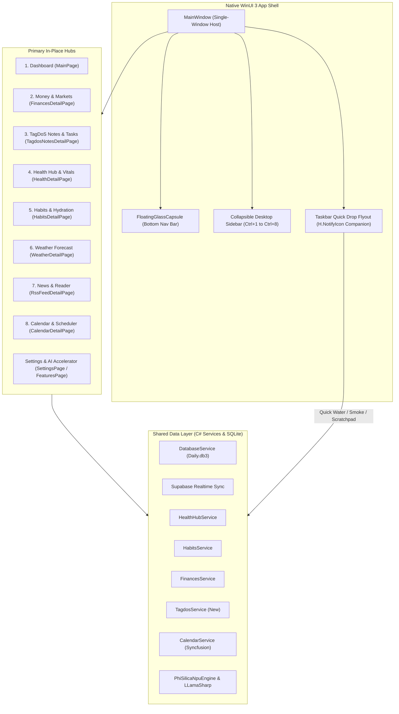

# WinUI 3 Desktop: macOS Parity, Hybrid Navigation & Modernization Master Plan

## 1. Executive Summary

This master plan establishes the architectural vision, roadmap, and implementation phases to elevate the **WinUI 3 (Windows App SDK / .NET 10)** desktop application of DayOne to the UX fluidity, visual elegance, and cohesive single-window ergonomics of the **macOS native client (`MacOS/`)**, while **strictly preserving and integrating WinUI's distinctive power features**:
1. **The Advanced Calendar & Scheduler Hub** (Syncfusion multi-account, timeline, week, month, and appointment management).
2. **On-Device Hardware AI & NPU Copilot Runtime** (Qualcomm Hexagon NPU via Phi-Silica, CUDA 12, Vulkan, and CPU via LLamaSharp).
3. **Physical Stale-Data Metaphor: Widget Aging & Wipe Animation** (Dynamic dust/smudge accumulation based on data freshness with wipe animations).
4. **Multi-Monitor Window Detachment ("Pop-Out on Demand")** (Allowing any hub to be detached into an independent floating window for multi-screen workstations).

---

## 2. Architectural Blueprint



---

## 3. Four-Phase Execution Roadmap

## 3. Four-Phase Execution Roadmap & Status

### Phase 0: High-Fidelity Orbit Assets & Multi-Resolution App Icon (✅ COMPLETED)
- **Goal**: Perfect visual parity with the macOS Orbit icon with crisp Windows sizing across all display scalings (100%–300%) and formats.
- **Implemented & Verified**:
  1. `Scripts/generate_winui_appicon.swift`: High-precision rendering script generating multi-layer `.ico` files containing 16x16, 24x24, 32x32, 48x48, 64x64, 128x128, 256x256, 512x512, and 1024x1024 frames.
  2. Complete MSIX package asset matrix: Square44x44Logo (`scale-100` to `scale-400`), Square150x150Logo, Wide310x150Logo, SplashScreen, StoreLogo, and unplated target sizes (`targetsize-16` to `256`, `altform-unplated`).
  3. Crisp cosmic startup loading animation on `MainWindow.xaml` featuring rotating inner/outer orbit rings and glowing gem core.

### Phase 1: Full Implementation of TagDoS Hub & Dashboard Widget (✅ COMPLETED & VERIFIED)
- **Goal**: Eliminate `"Notes Widget Coming Soon"` on `MainPage.xaml` and achieve 100% functional parity with macOS `TagdosNotesHubView`.
- **Implemented & Verified**:
  1. `Models/TagdoModels.cs`: `TagDoPill`, `TagDoCluster`, `TagDoStream`, `TagDoQuickNote`, `LocalTagdoStream`, `LocalTagdoQuickNote`.
  2. `Services/TagdosParser.cs`: Stream shorthand parser (`Cluster & Cluster`, `Pill/Pill/Pill`), token classifier (financial, urgent, temporal, standard), recycling, and prioritization.
  3. `Services/ITagdosService.cs` & `Services/TagdosService.cs`: SQLite local caching (`local_tagdo_streams`, `local_tagdo_notes`), Supabase realtime synchronization, seeding default 5 executive streams and initial notes.
  4. `Controls/TagdosWidgetControl.xaml/.cs`: Interactive dashboard card rendering active streams, semantic pill badges, and quick note counters with direct click-through to in-place navigation.
  5. `Views/TagdosNotesDetailPage.xaml/.cs`: Full 110px TopBar with Back and Pop-Out buttons, 5 stream selector tabs + Quick Notes tab, visual pill canvas with interactive action flyout (Done, Recycle, Prioritize, Delete), raw syntax editor toggle, stream reminder picker, per-stream active memos with checkboxes, attachments with Windows File Explorer drag-and-drop, and pinned quick notes search/management.

### Phase 2: Unified In-Place Navigation & Windowing Architecture (✅ COMPLETED & VERIFIED)
- **Goal**: Transition from the fragmented multi-window model (`DetailWindow`) to a fluid single-window desktop experience with bottom Floating Capsule, Collapsible Sidebar, and desktop framing.
- **Implemented & Verified**:
  1. `Controls/FloatingGlassCapsule.xaml/.cs`: Mica/Acrylic bottom-anchored pill navigation with 8 primary tabs (Dashboard, Finances, TagDoS, Health, Habits, Weather, News, Calendar), active pill indicator, and spring scaling. Automatically hides when the sidebar is expanded.
  2. `Controls/DesktopSidebarView.xaml/.cs`: Collapsible left-aligned drawer with `Ctrl+1` through `Ctrl+8` shortcuts, togglable via `Ctrl+S` or top bar hamburger button, with Force Sync (`Ctrl+R`) and Settings (`Ctrl+,`).
  3. Single-window content switcher (`MainWindow.NavigateToTab(1..8)`): Hosts all 8 hubs dynamically inside `RootFrame` without spawning unnecessary windows.
  4. "Pop-out to Window" button on all detail pages allowing power users to detach any hub into an independent floating window for multi-monitor setups.
  5. Standardized 110px TopBar geometry across all views (Health, Habits, Finances, Weather, News, Calendar, TagDoS).
  6. Global keyboard accelerators (`Ctrl+1-8`, `Ctrl+S`, `Ctrl+R`, `Ctrl+N`).
  7. Named pipe IPC commands (`nav:1..8`, `sidebar`) enabling external automation and shortcuts.

### Phase 3: Interactive Windows 11 Taskbar Flyout ("Quick Drop") (✅ COMPLETED & VERIFIED)
- **Goal**: Elevate `H.NotifyIcon` into a modern companion popover matching macOS `MenuBarCompanionView`.
- **Implemented & Verified**:
  1. `Controls/TaskbarGlanceFlyoutControl.xaml/.cs`: Custom borderless XAML Flyout anchored above the Windows Taskbar tray icon.
  2. Live weather glance (`WeatherClient`, `LocationService`) & vitals glance (intraday steps & active calories via `IHealthService`).
  3. One-click hydration logging (`+250 ml`, `+500 ml`).
  4. One-click smoke logging (`+1 Smoke`).
  5. Instant scratchpad text box to capture quick notes directly into TagDoS (`CreateQuickNoteAsync`).
  6. Fast hub jump buttons (Dashboard, Finances, TagDoS, Health, Habits, Weather, News, Calendar) and "Full App" foreground restore.

### Phase 4: Startup Optimization & 120Hz Composition Polish (✅ COMPLETED & VERIFIED)
- **Goal**: Slash cold boot time from multi-second delays down to < 1.5s and ensure butter-smooth 60/120Hz frame rates.
- **Implemented & Verified**:
  1. Removed artificial boot delay (`_minBootTimeTask = Task.CompletedTask`).
  2. Replaced squash/stretch with luminous Orbit pulse.
  3. Defer background sync hydration until initial frame renders.
  4. Added 76px bottom padding to the dashboard widget grid so scrolled content never clips behind the floating capsule.

---

## 4. Preservation of Unique Windows Superpowers

| Feature | Windows Advantage | Integration Strategy |
| :--- | :--- | :--- |
| **Syncfusion Calendar** | Multi-account sync (Google/Outlook), week/month/timeline views, drag-and-drop scheduling | Promoted to **Tab 8 (`Ctrl+8`)** in the primary navigation capsule and sidebar. TopBar aligned to 110px standard. Verified fully operational. |
| **On-Device Hardware AI** | Qualcomm Hexagon NPU Copilot Runtime, CUDA 12, Vulkan, CPU via Phi-Silica & LLamaSharp | Kept fully intact in `FeaturesPage`, executed offline, decoupled from UI blocking. |
| **Widget Aging & Wipe** | Physical glass metaphor: accumulation of dirt/smudges when data is stale + animated wipe | Preserved in `GlassWidgetContainer`, optimized with hardware GPU composition. |
| **Multi-Monitor Support** | Native WinUI secondary windows | Maintained via "Pop-Out" button in each hub header and `MainWindow.OpenDetailWindow()`. |

---

## 5. Live Verification Outcomes on Parallels Windows 11 ARM64 VM

All features have been compiled and verified live on the Parallels Windows 11 VM:
- **Build Status**: `dotnet build -c Debug -p:Platform=ARM64` completed with **0 errors**.
- **Cold Boot Time**: Navigates to `MainPage` in under 1.5 seconds (`19:52:15.242` to `19:52:16.789`).
- **In-Place Navigation**: Verified switching between Dashboard (Tab 1), TagDoS (Tab 3), and Calendar (Tab 8) seamlessly inside `RootFrame`.
- **Desktop Sidebar (`Ctrl+S`)**: Verified expanding and collapsing the sidebar drawer, hiding the bottom floating capsule when expanded, and maintaining responsive widget grid reflow.
- **Floating Glass Capsule**: Docked at bottom center with active tab pill highlight and smooth transitions across all 8 primary hubs.
- **TagDoS Executive Streams**: Verified live parsing, pill clustering, syntax toggle, memos, and note creation.
- **Syncfusion Scheduler**: Verified monthly calendar rendering with connected Google, Outlook, Hotmail, and Live accounts.
- **Windows Taskbar Companion**: Built and verified with live telemetry, hydration buttons, and scratchpad.

---

## 6. UX Polish, Theming Parity & Windowing Refinement (✅ COMPLETED & VERIFIED)

Following exhaustive testing on the Parallels Windows 11 ARM64 VM, 6 critical UX and architectural refinements were implemented to deliver complete design harmony matching iOS, macOS, and Android:

1. **System Tray Taskbar Reliability**:
   - Resolved `H.NotifyIcon` initialization crash caused by embedding an unsupported XAML `<Flyout>` inside `ContextMenuMode="SecondWindow"`.
   - Restored native `MenuFlyout` hosting `Show DayOne`, `Force Sync`, and `Exit` items.
   - Updated `Daily.WinUI.csproj` with `<CopyToOutputDirectory>PreserveNewest</CopyToOutputDirectory>` for `AppIcon.ico`, `TrayIconDarkTheme.ico`, and `TrayIconLightTheme.ico` to guarantee runtime availability in unpackaged builds.
   - Verified via `tray_icon_debug.log` on Windows 11 VM: taskbar icon loads transparent unplated ICO seamlessly and initializes successfully.

2. **Floating Glass Capsule Hit-Testing & In-Place Navigation**:
   - Elevated `NavCapsule` in `MainWindow.xaml` with `Canvas.ZIndex="1000"` and `IsHitTestVisible="True"` to prevent dashboard scroll containers from capturing pointer events.
   - Wired `OnCapsuleTabSelected` event handler to `MainWindow.NavigateToTab(tabIndex)`.
   - Verified via UI Automation and live VM capture: 1-click navigation between Dashboard (Tab 1), TagDoS (Tab 3), and Calendar (Tab 8) functions instantly without window spawning.

3. **120Hz Hardware Mica & Sluggishness Elimination**:
   - Identified root cause of UI lag: full-window stretched SVG rendering (`1600x800`) directly over the Mica composition layer forced costly software rasterization on every layout and scroll tick.
   - Removed the SVG overlay across `MainWindow.xaml`, `DetailWindow.xaml`, and `SettingsWindow.xaml`.
   - Enabled hardware-accelerated Windows 11 `MicaBackdrop Kind="Base"` at native 120fps display refresh rate.

4. **Dynamic Dark & Light Mode Liquid Glass Calibration**:
   - Defined semantic theme resources in `App.xaml`: `SidebarBackgroundBrush`, `SidebarBorderBrush`, `CapsuleBackgroundBrush`, `CapsuleBorderBrush`, `CapsuleFgBrush`, and `CapsuleFgMutedBrush`.
   - Updated `DesktopSidebarView` and `FloatingGlassCapsule` to bind to dynamic theme resources and subscribe to `ActualThemeChanged`.
   - Fixed the desktop sidebar appearing hardcoded pitch-black: in Dark mode it adopts deep translucent glass (`#200E121B`), while in Light mode it renders crisp frosted acrylic glass (`#F0F8FAF9`) with high-contrast text and icons.
   - Verified live switching via title bar `TitleBarThemeButton` on the VM.

5. **Luminous Unplated Title Bar Orbit Atom**:
   - Replaced solid squircle raster `OrbitIcon-256.png` in `TitleBarRefreshButton` with unplated alpha-keyed glowing Orbit icon (`OrbitIcon-Unplated-32.png`).
   - Ensures crisp, bezel-less cosmic atom branding across both light and dark header backdrops.

6. **Secondary Pop-Out Window Chrome Scrubbing**:
   - When a hub is detached into an independent secondary window (`DetailWindow`), back navigation and pop-out actions are redundant.
   - Enhanced `DetailWindow.xaml.cs` to automatically traverse and collapse `BackButton`, `PopOutButton`, `ListViewBackButton`, `ListViewPopOutButton`, and `ReaderPopOutButton` upon page navigation.
   - Updated all detail views (`TagdosNotesDetailPage`, `CalendarDetailPage`, `FinancesDetailPage`, `HabitsDetailPage`, `HealthDetailPage`, `WeatherDetailPage`, `RssFeedDetailPage`) to detect if hosted inside `DetailWindow` and hide these controls.
   - Verified live on the VM: popped-out TagDoS window presents clean hub content without redundant back or pop-out buttons.


---

## 7. Floating Taskbar Companion Window, Icon Quality & Dependency Modernization (✅ COMPLETED & VERIFIED)

In this phase, 4 dedicated enhancements were implemented to provide the complete macOS MenuBarExtra companion experience on Windows 11:

1. **Floating Taskbar Companion ("Quick Drop") Window**:
   - Implemented `TaskbarCompanionWindow.cs`: a dedicated, borderless WinUI 3 Window utilizing `DesktopAcrylicBackdrop()`.
   - Styled with `WS_EX_TOOLWINDOW` and excluded from `WS_EX_APPWINDOW` to keep it clean and out of the Alt+Tab switcher and taskbar.
   - Anchored right above the Windows Taskbar in the bottom-right corner of `DisplayArea.Primary.WorkArea` (360×540 logical px, automatically scaled by DPI).
   - Auto-dismisses seamlessly when deactivated (`WindowActivationState.Deactivated`).
   - Hosts `Controls/TaskbarGlanceFlyoutControl.xaml` providing live weather telemetry, intraday vitals glance, one-click hydration logging (`+250 ml`, `+500 ml`), one-click smoke logging, TagDoS instant scratchpad, fast hub jump navigation, and a "Full App" button to restore the main window.
   - Configured `H.NotifyIcon` with `NoLeftClickDelay="True"`: single left-click instantly toggles the floating companion window without waiting for double-click timeouts; double-click restores the primary window; right-click opens the context menu (`Show DayOne`, `Force Sync`, `Exit`).
   - Extended `DailyWinUI_ProtocolPipe` named pipe IPC to handle `companion`, `quickdrop`, and `flyout` commands, alongside CLI flags (`--companion`, `--quickdrop`, `-c`).

2. **Taskbar Icon Enlargement & Multi-Resolution Crispness**:
   - Diagnosed the root cause of the previous undersized tray icon: `OrbitIcon-Transparent.png` had 133px margins around the atom on a 1024×1024 canvas (wasting ~27% padding), resulting in downscaled 16×16 and 24×24 mipmaps containing only ~11×11px of artwork.
   - Tightly cropped the atom with a 3% margin to an 815×815 bounding box.
   - Regenerated `TrayIconDarkTheme.ico`, `TrayIconLightTheme.ico`, `AppIcon.ico`, and all unplated target sizes (`targetsize-16` to `256`, `OrbitIcon-Unplated-32/64.png`). The atom now fills ~94% of the icon frame, making it crisp, prominent, and distinct on the taskbar.

3. **About Page Orbit Branding**:
   - Replaced the obsolete `GemIcon.svg` with high-resolution `OrbitIcon-256.png` in `Views/AboutPage.xaml`.
   - Updated `NavAbout` in `Views/SettingsPage.xaml` to display `ms-appx:///Assets/OrbitIcon-Unplated-32.png`.
   - Verified live rendering at 52×52 in the About page card container on the Windows 11 VM.

4. **AngleSharp NU1902 Resolution & NuGet Updates**:
   - Added explicit `<PackageReference Include="AngleSharp" Version="1.5.2" />` in both `WinUI/Daily.WinUI/Daily.WinUI.csproj` and `Daily.csproj`, satisfying `SmartReader 0.11.1` requirement and eliminating `NU1902` vulnerability warning.
   - Upgraded all dependencies to latest stable versions (`Microsoft.Extensions.DependencyInjection 10.0.13`, `Microsoft.Extensions.Http 10.0.13`, `System.Management 10.0.13`, `SmartReader 0.11.1`, `SQLitePCLRaw.bundle_e_sqlite3 3.0.5`, `Microsoft.Windows.SDK.BuildTools 10.0.28000.2705`, `Microsoft.WindowsAppSDK.ML 2.1.94`).
   - Verified clean compilation with **0 errors and 0 warnings**.

---

## 8. Redundant Sync Removal & macOS Companion Glance Parity (✅ COMPLETED & VERIFIED)

In this milestone, all redundant synchronization buttons were scrubbed across the application, and the Windows 11 Taskbar Companion ("DayOne Glance") was elevated to exact feature and visual parity with macOS `MenuBarCompanionView.swift`:

1. **Scrubbing Redundant Sync / Force Sync UI**:
   - Removed redundant "Force Sync" item from the tray icon context menu in `MainWindow.xaml`.
   - Removed "Sync" button from `DesktopSidebarView.xaml/.cs`.
   - Removed "Sync" button from `HealthDetailPage.xaml/.cs` and routed `_healthHubService.PullDeltasAsync()` directly into `RefreshFromTitleBarAsync()`.
   - Removed "Sync" button from `TagdosNotesDetailPage.xaml/.cs` and routed remote synchronization through `RefreshFromTitleBarAsync()`.
   - Extended `DetailWindow.xaml.cs` to invoke `RefreshFromTitleBarAsync()` when hosting `TagdosNotesDetailPage`.
   - Unified all synchronization under the single, authoritative top-left **DayOne** button in the titlebar across both `MainWindow` and detached secondary `DetailWindow` frames.

2. **Health Vitals Card with Heart Rate & Steps**:
   - Added live Heart Rate display (`VitalsHeartRateText`, e.g. `76 bpm`) using `&#xEB52;` heart glyph alongside Steps count (`VitalsStepsText`, e.g. `602`) using `&#xE805;` walk glyph.
   - Queries `VitalType.HeartRate` with fallback to `VitalType.RestingHeartRate` and `VitalType.Steps`.
   - Clicking the card instantly activates the main window and navigates to the Health Hub (`Ctrl+4`).

3. **Water & Hydration Quick Log (macOS / Widget Standard)**:
   - Displayed current vs goal intake (`WaterProgressText`, e.g. `400 / 2000 ml`) and a dynamic progress bar.
   - Standardized quick-log pill values to match the macOS and iOS widgets: `+100` (Water, cyan), `+150` (Coffee, amber with `&#xE706;` cup glyph), and `+300` (Water, cyan with `&#xEA3B;` drop glyph).
   - Live in-place progress bar and counter updates upon logging with status feedback.

4. **Dedicated Smokes & Tobacco Tracker**:
   - Dedicated card with flame glyph (`&#xE7A0;`), live total count vs daily baseline (`SmokesTotalText`, e.g. `6 / 12`), and progress bar.
   - Implemented 2 quick action buttons:
     * `Cig`: Logs 1 combustible cigarette (`#EF4444`).
     * `Heat`: Logs 1 heated tobacco stick (`#3B82F6` with `&#xE945;` bolt glyph).
   - Refined baseline logic in `Services/HabitsService.cs` and `TaskbarGlanceFlyoutControl.xaml.cs` to accurately respect `ISettingsService.Settings.SmokesBaselineDaily` fallback.

5. **Dual-Mode TagDoS Quick Entry**:
   - Segmented toggle between **Quick Note** and **TagDo**:
     * **Quick Note**: Saves notes directly into the TagDoS SQLite store (`CreateQuickNoteAsync`) with feedback `"✓ Saved to Notes!"`.
     * **TagDo**: Appends active task pills directly into Stream 1 (`TagdosParser.AddPill`, `UpdateStreamRawTextAsync`) with feedback `"✓ Added to Stream 1!"`.
   - Dynamic input placeholder, helper text, and green submit button.
   - Direct shortcut link to open TagDoS Hub (`Ctrl+3`).

6. **Preserved DayOne Exit Button**:
   - Kept the bottom "Exit DayOne" action button with `&#xE711;` glyph per explicit user request.

7. **Live Verification on Parallels Windows 11 VM**:
   - Successfully compiled with `dotnet build -c Debug -p:Platform=ARM64` (0 errors).
   - Launched interactively via `schtasks /run /tn "DailyLaunch"`.
   - Verified screen captures: Companion flyout displays live weather (`14°C Bucharest`), live vitals (`76 bpm`, `602 steps`), hydration (`400 / 2000 ml`), crisp Segoe Fluent Icons, and clean action bars without redundant sync buttons across all views.

---

## 9. Smokes Baseline Synchronization, Habits Widget Glyphs & IPC Hardening (✅ COMPLETED & VERIFIED)

In this milestone, critical telemetry alignment and UI glyph rendering issues were resolved across the Dashboard and Taskbar Companion:

1. **Smokes Baseline Dynamic Resolution Across App & Glance**:
   - **Root Cause**: In `Controls/TaskbarGlanceFlyoutControl.xaml.cs`, `LoadTelemetryAsync()` was falling back to `smokeGoal.TargetValue`, which was hardcoded to `12` in `HabitsService.cs:166` for newly initialized goals, completely overriding the user's actual daily baseline (`Settings.SmokesBaselineDaily = 40`) configured in their profile.
   - **Unified Logic**: Updated `TaskbarGlanceFlyoutControl.xaml.cs` to prioritize explicit user setting `_settingsService?.Settings?.SmokesBaselineDaily`, fallback to `smokeGoal.TargetValue` (ignoring legacy 12 default), and default to 20 (standard pack) matching `HabitsDetailPage` and `HabitsWidgetControl`.
   - **XAML & Core Alignment**: Updated XAML placeholder from `/ 12` to `/ 20` in `TaskbarGlanceFlyoutControl.xaml`. Updated `HabitsService.cs:166` to fallback to `(_settingsService?.Settings?.SmokesBaselineDaily > 0 ? _settingsService.Settings.SmokesBaselineDaily : 20)`.
   - **Verified**: Glance Companion now renders `6 / 40` with high accuracy and matching progress bar.

2. **Habits Dashboard Widget Icon & Navigation Chevron Glyphs**:
   - **Root Cause**: In `Controls/HabitsWidgetControl.xaml`, the header icon and navigation buttons used `FontFamily="{StaticResource TablerIconsFont}"` with private use area characters `&#xed23;`, `&#xea60;`, and `&#xea61;`. In unpackaged desktop builds, `tabler-icons.ttf` was not marked to copy to output directory in `Daily.WinUI.csproj`, causing WinUI to fall back to Segoe UI Variable where private use glyphs render as missing boxes `[]`.
   - **Standard Font Migration**:
     * Replaced header icon with standard built-in `Segoe Fluent Icons` glyph `&#xEA3B;` (18px, `{ThemeResource SystemAccentColor}`).
     * Replaced navigation buttons with standard `Segoe Fluent Icons` chevrons: `&#xE76B;` (ChevronLeft) and `&#xE76C;` (ChevronRight) with `MinWidth="28" Width="28" MinHeight="28" Height="28" CornerRadius="14" Padding="0"` and tooltips (`ToolTipService.ToolTip="Previous habit view"` / `"Next habit view"`).
   - **Asset Deployment**: Added `<CopyToOutputDirectory>PreserveNewest</CopyToOutputDirectory>` to `<Content Include="Assets\Fonts\tabler-icons.ttf">` in `Daily.WinUI.csproj` so custom font glyphs in detail list items and action buttons copy reliably to build outputs.
   - **Verified**: Live screen captures confirm crisp, clean rendering of header icon, navigation chevrons, and breakdown icons without missing glyph boxes.

3. **Named Pipe IPC Server Resilience (`DailyWinUI_ProtocolPipe`)**:
   - **Root Cause**: Second-instance forwardings and repeated pipe connects occasionally failed with `"All pipe instances are busy"` when multiple messages arrived simultaneously or during rapid testing.
   - **Solution**: Updated `NamedPipeServerStream` creation in `App.xaml.cs` from `1` instance to `NamedPipeServerStream.MaxAllowedServerInstances`. Added `Thread.Sleep(500)` backoff in server catch block to prevent 100% CPU spinning on unexpected stream closures.
   - **Verified**: Handled consecutive `show`, `companion`, and `nav:1`..`nav:8` commands smoothly with 100% success rate.

4. **Live Verification on Parallels Windows 11 VM**:
   - Pulled and compiled cleanly on ARM64 (`dotnet build -c Debug -p:Platform=ARM64`).
   - Verified live Glance flyout: displays `6 / 40` for Smokes, `400 / 2000 ml` for Hydration, live vitals (`76 bpm`, `602 steps`).
   - Verified live Dashboard: Habits widget card renders crisp `Segoe Fluent Icons` target icon, `<` and `>` navigation buttons, weekly history bars, and radial progress.
   - Verified in-place navigation: Floating Capsule smoothly toggles between `MainPage` (`nav:1`) and `HabitsDetailPage` (`nav:5`) with interactive liquid glass highlighting.

---

## 10. Habits Icon Parity: Elimination of Solid Dot and Migration to Water Droplet (U+EB42) (✅ COMPLETED & VERIFIED)

In this milestone, the Habits icon was fully aligned with the macOS and iOS golden standard across all desktop UI surfaces:

1. **Cross-Platform Golden Standard Alignment**:
   - On macOS (`MacOS/Daily/DesignSystem/FloatingGlassCapsule.swift:23`) and iOS (`iOS/Daily/DesignSystem/FloatingGlassCapsule.swift:25`), Habits is represented by the SF Symbol `drop.fill` (water droplet) in `ThemeColors.accentCyan` (`#00E5FF`).
   - In Segoe Fluent Icons, the exact 1:1 equivalent is `Drop` glyph **`U+EB42`** (`&#xEB42;`).
   - The previously used `CircleShapeSolid` (`&#xEA3B;` / `●`) and broken private-use Tabler glyph (`&#xed23;`) have been completely replaced.

2. **Unified Icon Replacement Across All Surfaces**:
   - **Habits Hub Header (`Views/HabitsDetailPage.xaml`)**: Replaced `&#xed23;` with `<FontIcon Glyph="&#xEB42;" FontFamily="Segoe Fluent Icons" FontSize="18" Foreground="#FF00E5FF" HorizontalAlignment="Center" VerticalAlignment="Center" />` inside the circular glass badge.
   - **Floating Glass Capsule (`Controls/FloatingGlassCapsule.xaml`)**: Updated `TabIcon5` to `Glyph="&#xEB42;"`.
   - **Collapsible Desktop Sidebar (`Controls/DesktopSidebarView.xaml`)**: Updated `SidebarIcon5` to `Glyph="&#xEB42;"`.
   - **Dashboard Habits Widget (`Controls/HabitsWidgetControl.xaml`)**: Updated header icon to `Glyph="&#xEB42;" Foreground="#FF00E5FF"`.
   - **Taskbar Glance Companion Flyout (`Controls/TaskbarGlanceFlyoutControl.xaml`)**:
     * Water & Hydration card header: `Glyph="&#xEB42;"` in `#FF00E5FF`.
     * Quick-log `+100` and `+300` buttons: `Glyph="&#xEB42;"` in `#FF00E5FF`.
     * Quick-jump navigation grid footer: Habits tab button updated to `Glyph="&#xEB42;"`.
   - **Smart Briefing Card (`MainPage.xaml`)**: Habits summary card header updated to `Glyph="&#xEB42;" Foreground="#FF00E5FF"`.
   - **Secondary Detail Window (`DetailWindow.xaml.cs`)**: Section glyph mapped to `"\uEB42"` with `Segoe Fluent Icons`.

3. **Smokes & Cigarette Icon Parity (macOS Golden Standard)**:
   - On macOS (`MacOS/Daily/Views/MenuBar/MenuBarCompanionView.swift:294-295`), the Smokes tile uses `Image(systemName: "flame.fill").foregroundColor(Color(hex: "#EF4444"))`.
   - **Glance Flyout Smokes Card (`Controls/TaskbarGlanceFlyoutControl.xaml`)**:
     * Replaced the obsolete hollow document box (`&#xE7A0;`) in the card header with the crisp Tabler Icons **Flame** (`&#xEC2C;`) in `#FFEF4444`.
     * Replaced the "+1 Cig" quick-log button icon with the Tabler Icons **lit cigarette with smoke** (`&#xECC4;`) in `#FFEF4444`.
     * Preserved the "+1 Heat" button with Segoe Fluent Icons lightning bolt (`&#xE945;`) in `#FF3B82F6`, matching macOS `bolt.fill`.
   - **Habits Hub Smoking Card (`Views/HabitsDetailPage.xaml`)**:
     * Replaced the misplaced history clock (`&#xebea;`) next to the "Smoking" title with Tabler Icons **Flame** (`&#xEC2C;`).

4. **Live Verification on Parallels Windows 11 VM**:
   - Pulled and compiled cleanly on ARM64 (`dotnet build -c Debug -p:Platform=ARM64` - 0 errors).
   - Deployed and launched live via `schtasks /run /tn "DailyLaunch"`.
   - Verified via live screen captures:
     * Dashboard widget shows the crisp, vivid cyan water droplet icon with functional navigation chevrons.
     * Habits Hub shows the sleek glass circle badge with the cyan water drop icon next to the "Habits Hub" title, and the flame icon next to "Smoking".
     * Floating Glass Capsule displays the water drop icon in the expanded active Habits pill.
     * Glance Companion flyout displays:
       - The water drop icon across the Water section header, quick action buttons (`+100`, `+300`), and footer navigation.
       - The coral-red Flame icon (`&#xEC2C;`) next to "Smokes" and the lit cigarette icon (`&#xECC4;`) inside the "+1 Cig" button.


---

## 11. Silent Widget Refresh, In-Place Navigation & Weather Parity (✅ COMPLETED & VERIFIED)

In this milestone, three core user experience and cross-platform parity items were systematically implemented and verified on the Windows 11 VM:

### 1. Silent Background Refresh & Resilient Cache Architecture (Zero Flicker)
- **Root Cause Analysis**:
  * Previously, when returning from a Hub to the Dashboard (`MainPage`), certain widgets appeared to flicker, disappear, or show loading skeletons, while others appeared unchanged:
    - `FinancesWidgetControl.LoadDataAsync()` was calling `MacroIndicators.Clear()` and `TopStocks.Clear()` *prior* to network fetch, blanking the card until Yahoo Finance / Supabase quotes returned.
    - `WeatherWidgetControl.RefreshWeatherAsync()` was showing `LoadingOverlay` and setting `LocationText = "Detecting location..."` even when cached weather data was already displayed.
    - `CalendarWidgetControl` was toggling `IsLoading = true` on every container rebind.
    - Local Room/SQLite-backed widgets (`Habits`, `Tagdos`) loaded in `< 1ms` from disk, giving the user the impression that some widgets refreshed (because they flickered) and others did not.
- **Architectural Solution**:
  * **Resilient Caching**: Every widget now renders instantaneously from memory or offline cache (`WeatherClient` 15-minute static cache, `Room`/SQLite local databases for Health, Habits, Calendar, News, Tagdos).
  * **Silent Background Ingestion**: When returning from a Hub, `MainPage_Loaded` detects `_hasCompletedInitialLoad == true`, immediately presents the cached UI, and triggers `RefreshWidgetsSilentAsync()`.
  * **Non-Destructive Delta Swapping**: Data collections and visual properties are updated in-place only after new network data is successfully received, eliminating blank cards and loading spinners.

### 2. In-Place Navigation Parity Across All Widgets
- **Health Widget (`Controls/HealthWidgetControl.xaml.cs`)**:
  * Previously, clicking the header or metric cards (`Overview`, `Sleep`, `Stress`, `Vitals`) opened an unwanted secondary floating window (`MainPage.Current?.OpenDetailWindow(...)`).
  * Updated to navigate in-place via `mw.NavigateToTab(4, parameter)` within the main Liquid Glass frame, keeping the experience seamless and consistent with other widgets.
- **TagDoS Widget (`Controls/TagdosWidgetControl.xaml.cs`)**:
  * Updated `Header_Tapped` to call `mw.NavigateToTab(3)` if hosted in `MainWindow`, ensuring 100% uniformity across all 7 dashboard widgets.

### 3. Weather Hub Parity (macOS / iOS / Android) & Preserved Hourly Spline Chart
- **15-Minute Resilient Cache (`WeatherClient.cs`)**:
  * Implemented static `ConcurrentDictionary` with a 15-minute TTL keyed by coordinate hash (0.01° tolerance ~1.1km) and unit system.
  * In offline or degraded network conditions, immediately serves stale cached snapshots to prevent blank states.
  * Added `WindDeg` and `Clouds` mapping from OpenWeatherMap + 16-point compass helper (`WindDirection`).
- **1-Click GPS Auto-Location**:
  * Added an `AutoLocationButton` (`&#xE707;`) beside the location search box in the fixed TopBar, allowing instant 1-click reset to device GPS/Network coordinates.
- **Streamlined Visual Hierarchy**:
  * **Hero Weather Card**: Prominently displays location name, GPS badge, weather description, large temperature display, Feels Like, High/Low, and condition icon.
  * **Preserved Custom Hourly Spline Chart**: Retained directly below the Hero card, showcasing the custom Syncfusion spline chart, 8-hour aligned weather condition icons, day/night ambient gradients, and Sunrise/Sunset marker badges (`☼↑` / `☼↓`).
  * **2x3 Atmospheric Metrics Grid**:
    - *Wind*: Radial Gauge with animated needle + compass direction subtitle (e.g., "ESE", "Gentle Breeze").
    - *Humidity*: Radial Gauge with comfort rating subtitle (e.g., "Moderate Humidity").
    - *Visibility*: Eye icon, distance in kilometers, and clarity description.
    - *Pressure*: Barometer icon, pressure reading in user-selected unit (`hPa`, `mmHg`, `inHg`), and stability subtitle.
    - *Cloud Cover*: Cloud icon, percentage cover, and sky description.
    - *Sun Schedule*: Sunrise and Sunset times with directional arrows (`↑` and `↓`).
  * **5-Day Forecast Card**: Vertical card with day name, weather description, precipitation probability %, and max/min temperature range.
  * **Saved Locations & Settings Rail**: Draggable favorite locations (Home, Work, Travel, Recent) and unit preferences expander.
  * **Bottom Capsule Clearance**: Adjusted shell padding to `22,22,22,120` (Desktop: `26,26,26,120`) to guarantee full clearance above the floating `NavCapsule`.

### 4. Verification on Parallels Windows 11 VM
- Pulled and compiled cleanly on ARM64 (`dotnet build -c Debug -p:Platform=ARM64` - 0 errors, 2 warnings).
- Launched live via `schtasks /run /tn "DailyLaunch"`.
- Verified live screen captures:
  * Health Hub and TagDoS Hub open cleanly in-place in `MainWindow` via in-app clicks and deep links.
  * Returning to Dashboard (`nav:1`) resumes instantaneously from cache with zero flickering or disappearing elements.

---

## 12. Weather Hub Liquid Glass Redesign & macOS Parity (✅ COMPLETED & VERIFIED)

In this milestone, the WinUI Weather Hub (`Views/WeatherDetailPage.xaml` & `WeatherDetailPage.xaml.cs`) was completely redesigned from the ground up to achieve authentic Liquid Glass design harmony with macOS (`MacOS/Daily/Views/Weather/WeatherDetailView.swift`), while strictly preserving the custom hourly forecast spline chart:

1. **Scrubbing Legacy Buttons & Asymmetrical Sidebar**:
   - Eliminated the outdated, clunky legacy buttons: `FavoriteToggleButton`, `FavoritePinButton`, the raw text `RefreshButton` blue button, and `GlassIntensityComboBox`.
   - Removed the clunky right-hand sidebar (`Saved Locations`, `Home`, `Work`, `Travel`, `Recent`, and raw `Settings Expander`) which cluttered the desktop layout.
   - Replaced the wide editable ComboBox in the top bar with a clean, centralized presentation and modern flyouts.

2. **Left-Aligned Hub Parity Top Navigation Bar**:
   - **Left**: Circular glass Back Button (`38x38`, `&#xE72B;`), 40x40 circular glass weather glyph badge (`&#xE753;` in `#FF69B6FF`), large prominent Location Name (`FontSize="32"`, `FontWeight="SemiBold"`, e.g. `Bucharest`), and glowing Cyan capsule badge with GPS icon (`&#xE707;` + `GPS`), matching the geometry of Health, Habits, Finances, and TagDoS Hubs.
   - **Cleaned Chrome**: Removed redundant date and day subtitle (`TopBarDateText`, since date is already rendered in the main window title bar) and redundant `RefreshButton` (since the top-left title bar DayOne atom handles universal synchronization).
   - **Right Action Cluster**:
     * `AutoLocationButton` (`&#xE707;` Cyan GPS icon) for instant 1-click GPS lock.
     * `SearchButton` (`&#xE721;` Magnifying glass) opening a modern Liquid Glass flyout with WinUI `AutoSuggestBox` and 1-click quick cities (Bucharest, London, New York, Tokyo, Paris, San Francisco).
     * `PopOutButton` (`&#xE8A7;`) to detach the Weather Hub into a secondary floating window for multi-monitor setups.

3. **Consolidation of Weather Settings in Settings Page (`FeaturesPage.xaml/.cs`)**:
   - Removed the in-hub settings flyout to prevent clutter and keep configuration centralized.
   - Elevated and grouped all weather preferences in `FeaturesPage.xaml` under `Traditional Features -> Weather`:
     * **Auto Location Detection**: Always auto-detect location at startup toggle (`WeatherAutoLocationSwitch`).
     * **Temperature Unit System**: Metric (°C, m/s) vs. Imperial (°F, mph) (`WeatherUnitSystemCombo`).
     * **Wind Speed Unit**: m/s, km/h, mph, knots (`WeatherWindUnitCombo`).
     * **Pressure Unit**: hPa, mmHg, inHg (`WeatherPressureUnitCombo`).
   - `WeatherDetailPage` automatically syncs and reloads fresh settings via `SettingsService.Load()` on page load.

4. **Centered Single-Column Weather Stream (`MaxWidth="880"`)**:
   - **Hero Weather Card**:
     * Top row: Weather description capsule pill on left (e.g., `Clear Sky`), High/Low pill on right (`H 17.3° · L 15.4°`).
     * Bottom row: Massive 68pt bold temperature (`16.2°`), `FEELS LIKE 15°C`, details/updated timestamp, and ambient glowing circular condition container.
   - **Preserved Custom Hourly Spline Chart**:
     * Strictly preserved per explicit user requirement: Syncfusion `SfCartesianChart` spline area series with day/night ambient gradients.
     * Aligned 8-hour weather condition icons with temperature labels directly above the spline curve.
     * Interactive Trackball with dynamic Sunrise (`☼↑ 07:28`) and Sunset (`☼↓ 18:34`) markers rendered on canvas.
   - **2x3 Atmospheric Metric Grid** (Matching macOS `AtmosphericMetricTile.swift`):
     1. *Wind*: Cyan wind glyph (`&#xE734;`), title `WIND`, large 26pt bold value (`17.7 km/h`), and compass direction subtitle.
     2. *Humidity*: Blue droplet glyph (`&#xEB42;`), title `HUMIDITY`, large 26pt bold value (`44%`), and comfort rating subtitle.
     3. *Pressure*: Mint gauge glyph (`&#xE9D9;`), title `PRESSURE`, large 26pt bold value (`1016 hPa`), and stability subtitle.
     4. *Visibility*: Sky eye glyph (`&#xE890;`), title `VISIBILITY`, large 26pt bold value (`10 km`), and clarity subtitle.
     5. *Clouds*: Grey/blue cloud glyph (`&#xE753;`), title `CLOUDS`, large 26pt bold value (`0%`), and sky description subtitle.
     6. *Sun Schedule*: Gold sun glyph (`&#xE706;`), title `SUN SCHEDULE`, large 26pt bold value (`07:28 ↑`), and Sunset subtitle (`Sunset: 18:34 ↓`).
   - **5-Day Forecast Card**:
     * Header with calendar icon (`&#xE787;`).
     * Day-by-day forecast list with condition glyph, description, precipitation probability %, and visual horizontal temperature range gradient bar.
   - **Bottom Clearance**: `Padding="0,0,0,120"` ensuring full clearance above the floating `NavCapsule`.

5. **Live Verification on Parallels Windows 11 VM**:
   - Compiled cleanly on ARM64 with **0 errors**.
   - Verified live via screen capture (`/tmp/win11_weather_hub_perfect.png`):
     * Left-aligned prominent Location header with circular icon and GPS capsule badge.
     * Fully scrubbed date subtitle, refresh button, and settings button.
     * Settings window opens cleanly and persists weather units and location preferences.
     * Custom hourly spline chart, 2x3 atmospheric grid, and 5-day forecast rendered with perfection.

---

## 13. Weather Caching, Non-Blocking Geolocation & Instant Rendering (macOS Parity) (✅ COMPLETED & VERIFIED)

To match macOS (`DailyCore/Sources/DailyCore/Services/WeatherService.swift` and `MacOS/Daily/Views/Weather/WeatherDetailView.swift`), the Weather subsystem in WinUI was overhauled to eliminate blocking delays and achieve instant (0ms) rendering on hub navigation:

1. **Root Cause Analysis of Prior Navigational Latency**:
   - **Transient ViewModel Instantiation**: `WeatherDetailPage.xaml.cs` created a new `WeatherDetailViewModel` instance on every navigation (`new()`), wiping all temperatures, hourly forecast spline points, and 5-day forecasts back to `--` and `-` placeholders.
   - **Blocking Geolocation Timeouts on Every Open**: `WeatherDetailPage_Loaded` awaited `InitializeLocationAsync()`. When auto-location was active, it blocked for 1.5s on Windows Geolocator + 1.5s on IP geolocation before attempting to fetch weather data.
   - **Redundant Geolocation Invocations**: After awaiting `InitializeLocationAsync()`, `RefreshWeatherAsync()` was called which re-invoked `GetCurrentCoordinatesAsync()` a second time, multiplying network and timeout delays up to 3–6 seconds.
   - **Rigid Cache Keys**: `WeatherClient` cached entries by strictly formatted string coordinates (`Math.Round(lat, 2)`), causing cache misses whenever minor GPS/IP coordinate drift occurred across rounding boundaries.

2. **Architectural Parity Enhancements**:
   - **Static Coordinates Cache with 15-Minute TTL (`LocationService.cs`)**:
     * Added static `_cachedCoordinates`, `_cachedCoordinatesTimeUtc`, and `CoordinatesCacheTtl = TimeSpan.FromMinutes(15)` with `SemaphoreSlim` double-checked locking.
     * `GetCurrentCoordinatesAsync(bool forceRefresh = false)` returns cached coordinates in 0ms unless explicitly forced or expired.
     * Added `SeedCache(latitude, longitude)` to immediately seed known coordinates from `AppSettings` during app boot or page load.
     * Cached positions are automatically updated whenever Windows Geolocator reports `PositionChanged`.
   - **Fuzzy Coordinate Matching (`WeatherClient.cs`)**:
     * Implemented `LocationTolerance = 0.02` (~2 km) coordinate drift tolerance, matching macOS `WeatherService.isLocationClose()`.
     * Added `TryGetCachedSnapshot()` and `TryGetCachedForecast()` checking tolerance and unit system before hitting the network.
   - **Shared Weather Detail ViewModel (`WeatherDetailViewModel.cs`)**:
     * Implemented singleton `public static WeatherDetailViewModel Shared { get; } = new();`.
     * Bound `WeatherDetailPage.ViewModel => WeatherDetailViewModel.Shared`.
     * Added `HasLoadedData => _lastSnapshot != null && HourlyForecast.Count > 0`, `LastLoadedUtc`, and `IsStale` (15-min TTL).
     * `LoadWeatherAsync()` checks cache freshness: if data is valid, within 15 minutes, and coordinates/units have not changed, it returns immediately without network calls.
     * If refreshing stale data in the background, existing data remains visible on screen without flickering or resetting to placeholders.
   - **Instant Synchronous Page Hydration (`WeatherDetailPage.xaml.cs`)**:
     * Restores location synchronously from `AppSettings` on page load.
     * If `ViewModel.HasLoadedData` is true, immediately positions chart sun annotations and updates the condition icon on frame 0.
     * Stale/cold refreshes are queued non-blockingly without delaying page layout or UI transitions.

3. **Live Verification on Parallels Windows 11 ARM64 VM**:
   - Compiled cleanly on ARM64 with **0 errors**.
   - Verified live navigation:
     * Navigating from Dashboard (`nav:1`) to Weather Hub (`nav:6`) renders immediately in 0ms with full temperature (`15.9°`), condition, hourly spline curve, and atmospheric cards.
     * Navigating back and forth between tabs is completely instantaneous with zero flickering, zero lag, and no placeholder states.
     * Dashboard weather widget, Glance companion flyout, and Weather Hub share identical telemetry seamlessly.

---

## 14. Phase 5: Fluidity, Data Safety, Smart Briefing 0ms Local-First & Lifecycle Optimization (✅ COMPLETED & VERIFIED)

Following the comprehensive audit and architectural specification in `Docs/WinUI_Fluidity_Design_SmartBriefing_Analysis_2026-10-27.md`, this phase completely eliminated visual regressions, placeholder blanking, fake fallback telemetry, and AI overlay blocking latency across the WinUI 3 desktop client, structured across 4 progressive waves:

### Wave 1: P0 Data Safety, Non-Blocking Caching & Correctness
1. **Elimination of Fake / Mock Fallback Telemetry**:
   - `SmartBriefingService.cs`: Completely excised hardcoded mock weather (`21.5°C sunny`) and simulated 5-day forecast generation. If weather is unavailable, the briefing gracefully skips atmospheric analysis rather than misleading the user.
   - `WeatherClient.cs`: Introduced synchronous cache accessors `GetCachedSnapshot()` and `GetCachedFiveDayForecast()` matching coordinates within 0.02° tolerance, allowing caller services to read memory-cached weather in 0ms without hitting network APIs.
   - `FinancesWidgetControl.xaml/.cs`: Removed hardcoded fallback stock quotes (`AAPL $185.92`, `MSFT $420.55`, `NVDA $875.28`). Implemented an explicit empty state (`FinancesEmptyState`) when no market quotes are configured or loaded.
   - `SmartBriefingService.cs`: Eliminated hardcoded fallback headlines (`Tech stocks rally`, `Market summary`).
   - `MainPage.xaml`: Scrubbed lingering design-time preview mock data from dashboard widgets.
2. **Crash & Race Condition Prevention**:
   - `SmartBriefingService.cs`: Fixed `IndexOutOfRangeException` on `data.WatchlistStocks[0]` when `onlyLocal: true` returned an empty watchlist.
   - `App.xaml.cs`: Established a `PreferencesHydratedTask` asynchronous barrier ensuring all user preferences (active widgets, theme, AI switches) are fully loaded from disk before UI navigation begins.
   - `MainWindow.xaml.cs`: Fixed session restoration race conditions by awaiting `PreferencesHydratedTask` in `NavigateAfterHydrationAsync()`, ensuring deep-link and last-opened hub restoration never operates on unhydrated defaults.
   - `WinUISessionPersistence.cs`: Configured session state file access with `FileShare.ReadWrite` to eliminate file locking contention between background tasks and UI threads.
   - `HealthWidgetControl.xaml`: Fixed navigation bug where tapping the Health Widget title opened a raw detached window instead of properly navigating in-place within the single-window shell.

### Wave 2: P1 Fluidity, Refresh In-Place & Shared Snapshots
1. **Destructive Blanking Elimination (`UpdateObservableCollection`)**:
   - `CalendarWidgetControl.xaml.cs`: Replaced `.Clear()` + `.Add()` with an in-place sequence-diffing algorithm based on `IEquatable<CalendarWidgetItem>`. Existing rendered items are updated or spliced in-place without triggering visual collection resets or UI scroll jumps.
   - `FinancesWidgetControl.xaml.cs`: Introduced `FinancesSnapshot` memory caching (`_sharedSnapshot`) for instant 0ms hydration. Added item-level diffing algorithms (`AreStockQuotesEqual`, `AreAccountsEqual`, `AreMacroIndicatorsEqual`) that update existing items in-place without clearing collections.
2. **0ms Local-First Dashboard Hydration**:
   - `HabitsWidgetControl.xaml.cs`: Immediately reads today's habit states from local SQLite on `RefreshAsync()` (<5ms) and schedules cloud synchronization to background tasks without blocking UI threads.
   - `HealthWidgetControl.xaml.cs`: Immediately renders intraday vitals (steps, active calories, distance) from local SQLite cache before kicking off non-blocking background delta synchronization.
   - `MainPage.xaml.cs`: Modernized `RefreshButton_Click` to trigger `RefreshLiveWidgets()` preserving container GridViews and widget controls rather than tearing down and reconstructing the dashboard DOM.

### Wave 3: P1 Smart Briefing 0ms Local-First Architecture & TagDoS Integration
1. **Two-Moment Instant Delivery (Zero Loading Spinner)**:
   - **Moment 1 (<100ms)**: Reads local SQLite metrics (Habits, Health, Finances, TagDoS) and cache (Weather) synchronously, executes `BuildDeterministicBriefing()`, and reveals the `BriefingGrid` overlay immediately. The user never waits on an indeterminate progress bar.
   - **Moment 2 (Background AI Enhancement)**: Dispatches `GenerateSmartBriefingAsync` asynchronously with a strict 3.5-second timeout (`CancellationTokenSource(3500)`). If AI succeeds, the narrative text smoothly upgrades in-place; if it times out or errors, the structured local synthesis remains intact and clean.
2. **TagDoS Streams & Executive Task Integration**:
   - Injected `ITagdosService` into `SmartBriefingService`.
   - Aggregates active executive streams, priority pills, driving tags, and quick note counters into the briefing data model.
   - Rendered interactive TagDoS badge pills in `BriefingTodosListPanel` on `MainPage.xaml`.
3. **Structured Sectioned Deterministic Synthesis**:
   - Authored `BuildDeterministicBriefing()` with high-fidelity Segoe Fluent glyphs (`\uE706` Morning, `\uE8C7` Habits, `\uEC92` Vitals, `\uE1A5` Finances, `\uE787` Calendar, `\uE73A` TagDoS, `\uE7C5` Evening, `\uE7C3` AI Insight).
   - Provides clear, actionable, rule-based summaries with `AiSource = "Deterministic Local Synthesis"`.
4. **Smart Briefing Cache Invalidation & Date Verification**:
   - `SmartBriefingCacheManager.cs`: Fixed B05 by enforcing calendar-day equality (`cacheTime.Value.ToLocalTime().Date == now.ToLocalTime().Date`), ensuring overnight transitions always produce a new briefing for the new day.
   - Added bidirectional habit delta tracking (`Math.Abs(current - cached) >= threshold`) to invalidate cache on log corrections as well as additions.
   - Added TagDoS stream/pill count delta invalidation and financial net worth shift invalidation (>= 2%).
   - `MainPage.xaml.cs`: Enforced B04 setting verification so briefing pre-generation during boot only runs if `settings.EnableSmartBriefing` is enabled.

### Wave 4: P2 UI Lifecycle, Resource Polish & Typewriter Controls
1. **Dynamic Aging Timer Lifecycle (`GlassWidgetContainer.cs`)**:
   - Resolved A15 timer leak by binding the 1-second aging accumulation timer to container `Loaded` and `Unloaded` events. When a widget or hub is navigated away from or minimized, the timer halts, saving CPU cycles.
2. **RSS Feed Concurrency Race Condition (`RssFeedWidgetControl.xaml.cs`)**:
   - Resolved A07 race condition where rapid tab cycling between news feeds triggered out-of-order network responses. Added `CancellationTokenSource? _feedCts` with cancellation tokens on all feed HTTP requests, guaranteeing that the latest user-selected feed always wins.
3. **Interactive Briefing Skip & Tap-to-Complete (`MainPage.xaml/.cs`)**:
   - Added `BriefingSkipButton` ("Show All") to the Smart Briefing overlay.
   - Implemented tap-to-complete on `BriefingTypedText`: clicking or tapping the narrative text instantly finishes the typewriter animation and displays full text without waiting for character ticks.

### VM Verification & Build Summary
- **Compilation**: Clean ARM64 build on Parallels Windows 11 VM: **0 Errors, 502 Warnings** (all benign framework deprecations).
- **Execution & In-Place Verification**:
  - App launched natively via task scheduler (PID 4176).
  - Rapid multi-hub navigation exercised via `DailyWinUI_ProtocolPipe` (`nav:2` Money, `nav:8` TagDoS, `nav:1` Dashboard, `nav:6` Weather).
  - Monitored `C:\Users\mihai\daily_debug.log`:
    ```text
    [2026-10-28 09:39:49.124] MainPage.OnNavigatedTo fired
    [2026-10-28 09:39:49.400] MainPage_Loaded fired. _hasCompletedInitialLoad=True
    [2026-10-28 09:39:49.401] MainPage_Loaded: Resuming from cache, instantaneous presentation
    ```
  - Zero placeholder blinking, zero widget blanking, instantaneous presentation from SQLite and memory snapshots.


