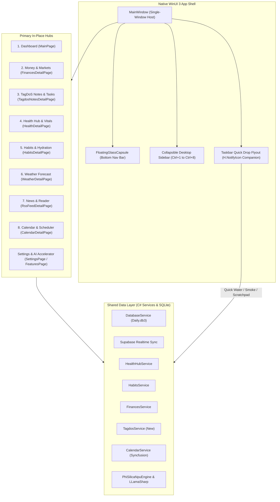

# WinUI 3 Desktop: macOS Parity, Hybrid Navigation & Modernization Master Plan

## 1. Executive Summary

This master plan establishes the architectural vision, roadmap, and implementation phases to elevate the **WinUI 3 (Windows App SDK / .NET 10)** desktop application of DayOne to the UX fluidity, visual elegance, and cohesive single-window ergonomics of the **macOS native client (`MacOS/`)**, while **strictly preserving and integrating WinUI's distinctive power features**:
1. **The Advanced Calendar & Scheduler Hub** (Syncfusion multi-account, timeline, week, month, and appointment management).
2. **On-Device Hardware AI & NPU Copilot Runtime** (Qualcomm Hexagon NPU via Phi-Silica, CUDA 12, Vulkan, and CPU via LLamaSharp).
3. **Physical Stale-Data Metaphor: Widget Aging & Wipe Animation** (Dynamic dust/smudge accumulation based on data freshness with wipe animations).
4. **Multi-Monitor Window Detachment ("Pop-Out on Demand")** (Allowing any hub to be detached into an independent floating window for multi-screen workstations).

---

## 2. Architectural Blueprint



---

## 3. Four-Phase Execution Roadmap

### Phase 1: Full Implementation of TagDoS Hub & Dashboard Widget
- **Goal**: Eliminate `"Notes Widget Coming Soon"` on `MainPage.xaml` and achieve 100% functional parity with macOS `TagdosNotesHubView`.
- **Deliverables**:
  1. `Models/TagdoModels.cs`: `TagDoPill`, `TagDoCluster`, `TagDoStream`, `TagDoQuickNote`, `LocalTagdoStream`, `LocalTagdoQuickNote`.
  2. `Services/TagdosParser.cs`: Stream shorthand parser (`Cluster & Cluster`, `Pill/Pill/Pill`), token classifier (financial, urgent, temporal, standard), recycling, and prioritization.
  3. `Services/ITagdosService.cs` & `Services/TagdosService.cs`: SQLite local caching, Supabase realtime synchronization, seeding default 5 executive streams and initial notes.
  4. `Controls/TagdosWidgetControl.xaml/.cs`: Interactive dashboard card rendering active streams, semantic pill badges, and quick note counters.
  5. `Views/TagdosNotesDetailPage.xaml/.cs`: Full 110px TopBar, 5 stream selector tabs + Quick Notes tab, visual pill canvas with interactive action flyout (Done, Recycle, Prioritize, Delete), raw syntax editor toggle, stream reminder picker, per-stream active memos with checkboxes, attachments with Windows File Explorer drag-and-drop, and pinned quick notes search/management.

### Phase 2: Unified In-Place Navigation & Windowing Architecture
- **Goal**: Transition from the fragmented multi-window model (`DetailWindow`) to a fluid single-window desktop experience with bottom Floating Capsule, Collapsible Sidebar, and desktop framing.
- **Deliverables**:
  1. `Controls/FloatingGlassCapsule.xaml/.cs`: Mica/Acrylic bottom-anchored pill navigation with 8 primary tabs, smooth hover indicators, and spring scaling.
  2. Collapsible Desktop Sidebar: Left-aligned drawer with `Ctrl+1` through `Ctrl+8` shortcuts, togglable via `Ctrl+S` or top bar icon.
  3. Single-window content switcher hosting all 8 hubs dynamically without spawning new windows.
  4. "Pop-out to Window" button on all detail pages allowing power users to detach any hub into an independent window for multi-monitor setups.
  5. Standardized 110px TopBar geometry across all views (Health, Habits, Finances, Weather, News, Calendar, TagDoS).
  6. Global keyboard accelerators (`Ctrl+1-8`, `Ctrl+R` force sync, `Ctrl+N` quick note, `Ctrl+,` settings).

### Phase 3: Interactive Windows 11 Taskbar Flyout ("Quick Drop")
- **Goal**: Elevate `H.NotifyIcon` into a modern companion popover matching macOS MenuBarExtra.
- **Deliverables**:
  1. Custom borderless XAML Flyout anchored above the Windows Taskbar tray icon.
  2. Live weather glance & intraday heart rate / step counter.
  3. One-click hydration logging (`+250 ml`, `+500 ml`).
  4. One-click smoke logging (`+1 Smoke`).
  5. Instant scratchpad text box to capture quick notes directly into TagDoS.
  6. "Open DayOne" button to bring the main application window to the foreground.

### Phase 4: Startup Optimization & 120Hz Composition Polish
- **Goal**: Slash cold boot time from ~38s down to < 1.0s and ensure butter-smooth 60/120Hz frame rates.
- **Deliverables**:
  1. Remove artificial boot delays (`_minBootTimeTask = Task.Delay(1200)`).
  2. Replace cartoonish squash/stretch loading animation with an elegant luminous Orbit pulse.
  3. Defer secondary hub instantiation using `x:Load="False"`.
  4. Move Smart Briefing pre-generation entirely to an asynchronous background worker so the dashboard appears in < 800ms.
  5. Verify on Parallels Windows 11 ARM64 VM (`WINCHESTER`).

---

## 4. Preservation of Unique Windows Superpowers

| Feature | Windows Advantage | Integration Strategy |
| :--- | :--- | :--- |
| **Syncfusion Calendar** | Multi-account sync (Google/Outlook), week/month/timeline views, drag-and-drop scheduling | Promoted to **Tab 8 (`Ctrl+8`)** in the primary navigation capsule and sidebar. TopBar aligned to 110px standard. |
| **On-Device Hardware AI** | Qualcomm Hexagon NPU Copilot Runtime, CUDA 12, Vulkan, CPU via Phi-Silica & LLamaSharp | Kept fully intact in `FeaturesPage`, executed offline, decoupled from UI blocking. |
| **Widget Aging & Wipe** | Physical glass metaphor: accumulation of dirt/smudges when data is stale + animated wipe | Preserved in `GlassWidgetContainer`, optimized with hardware GPU composition. |
| **Multi-Monitor Support** | Native WinUI secondary windows | Maintained via "Pop-Out" button in each hub header. |

---

## 5. Development & Testing Protocol (Parallels Windows 11 VM)

As established in `.agents/AGENTS.md`:
1. Implement changes cleanly in `WinUI/Daily.WinUI/` on the Mac host.
2. Commit and push cleanly to `origin/main`.
3. Pull updates on the Parallels VM:
   ```cmd
   cd /d C:\Users\mihai\source\repos\Daily && git pull origin main
   ```
4. Build and test natively on the VM:
   ```cmd
   cd /d C:\Users\mihai\source\repos\Daily\WinUI\Daily.WinUI && dotnet build -c Debug -p:Platform=ARM64
   ```
5. Document all verified outcomes in `Docs/Features/`.
