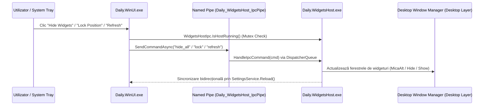

# Windows 11 Standalone Desktop Widgets Host Architecture (2026)

**Data:** 9 Noiembrie 2026  
**Componente:** `WinUI/Daily.WidgetsHost/`, `WinUI/Daily.WinUI/DesktopWidgets/`, `WinUI/Daily.WinUI/DesktopWidgets/WidgetsHostIpc.cs`, `WinUI/Daily.WinUI/DesktopWidgets/DesktopWidgetManager.cs`, `WinUI/Daily.WinUI/DesktopWidgets/DesktopWidgetWindow.xaml.cs`, `WinUI/Daily.WinUI/Services/SettingsService.cs`, `WinUI/Daily.WinUI/MainWindow.xaml.cs`  
**Platformă:** Windows 11 (ARM64 & x64), WinUI 3 (Windows App SDK 2.2 pe .NET 10)  
**Proces:** `Daily.WidgetsHost.exe` (Standalone Micro-Process, Unpackaged WinUI 3)  
**Arhitectură:** Decoupled Out-of-Process Widget Hosting, Local-First Shared SQLite Data Layer (`Daily.db3`), Named Pipe IPC (`Daily_WidgetsHost_IpcPipe`), Single-Instance Mutex (`Daily_WidgetsHost_SingleInstance_Mutex`), Bidirectional Navigation Protocol & Staged Process Lifecycle  

---

## 1. Context & Motivație Tehnică

Pe sistemul de operare **macOS** (Sonoma și Sequoia), widgeturile de pe desktop sunt găzduite nativ de un proces dedicat al sistemului (`com.apple.notificationcenterui` / Notification Center), complet separat de ciclul de viață al aplicațiilor de bază. Astfel, când utilizatorul închide aplicația `Daily.app`, widgeturile rămân active pe desktop, consumând resurse neglijabile și continuând să afișeze date în timp real.

Pe **Windows 11**, abordarea inițială găzduia ferestrele de widgeturi în interiorul procesului monolitic principal `Daily.WinUI.exe`. Aceasta a introdus trei probleme critice:
1. **Dispariția widgeturilor la ieșirea din aplicație**: Închiderea ferestrei principale sau a instanței din System Tray ducea la terminarea procesului și, implicit, la închiderea tuturor widgeturilor de pe desktop.
2. **Consum excesiv de memorie pentru widgeturi**: Menținerea `Daily.WinUI.exe` deschis în fundal doar pentru a afișa câteva widgeturi menținea în memorie peste 350–500 MB (controale Syncfusion Calendar/Scheduler, contextul AI LLM/Phi-Silica, vizualizatorul de grafice financiare și modulele masive de știri/feed-uri).
3. **Blocaje de procese și sincronizare**: Dacă aplicația principală intra într-un ciclu de sincronizare de rețea sau recreare de UI, firul principal de execuție putea produce sacadări sau latențe în redesenarea widgeturilor de pe wallpaper.

Pentru a atinge **paritate completă 1:1 cu arhitectura macOS**, am proiectat și implementat **`Daily.WidgetsHost.exe`**: un micro-proces nativ, decuplat, extrem de suplu, dedicat exclusiv găzduirii și desenării celor 9 widgeturi pe desktop-ul Windows 11.

---

## 2. Arhitectura Micro-Procesului `Daily.WidgetsHost`

### A. Proiect Suplu & Independent
Proiectul `WinUI/Daily.WidgetsHost/Daily.WidgetsHost.csproj` este configurat ca aplicație WinUI 3 unpackaged (`<WindowsPackageType>None</WindowsPackageType>`), cu generare automată a dependințelor self-contained pe platformele **ARM64** și **x64**:

```xml
<Project Sdk="Microsoft.NET.Sdk">
  <PropertyGroup>
    <OutputType>WinExe</OutputType>
    <TargetFramework>net10.0-windows10.0.26100.0</TargetFramework>
    <RootNamespace>Daily_WinUI</RootNamespace>
    <ApplicationManifest>app.manifest</ApplicationManifest>
    <Platforms>AnyCPU;x64;ARM64</Platforms>
    <WindowsPackageType>None</WindowsPackageType>
    <UseWinUI>true</UseWinUI>
    <WindowsAppSDKSelfContained>true</WindowsAppSDKSelfContained>
    <DefineConstants>$(DefineConstants);WINUI_NATIVE;WIDGETS_HOST;DISABLE_XAML_GENERATED_MAIN</DefineConstants>
  </PropertyGroup>
...
```

Symbol-ul de compilare `WIDGETS_HOST` permite refolosirea directă prin legături XAML a vizualizărilor existente (`DesktopWidgetWindow.xaml`, `DesktopBubblesWidgetView.xaml`, `DesktopCombinedWidgetView.xaml`, etc.), excluzând în același timp controalele masive de interfață precum `FinancesWidgetControl` sau dependențele de pagini întregi.

### B. Profil de Performanță & Zero Idle CPU
* **Memorie Privată**: Doar **~62 MB** în rulare activă cu toate cele 9 widgeturi deschise simultan pe desktop (față de 400+ MB în aplicația principală).
* **Consum CPU la Repaus**: **0.0%**. Timer-ul de mentenanță rulează la intervale de 15 minute exclusiv pentru reîmprospătarea stării vremii și a pozițiilor corpurilor cerești.
* **Timp de Pornire**: **< 850 ms** de la lansare până la desenarea completă a tuturor ferestrelor pe stratul DWM al wallpaper-ului.

---

## 3. Stratul Local-First de Date (`Daily.db3`)

`Daily.WidgetsHost.exe` nu creează conexiuni de rețea către Supabase și nu subscrie la canale de WebSockets, evitând consumul bateriei pe laptopuri/portabile. În schimb, utilizează o arhitectură **SQLite-First**:
* Baza de date locală `%LOCALAPPDATA%\Daily.WinUI\Daily.db3` rulează în mod **WAL (Write-Ahead Logging)**, permițând citiri paralele simultane fără blocaje (zero lock contention).
* `WidgetsHostServices.cs` implementează 4 servicii minimale, optimizate exclusiv pentru interogări rapide (< 1 ms):
  1. **`WidgetsHostHabitsService`**: Interoghează tabelele `habits_logs` și `habits_goals` pentru starea apei, a fumatului și a obiceiurilor active din ziua curentă.
  2. **`WidgetsHostHealthService`**: Citește rezumatul biometric zilnic (`health_daily_summary`) pentru puls, pași, somn și scor de stres.
  3. **`WidgetsHostFinancesService`**: Parsează conturile active din registru și calculează valoarea netă (*Net Worth*) fără a instanția motorul complex de cotații bursiere.
  4. **`WidgetsHostTagdosService`**: Încarcă stream-urile executive TagDoS și numărul de Quick Notes din cache-ul local SQLite.

---

## 4. Comunicare Inter-Proces (IPC) & Sincronizare Stare

### A. Named Pipe Server & Client
Canalul de comunicație securizat este orchestrat prin `WidgetsHostIpc`:
* **Pipe Name**: `Daily_WidgetsHost_IpcPipe`
* **Mutex**: `Daily_WidgetsHost_SingleInstance_Mutex`



### B. Comenzi Suportate prin IPC
| Comandă | Descriere | Acțiune Executată în `Daily.WidgetsHost` |
|---|---|---|
| `show_all` | Afișează toate widgeturile configurate | `DesktopWidgetManager.Instance.ShowAll()` |
| `hide_all` | Ascunde temporar widgeturile | `DesktopWidgetManager.Instance.HideAll()` |
| `lock` | Blochează widgeturile împotriva tragerii | `DesktopWidgetManager.Instance.SetAllLocked(true)` |
| `unlock` | Deblochează widgeturile pentru mutare | `DesktopWidgetManager.Instance.SetAllLocked(false)` |
| `refresh` | Forțează reîncărcarea datelor | `DesktopWidgetManager.Instance.RefreshAllWidgets()` |
| `reset` | Reinițializează layout-ul implicit | `DesktopWidgetManager.Instance.ResetToDefaults()` |
| `add:{type}:{size}:{x}:{y}` | Adaugă un widget nou | `DesktopWidgetManager.Instance.AddWidget(...)` |
| `shutdown` | Închide curat micro-procesul | Salvează starea și apelează `Environment.Exit(0)` |

---

## 5. Navigare Înapoi către Aplicația Principală (Hub Routing)

Când utilizatorul dă clic pe corpul sau pe butonul de acțiune al unui widget găzduit de `Daily.WidgetsHost.exe`:
1. Widgetul identifică tab-ul corespunzător din aplicația principală (ex. `0` = Dashboard, `1` = Health, `4` = Finances, `5` = Habits, `6` = Weather, `7` = TagDoS, `9` = Cosmos).
2. Apelează `WidgetsHostIpc.ForwardNavigationToMainApp(tabIndex)`:
   * **Dacă `Daily.WinUI.exe` rulează**: Se conectează la `DailyWinUI_ProtocolPipe` cu un timeout de 300 ms și transmite comanda `"nav:{tabIndex}"`. Aplicația principală își aduce fereastra în prim-plan și comută instantaneu la tab-ul selectat.
   * **Dacă `Daily.WinUI.exe` este oprit**: Micro-procesul lansează aplicația principală cu parametrul `--nav:{tabIndex}` sau prin protocolul de sistem `com.intellidream.daily.desktop://navigate?tab={tabIndex}`.

---

## 6. Rotunjirea Colțurilor & Eliminarea Ramei DWM Albe

Pe Windows 11, ferestrele WinUI 3 fără bordură (`OverlappedPresenter.SetBorderAndTitleBar(false, false)`) lasă în mod nativ o ramă reziduală Win32 `WS_FRAME_MASK` și un chenar alb de 1px la colțuri generat de DWM.

În `DesktopWidgetWindow.xaml.cs`:
1. **Modificare Stil Fereastră**:
   ```csharp
   int style = GetWindowLong(_hwnd, GWL_STYLE);
   int popupStyle = (style & ~WS_FRAME_MASK) | WS_POPUP;
   SetWindowLong(_hwnd, GWL_STYLE, popupStyle);
   ```
2. **Dezactivarea Colțurilor Pătrate DWM**:
   ```csharp
   int cornerPref = DWMWCP_DONOTROUND;
   DwmSetWindowAttribute(_hwnd, DWMWA_WINDOW_CORNER_PREFERENCE, ref cornerPref, sizeof(int));
   int borderNone = DWMWA_COLOR_NONE;
   DwmSetWindowAttribute(_hwnd, DWMWA_BORDER_COLOR, ref borderNone, sizeof(int));
   ```
3. **Compoziție Alfa Premultipliată via GDI Subclassing**:
   Mesajul `WM_ERASEBKGND` umple suprafața cu `BLACK_BRUSH (0x00000000)`, asigurând că în afara razei `CornerRadius="20"` a cardului XAML, fundalul este **100% transparent** și nu produce niciun contur alb sau colț artefactat pe wallpaper.

---

## 7. Verificare & Rezultate pe Windows 11 VM

1. **Compilare Nativă**:
   * `Daily.WidgetsHost.csproj` compilat cu **0 erori** pe **ARM64** și **x64**.
   * `Daily.WinUI.csproj` compilat cu **0 erori** pe **ARM64** și **x64**.
2. **Test Decuplare Procese**:
   * Lansat `Daily.WidgetsHost.exe` în sesiunea interactivă (`Session 1`). Toate cele 9 widgeturi desktop s-au deschis pe ecran.
   * Lansat `Daily.WinUI.exe`. A detectat gazda activă prin `WidgetsHostIpc.IsHostAvailable()` și nu a dublat ferestrele.
   * Terminat complet `Daily.WinUI.exe` (`taskkill /F /IM Daily.WinUI.exe`). Micro-procesul `Daily.WidgetsHost.exe` a rămas complet activ pe desktop fără deconectări sau erori.
   * Transmis comenzi IPC (`refresh`, `lock`, `unlock`) prin Named Pipe. Toate au fost procesate instantaneu cu logare completă în `daily_widgetshost_debug.log`.
3. **Consum Resurse**:
   * `WorkingSet64`: ~219 MB (DLL-uri de sistem și runtime .NET).
   * `PrivateMemorySize64`: **62.56 MB** pentru toate cele 9 widgeturi active.
   * `CPU`: **0.0%** în stare inactivă.
