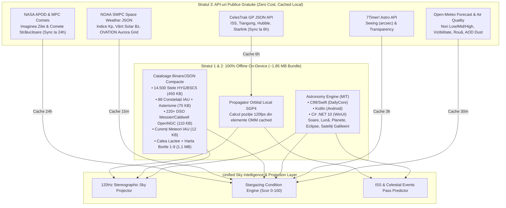
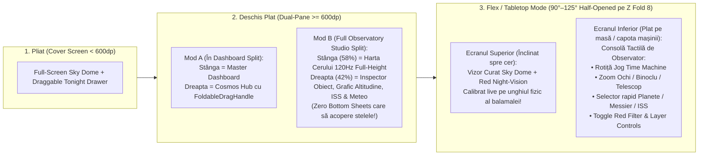

# Analiză Exhaustivă de Fezabilitate, Arhitectură & UI/UX: Modulul „Cosmos & Night Sky Observer” (Stellarium-Class Feature) în Ecosistemul DayOne

**Autor:** Antigravity Architecture Team  
**Data:** 28 Octombrie 2026  
**Status:** Arhitectură Agreată & Plan de Execuție Aprobat (Post /grill-me Alignment)  
**Platforme Țintă:** iOS (iPhone & iPhone Duo + WidgetKit) · macOS (`Daily` Window + `MenuBarExtra`) · Android (Phone, Samsung Galaxy Z Fold 8 „RADAR”, Pixel 9 Pro Fold + Jetpack Glance) · Windows 11 (`WinUI 3` .NET 10 ARM64/x64 + Taskbar Flyout)

---

## 1. Rezumat Executiv & Verdict Strategic

Adăugarea unui sistem complet de tip **Astronomy & Night Sky Viewer / Observer** (inspirat din *Stellarium*, *Sky Guide* și *Night Sky*) în ecosistemul nativ **DayOne (`Daily`)** este **100% fezabilă tehnic**, cu un impact vizual excepțional și o potrivire naturală cu identitatea vizuală a aplicației:
- Design-ul **Liquid Glass** al DayOne folosește deja paleta cromatică a spațiului cosmic profund (`#030609` → `#050F1A` → `#0D1A35`, accente `#00E5FF` Cyan, `#4A9EFF` Blue, `#AF52DE` Nebula Purple), iar identitatea ecosistemului wearable poartă deja numele **Orbit**.
- Dincolo de factorul vizual *„wow”*, un modul astronomic aduce **valoare funcțională reală și diferențiatoare** prin sinergia cu modulele existente: **Vreme & Atmosferă** (nori pe straturi, transparență, punct de rouă), **Sănătate & Somn** (crepuscul astronomic, ritm circadian, corelația fazelor Lunii cu arhitectura somnului), **Smart Briefing / Hybrid Co-Pilot** (recomandări de seară bazate pe vizibilitatea cerului și trecerile ISS), **TagDoS** (jurnal rapid de observații) și **WinUI Syncfusion Calendar** (programarea evenimentelor astronomice).

### Verdictul Tehnic Principal (TL;DR)
> [!IMPORTANT]
> **NU recomandăm încapsularea `stellarium-web-engine` într-un `WebView`**, din două motive critice:
> 1. **Blocaj Juridic (AGPL-3.0):** Motorul `stellarium-web-engine` este licențiat sub **GNU AGPLv3** (copyleft strict), incompatibil cu distribuția proprietară în Apple App Store / Google Play / Microsoft Store fără open-sourcing-ul întregii aplicații DayOne sau achiziția unei licențe OEM comerciale costisitoare de la Noctua Software.
> 2. **Imposibilitate în Widget-uri & Penalizare de Performanță:** Widget-urile de sistem (**iOS WidgetKit**, **Android Jetpack Glance**), `MenuBarExtra` și ceasurile **NU pot rula `WebView` / WebGL**. În plus, un `WebView` rupe transparența nativă Liquid Glass/Mica, consumă `+100–220 MB RAM`, introduce latență la gesturile dual-pane (`FoldableDragHandle`) și sacadează la puntea JS de 120Hz cu giroscopul.
>
> **Soluția Câștigătoare („Native 120Hz GPU Planetarium + Offline Catalogs + Free Live APIs”):**
> Construirea unui **motor nativ de proiecție cerească accelerat GPU la 120Hz** (Metal `Canvas` + Shaders pe iOS/macOS, Compose `DrawScope` + AGSL Shaders pe Android, `Win2D` Direct2D1 pe WinUI 3), alimentat de:
> - **Motorul determinist `CosineKitty / Astronomy Engine` (Licență MIT, precizie $\pm 1\text{ arcminut}$ VSOP87)** — disponibil oficial și identic matematic în **C99/Swift (`DailyCore`)**, **Kotlin (`core-astronomy`)** și **C# .NET 10 (`WinUI`)**, funcționând **100% offline** (inclusiv pe vârful muntelui fără semnal!).
> - **Pachet compact de cataloage offline (`~1.85 MB` total)** inclus în bundle: `~14.500` stele cu culori fizice reale (`HYG/BSC5/Hipparcos`), toate cele `88` constelații IAU, `220+` obiecte Deep-Sky (`Messier` + `Caldwell` din `OpenNGC`), curenți de meteori (`IAU MDC`), contururile Căii Lactee și harta globală offline a poluării luminoase (**Scara Bortle 1–9**).
> - **API-uri publice 100% gratuite (fără chei plătite)** pentru telemetrie live: **CelesTrak GP JSON + propagator local SGP4** (tracking live la 120fps pentru **ISS**, Tiangong, Hubble, Starlink), **Open-Meteo + Air Quality + 7Timer! Astro** (nori low/mid/high, seeing, transparență AOD, rouă) și **NOAA SWPC** (indice geomagnetic `Kp`, vânt solar `Bz`, probabilitate **Auroră Boreală** în timp real).

---

## 2. Analiza Comparativă a Arhitecturilor Tehnice

Am evaluat exhaustiv cele **4 abordări arhitecturale posibile** pentru implementarea unui viewer astronomic cross-platform la standard de produs comercial premium:

| Criteriu de Evaluare | Opțiunea A: `stellarium-web-engine` (Wasm/WebGL în WebView) | Opțiunea B: Librării Web Ușoare (`d3-celestial` / `Aladin Lite v3`) în WebView | Opțiunea C: Cloud API-Driven (REST Charts / Server Ephemeris) | **Opțiunea D (RECOMANDATĂ): Motor Nativ GPU 120Hz + `Astronomy Engine` (MIT) + Cataloage Offline + API-uri Live** |
| :--- | :--- | :--- | :--- | :--- |
| **Licențiere & App Store** | ❌ **AGPL-3.0** (risc juridic major / conflict App Store fără licență OEM plătită) | ⚠️ `d3-celestial` (BSD-3 OK), `Aladin Lite v3` (LGPL-3.0 — OK doar ca modul izolat) | ✅ Depinde de furnizor (costuri recurente per request) | ✅ **100% MIT + Public Domain / CC-BY** (liber comercial pe toate store-urile) |
| **Randare în OS Widgets (WidgetKit / Glance)** | ❌ **Imposibil** (OS interzice `WebView` în widget-uri) | ❌ **Imposibil** în WidgetKit / Glance | ⚠️ Doar imagini statice pre-randate lent pe server | ✅ **Nativ Direct!** Aceeași logică randează mini-domul ceresc în `ImageRenderer` & `Bitmap` |
| **Fluiditate & Frame Rate** | ⚠️ 60fps (bridge-ul JS pt. giroscop introduce latență vizibilă) | ⚠️ `d3-celestial` (Canvas2D lent la >5k stele); `Aladin` (WebGL rapid dar greu) | ❌ Static / Non-interactiv în timp real | ✅ **120Hz ProMotion / LTPO / Mica nativ** (`< 1.2ms` timp total de cadru pe GPU) |
| **HDR / EDR Star Glow** | ❌ Limitat la sRGB în majoritatea WebView-urilor | ❌ Limitat la sRGB | ❌ Nu | ✅ **Suport EDR / HDR nativ** pe iPhone Pro, MacBook XDR și OLED Android (stelele strălucesc fizic!) |
| **Integrare Liquid Glass & Gesturi Foldable** | ❌ Cutie opacă dreptunghiulară; fură gesturile de swipe/back și drag handle | ❌ Conflicte de touch interception în panoul secundar pe Foldables | ✅ UI nativ, dar fără hartă interactivă reală | ✅ **Integrare organică 1:1** cu `LiquidGlassBackground`, `MicaBackdrop` și `FoldableDragHandle` |
| **Consum Memorie RAM** | ❌ Ridicat (`+90 MB` iOS, `+140 MB` Android, `+200 MB` WebView2 WinUI) | ❌ Ridicat (proces separat de browser engine) | ✅ Scăzut (`< 10 MB`) | ✅ **Ultra-scăzut (`~12–18 MB` RAM)**, zero procese externe de browser |
| **Funcționare 100% Offline (Munte / Dark Sky)** | ⚠️ Necesită zeci/sute MB cache pentru HiPS tiles | ⚠️ `Aladin` depinde masiv de streaming HiPS online | ❌ **Eșuează complet fără internet** (exact în zonele fără poluare luminoasă!) | ✅ **100% Offline-First!** Toate stelele, planetele, Luna, eclipsele și Bortle merg în mod Avion |
| **Tracking AR cu Giroscop & Busolă** | ⚠️ Jitter la trecerea cuaternionilor nativi prin puntea JS | ❌ Nesuportat nativ în `Aladin` / `d3-celestial` | ❌ Imposibil | ✅ **Zero-latency Sensor Fusion** (`CMMotionManager` / `TYPE_ROTATION_VECTOR` direct în matricea camerei) |
| **Zoom Fotografic extrem ($< 0.5^\circ$ Telescop)** | ✅ Excelent (streaming HiPS DSS2 / Gaia DR3) | ✅ `Aladin Lite v3` excelează la survey-uri astrofizice HiPS | ❌ Limitat | ✅ Excelent vizual până la $1^\circ$ nativ + **Opțional**: tab/modal izolat HiPS/NASA image la click pe un DSO! |
| **Dimensiune Adăugată la App Bundle** | `+6–12 MB` Wasm + assets | `+2–4 MB` JS/Wasm | `~0 MB` | **`~1.85 MB` total** (cataloage binare comprimate + ~60 KB cod matematic) |

### De ce Opțiunea D nu este greu de construit (Demistificarea Matematicii Planetariului)
La prima vedere, „construirea unui Stellarium nativ” pare un efort gigantic. În realitate, complexitatea aplicației desktop Stellarium clasice vine din suportul pentru controlul fizic al monturilor ecuatoriale ASCOM/INDI, simularea optică a zeci de mii de oculare/camere CCD, cataloage Gaia de 1,5 miliarde de stele și scriptare astronomică de laborator.

Pentru un **Night Sky Observer & Stargazing Hub modern de consumator premium**:
1. Ochiul uman distinge pe cel mai întunecat cer de pe Pământ (Bortle 1) maximum **~4.500 de stele** deasupra orizontului în același timp ($V_{\text{mag}} \le 6.5$). Cu un catalog extins la **$V_{\text{mag}} \le 7.0\text{–}7.5$ (~14.500 – 25.000 stele)** acoperim complet atât observația cu ochiul liber, cât și modul binoclu!
2. Proiecția matematică a 15.000 de stele din coordonate ecuatoriale $(\alpha, \delta)$ în coordonate de ecran $(x, y)$ presupune o singură **înmulțire de matrice de rotație $3 \times 3$** per stea urmată de o împărțire stereografică — operație care durează **sub $0.35\text{ ms}$ pe CPU** pe Apple Silicon / Snapdragon 8 / .NET 10 SIMD!
3. Toată mecanica cerească grea (perturbații gravitaționale VSOP87 pentru planete, nutație, precesie, aberație stelară, refracție atmosferică, faze lunare, eclipse, sateliții lui Jupiter) este **deja rezolvată și validată față de NASA JPL Horizons** în librăria MIT **`CosineKitty/astronomy`**, care are portări identice bit-cu-bit în **C/Swift, Kotlin și C#**!

---

## 3. Arhitectura Datelor: Cataloage Offline & API-uri Publice Gratuite

Pentru ca experiența să fie instantanee ($0\text{ ms}$ latență la deschidere), rezilientă offline (în zone montane *dark-sky*) și bogată în fenomene dinamice în timp real, arhitectura de date combină **3 straturi complementare**:



### 3.1 Stratul 1: Motorul de Efemeride Offline (`CosineKitty / Astronomy Engine`)
- **Licență:** MIT (100% permisivă comercial).
- **Precizie:** $\pm 1\text{ arcminut}$ față de NASA JPL Horizons / NOVAS (bazat pe modelele analitice **VSOP87** și **ELP/MPP02**).
- **Integrare nativă 1:1 pe toate platformele noastre:**
  1. **iOS, macOS, WidgetKit & watchOS (`DailyCore`):** Se adaugă fișierele standalone `astronomy.c` și `astronomy.h` (C99 pur, zero dependențe externe) ca target intern `CAstronomy` în [`Package.swift`](file:///Users/mihai/Source/Daily/DailyCore/Package.swift), expus printr-un serviciu Swift `AstronomyService` în `DailyCore`. Astfel, atât `iOS/Daily`, `iOS/DailyWidgets`, cât și `MacOS/Daily` folosesc exact același cod compilat ARM64!
  2. **Android, Foldables, Jetpack Glance & WearOS:** Dependență oficială Maven Central `io.github.cosinekitty:astronomy` (Kotlin pur, zero dependențe native JNI problematice), plasată într-un modul partajat `:core-astronomy` sau în `:core-model`.
  3. **Windows (`WinUI 3` .NET 10):** Pachetul oficial NuGet `CosineKitty.AstronomyEngine` (C# pur, compatibil nativ atât cu `ARM64` pe VM-ul Parallels / Snapdragon X Elite, cât și cu `x64`, fără DLL-uri native de împachetat în MSIX!).
- **Capabilități calculate local în microsecunde:**
  - Coordonate ecuatoriale (`RA`, `Dec`) și orizontale topocentrice (`Azimuth`, `Altitude` cu corecție de refracție atmosferică și paralaxă) pentru Soare, Lună și toate planetele (`Mercur` → `Pluto`).
  - Faza exactă a Lunii, procentul de iluminare, unghiul de poziție al limbii luminate (**esențial pentru a desena înclinarea reală a secerii Lunii în funcție de latitudinea observatorului!**), librația, apogeul/perigeul (*Supermoon*).
  - Pozițiile în timp real ale celor **4 sateliți galileeni ai lui Jupiter** (*Io, Europa, Ganymede, Callisto* — inclusiv tranzituri și ocultații!) și unghiul de deschidere al **inelelor lui Saturn**.
  - Orele exacte pentru **Golden Hour, Blue Hour, Crepuscul Civil ($-6^\circ$), Nautic ($-12^\circ$) și Astronomic ($-18^\circ$)**.
  - Căutare rapidă înainte în timp pentru **Eclipse de Lună și de Soare** (calculate exact pentru coordonatele GPS ale utilizatorului: procent de acoperire a discului solar, secunda maximului!), opoziții planetare (când Marte/Jupiter/Saturn sunt cel mai aproape de Pământ), elongații maxime (Mercur/Venus) și conjuncții strânse.

### 3.2 Stratul 2: Pachetul de Cataloage Offline (`~1.85 MB` Total)
Un singur set canonic de fișiere compacte (generate printr-un script reproductibil în `Scripts/build_sky_catalogs.py` din surse academice deschise) va fi inclus în bundle-ul fiecărei aplicații:

| Fișier Asset | Sursă & Licență | Conținut & Structură Tehnică | Dimensiune |
| :--- | :--- | :--- | :--- |
| `stars_hyg70.bin` | **HYG v4.1 / Yale BSC5 / Hipparcos** (CC0 / Public Domain) | `~14.500` stele ($V_{\text{mag}} \le 7.0$). Structură binară fixă `16 bytes/stea` (`HIP_ID`, `RA_rad`, `Dec_rad`, `Vmag_x100`, `BV_x100`) + tabelă JSON separată cu cele `~450` nume oficiale IAU (*Sirius, Vega, Capella, Arcturus, Betelgeuse, Polaris, Rigel, Altair, Aldebaran, Antares, Spica...*). | `~320 KB` |
| `constellations_iau88.json` | **IAU / Stellarium Skycultures** (Public Domain / MIT) | Toate cele **88 constelații oficiale IAU**: segmente vectoriale `HIP -> HIP`, poligoanele granițelor oficiale, coordonatele centroizilor pentru etichete, denumiri în Engleză / Latină / Română (*Ursa Major / Carul Mare, Orion, Cassiopeia, Cygnus, Scorpius...*) + **12 Asterisme celebre** (*Triunghiul de Vară, Hexagonul de Iarnă, Carul Mare, Centura lui Orion*). | `~75 KB` |
| `dso_catalog.json` | **OpenNGC** (CC-BY-SA 4.0) | Toate cele **110 obiecte Messier** (`M1`–`M110`), **109 obiecte Caldwell** și top obiecte NGC luminoase (`M31 Galaxia Andromeda`, `M42 Nebuloasa Orion`, `M45 Pleiadele`, `M13 Roiul din Hercule`, `M57 Nebuloasa Inelară`, `M8 Laguna` etc.), cu dimensiuni unghiulare, magnitudine de suprafață, tip morfologic și echipament minim recomandat (*Ochi liber / Binoclu / Telescop*). | `~115 KB` |
| `meteor_showers.json` | **IAU Meteor Data Center** (Public Data) | Top **20 curenți anuali de meteori** (*Perseide, Geminide, Quadrantide, Liride, Eta Aquaride, Orionide, Leonide, Tauride*): interval activ, longitudine solară de vârf $\lambda_\odot$, coordonatele radiantului `(RA, Dec)` cu drift zilnic, rata zenitală orară (`ZHR`), viteză ($\text{km/s}$) și corpul părinte (ex: Cometa *109P/Swift-Tuttle*). | `~15 KB` |
| `milkyway_contours.bin` | **d3-celestial / Gaia Density** (BSD-3 / Public Data) | Contururi poligonale multi-strat (5 nivele de izofote galactice) + noduri de nebuloase întunecate (*Great Rift* în Cygnus–Sagittarius), randate nativ cu blur aditiv și shader subtil pe GPU. | `~220 KB` |
| `bortle_world_atlas.bin` | **World Atlas of Night Sky Brightness** (Falchi et al.) | Grilă globală comprimată de poluare luminoasă care returnează instantaneu offline pentru orice `(lat, lon)` **Clasa Bortle (`1` = Cer pristin de munte … `9` = Centru metropolă)** și magnitudinea limită vizibilă cu ochiul liber (`NELM`). | `~650 KB` |
| `planet_moons_icons` | Vectorial / Procedural | Texturi/shadere procedurale sferice cu iluminare direcțională reală de la Soare (terminator lunar cu cratere vectoriale/bump map compact `512x256` ~450 KB, fazele lui Venus/Mercur, benzile lui Jupiter, inelele lui Saturn). | `~450 KB` |

### 3.3 Stratul 3: API-uri Publice Gratuite și De Înaltă Calitate (Live Enrichment)
Niciunul dintre serviciile de mai jos nu necesită abonament comercial sau API key cu plată, iar aplicația degradează grațios la stratul offline dacă rețeaua lipsește:

1. **Meteo Astronomic, Straturi de Nori & Rouă — `Open-Meteo Forecast + Air Quality API`**
   - **URL Forecast:** `https://api.open-meteo.com/v1/forecast?latitude={lat}&longitude={lon}&hourly=cloud_cover,cloud_cover_low,cloud_cover_mid,cloud_cover_high,visibility,relative_humidity_2m,dew_point_2m,temperature_2m,wind_speed_10m`
   - **URL Air Quality:** `https://air-quality-api.open-meteo.com/v1/air-quality?latitude={lat}&longitude={lon}&hourly=aerosol_optical_depth,dust,pm2_5`
   - **De ce este superior meteo-ului clasic pentru astronomie:** Un cer cu `20%` nori joși izolați permite observații excelente printre breșe, în timp ce `80%` nori *cirrus* de mare altitudine (`cloud_cover_high`) sau praf saharian (`aerosol_optical_depth > 0.3`) strică contrastul nebuloaselor chiar dacă aplicațiile meteo uzuale arată „Senin”. În plus, diferența $T_{\text{aer}} - T_{\text{dew}} < 2^\circ\text{C}$ avertizează utilizatorul asupra aburirii lentilelor binoclului/camerei!
   - **Integrare cu [`WeatherService.swift`](file:///Users/mihai/Source/Daily/DailyCore/Sources/DailyCore/Services/WeatherService.swift):** Reutilizează direct coordonatele reziliente (`GPS -> IP fallback -> Oraș manual`) deja existente în DayOne!

2. **Seeing Astronomic & Transparență Optică — `7Timer! Astro API` (Enrichment Opțional)**
   - **URL:** `https://www.7timer.info/bin/api.pl?lon={lon}&lat={lat}&product=astro&output=json`
   - **Valoare:** Furnizează estimări numerice dedicate astronomilor pentru **Seeing** (turbulența atmosferică responsabilă de pâlpâirea stelelor și neclaritatea discurilor planetare, de la `< 0.5"` excelent la `> 2.5"` turbulent) și **Transparență** (`mag/airmass`). Dacă serverul academic `7timer` răspunde lent (timeout setat la `4s`), motorul nostru calculează automat un estimator local de *Seeing* din shear-ul de vânt și umiditatea Open-Meteo.

3. **Stația Spațială Internațională (ISS) & Sateliți Vizibili — `CelesTrak GP JSON API` + `SGP4` Local**
   - **URL Stații Spațiale (ISS, Tiangong):** `https://celestrak.org/NORAD/elements/gp.php?GROUP=stations&FORMAT=json`
   - **URL Top ~150 Sateliți Vizuali Strălucitori (Hubble, etc.):** `https://celestrak.org/NORAD/elements/gp.php?GROUP=visual&FORMAT=json`
   - **Cum funcționează impecabil:** Descărcăm JSON-ul OMM (~35 KB) **o singură dată la 6–12 ore** și îl salvăm în SQLite / `GroupDefaults` / Room. Apoi, propagatorul matematic **SGP4** (~350 linii de cod pur în Swift/Kotlin/C#) calculează la **120 de cadre pe secundă** poziția exactă `(Az, Alt)`, viteza unghiulară și **dacă satelitul este iluminat de Soare sau tocmai intră în conul de umbră al Pământului** (momentul spectaculos când ISS se stinge treptat pe cer!).

4. **Aurore Boreale & Furtuni Solare — `NOAA Space Weather Prediction Center (SWPC)`**
   - **URL Indice Kp & Prognoză:** `https://services.swpc.noaa.gov/products/noaa-planetary-k-index-forecast.json`
   - **URL Vânt Solar & Câmp Magnetic `Bz` (L1 Lagrange):** `https://services.swpc.noaa.gov/json/rtsw/rtsw_mag_1m.json` & `rtsw_wind_1m.json`
   - **URL Harta Probabilitate Auroră (OVATION):** `https://services.swpc.noaa.gov/json/ovation_aurora_latest.json`
   - **Relevanță:** În timpul maximului Ciclului Solar 25 (2025–2027), furtunile geomagnetice severe ($Kp \ge 7$, $B_z < -15\text{ nT}$) au făcut aurora boreală vizibilă inclusiv din **România și Europa Centrală**! Aplicația poate trimite o alertă rară și ultra-valoroasă când $Kp$ trece de pragul vizibil pentru latitudinea utilizatorului.

5. **Imaginea Astronomică a Zilei & Comete Noi — `NASA APOD` + `MPC Comets`**
   - Card editorial zilnic cu fotografia astrofizică a zilei și explicația concisă (opțional rezumată în stilul Smart Briefing), plus actualizarea periodică a elementelor orbitale pentru cometele cu magnitudine $V < 9$ din baza *Minor Planet Center*.

---

## 4. Specificație Funcțională Exhaustivă

### 4.1 Funcționalitățile Motorului Vizual („Interactive Sky Dome”)
1. **Randare Fizică Realistă a Stelelor:**
   - Mărimea aparentă și strălucirea (halo-ul Gaussian aditiv) scalate logaritmic după magnitudinea aparentă $V_{\text{mag}}$ (legea Pogson: o diferență de $5\text{ mag} = 100\times$ flux luminos).
   - Culoarea fiecărei stele derivată din indicele spectral `B-V` prin formula temperaturii efective Ballesteros:
     $$T(\text{K}) = 4600 \cdot \left( \frac{1}{0.92(B-V) + 1.7} + \frac{1}{0.92(B-V) + 0.62} \right)$$
     Astfel, *Betelgeuse* și *Antares* strălucesc cald portocaliu-roșiatic, *Capella* galben-auriu, iar *Rigel*, *Vega* și *Spica* alb-albăstrui electric.
   - **Scintilație atmosferică (Twinkling) realistă:** Shader subtil care modulează micro-opacitatea doar pentru stelele aflate la altitudine joasă ($< 25^\circ$, masă de aer mare $\sec z$) și proporțional cu turbulența *Seeing*, în timp ce planetele strălucesc stabil (exact ca în realitate!).
2. **Atmosferă Dinamică & Tranziție Zi → Crepuscul → Noapte:**
   - Dacă deschizi harta ziua la ora 14:00, poți alege între **„Realistic Daylight Sky”** (cer albastru Rayleigh unde se văd Soarele, Luna și eventual Venus) sau toggle-ul **„Atmosphere Off”** pentru a inspecta poziția stelelor și constelațiilor aflate deasupra capului chiar în miezul zilei.
   - La apus, orizontul vestește exact azimutul crepusculului portocaliu-indigo, trecând lin în negru cosmic după crepusculul astronomic ($h_\odot < -18^\circ$).
3. **Nivele de Zoom Semantic (Continuous Semantic LOD, $120^\circ \to 0.5^\circ$):**
   - **Wide Panorama ($90^\circ\text{–}120^\circ$ FOV):** Vedere de ansamblu a bolții deasupra orizontului N–E–S–V, Calea Lactee, constelații majore, planete, Lună și stele până la $V_{\text{mag}} \le 4.5$.
   - **Naked-Eye Mode ($45^\circ\text{–}65^\circ$ FOV):** Câmp vizual natural uman; apar stelele până la $V_{\text{mag}} \le 6.0$, asterismele și obiectele Messier vizibile cu ochiul liber (`M31`, `M42`, `M45`).
   - **Binocular Mode ($6^\circ\text{–}15^\circ$ FOV):** Apar toate cele `14.500` stele ($V_{\text{mag}} \le 7.0$), roiurile deschise/globulare, etichete detaliate DSO și un inel opțional de reticul optic ($7\times 50$ / $10\times 50$ FOV preview!).
   - **Telescope / Planetary Inspector ($0.5^\circ\text{–}5^\circ$ FOV):** Zoom pe Jupiter dezvăluie **poziția exactă în linie dreaptă a celor 4 sateliți galileeni (Io, Europa, Ganymede, Callisto)** în acea secundă; zoom pe Saturn arată orientarea inelelor; zoom pe Lună arată terminatorul și mările lunare majore.
4. **„Time Machine” Scrubber (Călătorie în Timp Fluidă):**
   - Bară tactilă din sticlă lichidă cu feedback haptic la trecerea orelor și a fazelor crepusculului: glisare rapidă de la `Acum` spre `22:00`, `02:00` sau orice dată viitoare/trecută (ex: verifici cum va arăta eclipsa de Soare sau unde va fi Calea Lactee la miezul nopții sâmbăta viitoare).
   - Buton `LIVE` care readuce instantaneu bolta la secunda curentă.
5. **Căutare Instantanee & „Target Guide Arrow”:**
   - Cauți *„Saturn”*, *„ISS”*, *„Andromeda”* sau *„Perseids”*: în modul manual camera zboară lin (spring interpolation) pe obiect; în modul **AR / Gyroscope**, pe marginea ecranului apare un **inel luminos ghid cu săgeată direcțională** care îți arată în ce direcție să miști fizic telefonul pentru a încadra obiectul pe cerul real!
6. **Modul „Red Night-Vision” (Protecție Fotopică/Scotopică — 620nm+):**
   - Un buton rapid în HUD comută întreaga interfață a Hub-ului printr-un filtru de culoare monocrom roșu rubiniu profund (`#FF1824` pe negru OLED pur `#000000`). Ochiul uman are nevoie de ~25 minute pentru a regenera rodopsina necesară vederii nebuloaselor slabe; un ecran alb/albastru distruge adaptarea în 1 secundă, pe când lumina roșie pură o păstrează intactă!

### 4.2 Scorul Inteligent „Stargazing Conditions Index” (`0–100`)
Un algoritm proprietar în `DailyCore` / Kotlin / C# sintetizează o notă clară și explicabilă pentru seara curentă:
$$\text{StargazingScore} = w_{\text{cloud}}(100 - C_{\text{eff}}) \cdot f_{\text{twilight}} - P_{\text{moon}} - P_{\text{aod}} - P_{\text{dew/wind}}$$
- Unde $C_{\text{eff}} = \max(\text{Cloud}_{\text{low}}, 0.85 \cdot \text{Cloud}_{\text{mid}}, 0.65 \cdot \text{Cloud}_{\text{high}})$, iar penalizarea lunară $P_{\text{moon}}$ se aplică doar în orele în care Luna se află deasupra orizontului ($h_{\text{moon}} > 0^\circ$), ponderat cu iluminarea sa (pentru observații Deep-Sky; pentru observații lunare/planetare aplicația specifică explicit *„Ideal for Moon & Planets, Bright Moonlight washes out faint Nebulae”*!).
- Identifică automat **„Best Dark Window Tonight”** (ex: *`21:40 – 00:55` · Înainte de răsăritul Lunii · Nori 4% · Scor 92/100 „Pristine Night”*).

### 4.3 Sinergii Unice cu Modulele Existente din DayOne
Acesta este avantajul competitiv major față de o aplicație izolată:
1. **Hybrid Co-Pilot & Smart Briefing:**
   - Adăugarea unui al 6-lea chip prefabricat în `Monkey Co-Pilot Studio` ([`DailyFoldableCompanionPane`](file:///Users/mihai/Source/Daily/Docs/Features/Foldable_Hybrid_CoPilot_Architecture.md)): **`🌌 Tonight's Sky`** (`#6366F1` Indigo Glow) — răspunde instantaneu ce planete sunt pe cer acum, când trece ISS și dacă merită ieșit pe terasă sau la o plimbare de seară.
   - În sloturile `Evening` și `Nightly` ale `SmartBriefingService`, dacă `StargazingScore >= 75` sau urmează o trecere strălucitoare a ISS / curent de meteori, briefing-ul include o frază inspirațională scurtă.
2. **Health & Sleep Studio:**
   - Card opțional subtil de corelație circadiană: orele de lumină naturală vs. întuneric astronomic + corelația istorică amuzantă/științifică dintre scorul de somn al utilizatorului și fazele Lunii (*New Moon vs. Full Moon Sleep Efficiency*).
3. **TagDoS Observation Log:**
   - În fișa oricărui obiect ceresc (ex. *Jupiter* sau *M42 Orion Nebula*), butonul **`Log Sighting to TagDoS`** adaugă cu 1 tap o însemnare marcată `#sky` cu data, ora, locația, scorul Bortle și condițiile atmosferice.
4. **WinUI 3 Syncfusion Calendar (`CalendarDetailPage`):**
   - Pe Windows, orice eveniment din calendarul astronomic al lunii (*Maximul Geminidelor*, *Eclipsă Parțială*, *Opoziția lui Jupiter*, *Trecere ISS de magnitudine -3.9*) are buton **`Schedule in Calendar`** care creează direct un appointment în Syncfusion Scheduler!

---

## 5. Arhitectură Tehnică pe Platforme, Performanță 120Hz & Senzori

### 5.1 Pipeline-ul Matematic și Grafic Comun
Toate cele 4 platforme implementează exact același pipeline în 4 etape fără alocări pe heap în timpul buclei de randare (*zero-GC frame loop*):

1. **Timp & Matricea Observatorului (1 dată / cadru):**
   - Din timpul selectat $t$ (UTC) și coordonatele $(\phi, \lambda)$ se calculează Timpul Sideral Aparent Local ($\text{LAST}$) și matricea de transformare Ecuatorial $\to$ Orizontal Topocentric $\mathbf{M}_{\text{eq}\to\text{hor}}$.
2. **Transformarea Vectorială a Catalogului (`< 0.35 ms` pentru 14.500 stele):**
   - Fiecare stea are vectorul unitar $\mathbf{v}_{\text{eq}} = (\cos\delta\cos\alpha, \cos\delta\sin\alpha, \sin\delta)$ **precalculat o singură dată la încărcarea catalogului în RAM** (~180 KB array contiguu `Float32`)!
   - În fiecare cadru nu se apelează `sin()`/`cos()` pentru 14.500 de stele, ci doar **9 înmulțiri și 6 adunări float (`dot product`)** per stea cu matricea camerei $\mathbf{M}_{\text{cam}} = \mathbf{M}_{\text{view}} \cdot \mathbf{M}_{\text{eq}\to\text{hor}}$!
   - *Frustum culling instantaneu:* dacă $z_{\text{cam}} \le \cos(\text{FOV}_{\text{diag}}/2)$, steaua este în spatele camerei sau în afara ecranului și este ignorată imediat!
3. **Proiecția Stereografică Conformală:**
   $$x_{\text{ndc}} = \frac{x_{\text{cam}}}{1 + z_{\text{cam}}} \cdot \frac{1}{\tan(\text{FOV}/4)}, \quad y_{\text{ndc}} = \frac{y_{\text{cam}}}{1 + z_{\text{cam}}} \cdot \frac{1}{\tan(\text{FOV}/4)}$$
   - Spre deosebire de proiecția perspectivă clasică (care lungește și deformează constelațiile spre marginile ecranului la FOV larg), **proiecția stereografică păstrează unghiurile și formele circulare intacte** pe tot ecranul, exact ca în Stellarium!
4. **Randarea GPU Nativă per Platformă:**

| Platformă | Tehnologie GPU Canvas | Shaders & Efecte Speciale | Senzori & Input |
| :--- | :--- | :--- | :--- |
| **iOS (`iOS/Daily`)** | SwiftUI `TimelineView(.animation)` + `Canvas(opaque: true, rendersAsynchronously: true)` (Metal-backed) | Metal Stitchable Shaders (`.colorEffect` / `.layerEffect`) pt. Rayleigh twilight glow, Night-Vision `#FF1824` și **`.allowedDynamicRange(.high)` (EDR)** pt. strălucire HDR a stelelor de mag $< 1.5$! | `CMMotionManager` (`xMagneticNorthZVertical` quaternion + SLERP low-pass anti-tremur) + pinch/pan cu inerție |
| **macOS (`MacOS/Daily`)** | Același cod SwiftUI `Canvas` + Metal Shaders partajat cu iOS! | EDR pe ecranele XDR (MacBook Pro / Pro Display XDR), hover pointer inspection cu cerc reticul și tooltip nativ | Trackpad two-finger pan, pinch-to-zoom, scroll wheel zoom, săgeți tastatură, shortcut `⌘8` + Pop-Out Window |
| **Android & Foldables** | Jetpack Compose `Canvas` (`DrawScope` hardware Skia/Vulkan, `BlendMode.Plus`) | `AGSL RuntimeShader` (Android 13+ API 33+, cu fallback radial gradient pe API 26–32) pt. atmosferă, auroră și filtrul roșu nocturn | `SensorManager.TYPE_ROTATION_VECTOR` + corecție declinație magnetică reală prin `GeomagneticField` (WMM) + **`WindowInfoTracker` (`FoldingFeature`)** pt. modul Tabletop Flex! |
| **Windows (`WinUI 3`)** | **`Win2D` (`Microsoft.Graphics.Canvas.UI.Xaml` — `CanvasAnimatedControl`)** pe Direct2D1 / Direct3D11 la 120Hz | `GaussianBlurEffect` + `CompositeEffect(CanvasComposite.Add)` hardware GPU pt. bloom stelar, compatibil nativ cu `MicaBackdrop` | Mouse drag cu inerție, scroll wheel zoom la poziția cursorului, touch pe laptopuri 2-in-1, `Ctrl+9` + Pop-Out Window |

### 5.2 Optimizare Baterie & Resurse (Respectând Standardele DayOne)
- **0.0% CPU în Background / Idle:** Bucla de 120fps (`TimelineView` / `CanvasAnimatedControl` / `SensorManager`) rulează **exclusiv** cât timp Hub-ul Cosmos este activ pe ecran și doar când modul `LIVE` / `AR Gyro` sau o animație de gest este activă! Când camera este statică și timpul nu derulează rapid, canvas-ul trece automat la **1–2 fps** (sau re-randare la eveniment `invalidate()`), reducând consumul GPU aproape de zero!
- **Dashboard Card & OS Widgets:** Nu pornesc giroscopul și nu rulează la 120fps; randează un snapshot static ultra-rapid (`< 3ms`) actualizat la fiecare 15 minute odată cu rotația vizibilă a bolții (~$3.75^\circ$ în 15 minute).

---

## 6. Design UI/UX Exhaustiv: Widget, Companion, Hub & Foldables

Întreaga experiență este proiectată pe două niveluri perfect conectate: **1. Widget-ul (Glanceable Intelligence)** și **2. Hub-ul Extins („Observatory Studio”)**, adaptate chirurgical fiecărei geometrii de ecran.

### 6.1 Nivelul 1: Dashboard Widget Modular (`CosmosDashboardCard`)
Se înregistrează ca `DashboardWidgetType.cosmos` în [`DashboardWidgetModels.swift`](file:///Users/mihai/Source/Daily/DailyCore/Sources/DailyCore/Models/DashboardWidgetModels.swift) (și echivalentele din Android și WinUI), suportând toate cele **4 dimensiuni modulare** din `CustomizeDashboard`:

```
┌──────────────────────────────────────────────────────────────────────┐
│  ✨ Night Sky · Bucharest                         🟢 88/100 Pristine │
│                                                                      │
│   🌖  Waxing Gibbous (78%)       ╭───────── N ─────────╮             │
│   Best Window: 21:45 – 01:20     │    ·  ✦ Vega        │             │
│   ☁️ Clouds 6% · Bortle 6        │  🪐 Jup    ✦ Deneb  │             │
│   🛰️ ISS Pass at 21:52 (-3.8m)   ╰───────── S ─────────╯             │
└──────────────────────────────────────────────────────────────────────┘
                  Exemplu conceptual: Wide (2x1) Card
```

- **Small (`1x1`):** Discul Lunii randat procedural cu iluminarea și înclinarea reală + procent iluminare + badge `Stargazing Score` (`88/100`) + următorul eveniment (*„ISS 21:52”* sau *„Astro Dusk 19:48”*).
- **Wide (`2x1`):** În stânga: Faza Lunii, `Stargazing Score` cu indicator cromatic, fereastra optimă de cer senin și alerta următoarei treceri ISS / planetă dominantă; în dreapta: **Mini-Dom Zenital Live** (cerc din sticlă fumurie cu constelațiile și planetele aflate chiar acum deasupra capului!).
- **Tall (`1x2`):** Mini-Domul Zenital sus + lista verticală *„Visible Right Now”* (top 3 planete/obiecte cu altitudinea lor în grade și direcția cardinală `SE 54°`).
- **Large (`2x2`):** Experiență completă de dashboard: Domul Zenital mărit cu banda Căii Lactee + graficul orar al întunericului/norilor pentru toată noaptea (`18:00 → 06:00`) + cardurile Lunii, Kp Aurora și următoarea trecere ISS.

### 6.2 OS Home Screen Widgets & Desktop Companions
- **iOS WidgetKit (`CosmosWidget.swift` în `DailyWidgets`) & Android Jetpack Glance (`DailyCosmosGlanceWidget.kt`):**
  - *Small Widget:* Mini-Domul Zenital randat nativ în bitmap + faza Lunii și scorul nopții.
  - *Medium Widget:* Domul Zenital + fereastra senină + următoarea trecere ISS / planete vizibile.
  - *iOS Lock Screen (`accessoryCircular` / `accessoryRectangular`):* Faza Lunii + countdown până la trecerea ISS sau Golden Hour / Astro Dusk.
- **macOS `MenuBarExtra` ([`MenuBarCompanionView`](file:///Users/mihai/Source/Daily/Docs/Features/MacOS_Architecture_And_Parity.md)) & WinUI Taskbar Flyout:**
  - Opțiune nouă în `MacOSSettingsSection` pentru titlul din Menu Bar: `Icon & Night Sky` (ex: `✨ 🌖 88%` seara).
  - Rând compact în fereastra Glance (360pt) care afișează scorul cerului nocturn și deschide cu 1 click direct Hub-ul Cosmos în aplicația completă (cu auto-dismiss la Glance conform arhitecturii existente).

### 6.3 Nivelul 2: Hub-ul Extins („Cosmos & Observatory Hub”)

#### A. Pe Smartphone Compact (iPhone 16 Pro „Schmitz”, Pixel 9 Pro, S25 Edge, Z Fold 8 pliat)
- **Full-Bleed Interactive Sky Canvas (100% din fundalul ecranului):** Bolta înstelată se întinde din margine în margine (edge-to-edge sub status bar și sub controalele flotante din sticlă lichidă).
- **Top Header Unificat (Golden Standard 36pt Circular Glass):**
  - Stânga: Buton Back circular `36x36` (`chevron.left`, `Color.white.opacity(0.08)` fill, `0.12` border — 100% aliniat cu Health Hub și Weather Detail!).
  - Centru: Capsulă compactă cu locația + direcția azimutală curentă și FOV (`S-SE 164° · Alt +42° · FOV 60°`).
  - Dreapta: 3 butoni circulari `36x36`: **Search (`magnifyingglass`)**, **Red Night-Vision (`eye.fill` / roșu activ)** și **AR Gyroscope Tracking (`safari.fill` / `location.north.line.fill`)**.
- **Controale Flotante Inferioare (Liquid Glass):**
  - **Time Machine Pill:** `< -1h | 28 Oct, 22:15 (LIVE) | +1h >` — extensibil prin swipe orizontal în scrubber continuu cu marcaje pentru Apus, Astro Dusk, Miezul Nopții și Răsărit.
  - **Quick Layer Filter Pills:** `✦ Constellations` · `🪐 Planets` · `🌌 Deep Sky` · `🛰️ ISS & Sats` · `🧭 Grid`.
  - **Draggable Bottom Sheet („Tonight's Observatory Drawer”):** La un swipe în sus dezvăluie:
    1. *Stargazing Forecast Card* (grafic pe ore cu nori low/mid/high, transparență, rouă, seeing și Bortle).
    2. *Tonight's Best Targets* (carduri interactive; tap pe *Saturn* sau *M31 Andromeda* închide sertarul pe jumătate și centrează automat telescopul virtual pe obiect!).
    3. *Upcoming ISS Passes & Celestial Events* (cu buton de alertă notificare cu 10 minute înainte de trecerea ISS).
    4. *Space Weather & Aurora Gauge* (`Kp`, `Bz`, vânt solar) + *NASA Picture of the Day*.

#### B. Pe Dispozitive Pliabile — Experiență de Referință! (Samsung Galaxy Z Fold 8 „RADAR”, Pixel 9 Pro Fold, iPhone Duo)
Dispozitivele pliabile transformă acest feature într-un instrument astronomic fără rival, prin **3 moduri posturale adaptive**:



1. **Integrare Perfectă cu Dual-Pane Master-Detail Existent:**
   - Când utilizatorul apasă pe `CosmosDashboardCard` din panoul stâng pe Galaxy Z Fold 8 sau iPhone Duo, `CosmosHubView` se deschide fluid în panoul drept (cu `horizontalPadding = 0.dp`, `FoldableDragHandle` de 48x5dp sus și aliniere la pixel cu cockpit-ul stâng).
2. **„Full Observatory Split Mode” (Buton `Expand Canvas` în header):**
   - Pe ecranul interior mare (`2076x2152` pe Z Fold 8 / iPhone Duo), utilizatorul poate extinde Cosmos Hub pe ambele jumătăți: **Panoul Stâng** devine exclusiv fereastra neîntreruptă a cerului la 120Hz, iar **Panoul Drept** afișează permanent telemetria obiectului selectat (magnitudine, distanță în ani-lumină, ora răsăritului/culminației/apusului cu curbă de altitudine pe 24h, poziția sateliților lui Jupiter, scorul de seeing și trecerile ISS), separată exact pe pliul fizic (`1dp` glass crease)!
3. **„Smart Tripod Tabletop Mode” (`FoldingFeature.State.HALF_OPENED` pe Android Jetpack WindowManager):**
   - Aceasta este funcția *killer* pentru posesorii de **Samsung Galaxy Z Fold 8 („RADAR”)**: așezi telefonul îndoit la $95^\circ\text{–}120^\circ$ pe masă, pe balustrada balconului sau pe plafonul mașinii noaptea la munte!
   - Aplicația detectează automat starea `HALF_OPENED` cu balama orizontală (`FoldingFeature.Orientation.HORIZONTAL`):
     - **Jumătatea de sus** devine un vizor astronomic pur, fără butoane care să încarce imaginea, aliniat automat la azimutul busolei și înclinarea fizică a ecranului superior!
     - **Jumătatea de jos (orizontală pe masă)** devine **Panoul de Comandă al Observatorului** (rotiță fină de derulare a timpului, butoane mari ușor de apăsat pe întuneric în modul Red Night-Vision, ținte rapide *Tonight's Top 5*, detalii obiect). Astfel poți interacționa cu harta fără să miști sau să tremuri telefonul!

#### C. Pe Desktop: macOS (`MacOS/Daily`) & Windows 11 (`WinUI 3`)
- **Workspace Dual-Column & Full-Window:**
  - Pe **macOS**: integrat în `Dual-Pane Co-Pilot` (`⌘8`) + suport pentru **Detachable Floating Observatory Window** (`CosmosWindowManager`, exact după modelul verificat al `ArticleWindowManager` din News Reader!) — ideal pentru a lăsa harta cerului sau tracker-ul live ISS deschis pe un al doilea monitor! Include hover cu mouse-ul peste orice stea/planetă pentru afișarea instantanee a numelui, tipului spectral și distanței, plus strălucire **EDR/XDR** pe ecranele Apple Retina XDR.
  - Pe **WinUI 3**: integrat în navigația single-window (`Ctrl+9` / Sidebar / Capsule) + butonul standard **`Pop-Out to Window`** din TopBar-ul de `110px` pentru stații de lucru multi-monitor, randat la 120Hz prin `Win2D` peste `MicaBackdrop`, cu integrare directă în **Syncfusion Calendar** și posibilitatea de a întreba **motorul AI local pe NPU (`Phi-Silica` / `LLamaSharp`)** detalii astrofizice offline despre orice constelație, nebuloasă sau planetă selectată!

---

## 7. Roadmap Recomandat de Implementare (Fazat & Zero-Regresii)

Pentru o execuție curată, testabilă riguros pe simulatoare și pe dispozitivele fizice (**iPhone „Schmitz”**, **Mac**, **Galaxy Z Fold 8 „RADAR”**, **Pixel 9 Pro**, **Windows 11 ARM64 VM**), propunem 4 faze incrementale:

| Fază | Obiectiv & Livrabile | Efort Estimat | Valoare Livrată |
| :--- | :--- | :---: | :--- |
| **Faza 1: Core Ephemeris, Cataloage & API-uri** | • Script generare cataloage offline (`~1.85 MB`: stele HYG, 88 constelații IAU, DSO OpenNGC, meteori, Bortle, Calea Lactee).<br/>• Integrare `Astronomy Engine` (MIT) + `SGP4` în `DailyCore` (Swift), `:core-astronomy` (Kotlin) și `Services/Astronomy` (C#).<br/>• Client Open-Meteo Cloud/AOD + CelesTrak ISS + NOAA Aurora + calcul `StargazingScore` cu unit tests 1:1. | Scăzut–Mediu | Fundație matematică 100% deterministă și offline-first pe toate cele 4 platforme. |
| **Faza 2: Dashboard Card, OS Widgets & Briefing** | • `CosmosDashboardCard` (`1x1`, `2x1`, `1x2`, `2x2`) cu mini-dom zenital live și faza Lunii.<br/>• WidgetKit (`DailyWidgets`) pe iOS/macOS & Jetpack Glance pe Android.<br/>• Integrare în `MenuBarExtra` (macOS), Taskbar Flyout (WinUI) și chip `🌌 Tonight's Sky` în Hybrid Co-Pilot. | Mediu | Vizibilitate zilnică imediată în Dashboard și pe ecranele principale ale telefoanelor/desktop-urilor. |
| **Faza 3: Hub-ul Interactiv 120Hz Sky Dome** | • Randor stereografic GPU 120Hz (Metal `Canvas` + EDR pe iOS/macOS, Compose `DrawScope`/AGSL pe Android, `Win2D` pe WinUI).<br/>• Time Machine Scrubber, Căutare cu animare lină, Nivele semantice de zoom (inclusiv sateliții lui Jupiter), sertar *Tonight's Best* și Pop-Out Windows pe desktop. | Mediu–Ridicat | Experiență completă de planetariu interactiv fluid la 120fps în stil Liquid Glass. |
| **Faza 4: AR Gyroscope, Foldables Flex Tripod & Sinergii** | • Sensor fusion Giroscop + Magnetometru (`CMMotionManager` / `TYPE_ROTATION_VECTOR` + WMM) cu săgeată ghidare.<br/>• **Flex / Tabletop Observatory Mode** pe Galaxy Z Fold 8 (`HALF_OPENED`) + **Red Night-Vision Mode** (`#FF1824`).<br/>• Export evenimente în Syncfusion Calendar (WinUI) & Sky Log în TagDoS. | Mediu | Experiență flagship pe mobil și pliabile, imposibil de egalat de soluții bazate pe WebView. |

---

## 8. Decizii de Arhitectură & Produs Agreate (Rezoluție /grill-me)

În urma sesiunii interactive de rafinare și aliniere arhitecturală, următoarele 7 decizii cheie au fost stabilite și aprobate definitiv pentru ghidarea implementării:

1. **Navigație & Puncte de Intrare:**
   - **Soluție Agreată:** **Mod Hibrid**. Modulul `Cosmos` este integrat ca **Dashboard Widget** de primă clasă ([`CosmosDashboardCard`](file:///Users/mihai/Source/Daily/iOS/Daily/Views/Dashboard)), ca portal contextual în **Weather Hub** (comutator fluid *„Weather & Sky”* în antetul [`WeatherDetailView`](file:///Users/mihai/Source/Daily/iOS/Daily/Views/Weather/WeatherDetailView.swift)) și ca intrare dedicată în **Desktop Sidebar** (`⌘8` pe macOS / `Ctrl+9` pe WinUI 3).
   - **Beneficiu:** Păstrează bara de navigație flotantă [`FloatingGlassCapsule`](file:///Users/mihai/Source/Daily/iOS/Daily/DesignSystem/FloatingGlassCapsule.swift) compactă și ergonomică la cele 5 tab-uri primare pe telefoane.
2. **Denumire & Identitate Oficială:**
   - **Nume Agreat:** **`Cosmos`** (ex: *Cosmos Hub*, *CosmosDashboardCard*, *CosmosWidget*, *CosmosService*).
3. **Fidelitate Vizuală & Deep-Sky (DSO):**
   - **Soluție Agreată:** **100% Nativ & Offline Procedural Liquid Glass**. Discuri planetare cu iluminare direcțională realistă (faze Venus/Mercur, inelele lui Saturn, cele 4 luni galileene ale lui Jupiter), forme vectoriale luminoase pentru nebuloase și galaxii cu strălucire EDR/HDR + **fotografie reală NASA/Hubble** integrată în cardul de detalii/inspector al obiectului. Zero dependență de streaming online HiPS.
4. **Capabilități Senzoriale & Foldables (Galaxy Z Fold 8 „RADAR”):**
   - **Soluție Agreată:** **Flagship complet în v1**. Includem urmărirea AR prin giroscop/busolă cu săgeată ghidare („Point to Sky”), filtrul roșu nocturn pentru protejarea rodopsinei oculare (**Red Night-Vision `#FF1824`**) și modul special **Tabletop Flex Mode pe Galaxy Z Fold 8** (`FoldingFeature.State.HALF_OPENED` — ecranul de sus acționează ca vizor fără butoane aliniat la unghiul balamalei, ecranul de jos ca o consolă tactilă stabilă fără vibrații).
5. **Alerte & Notificări:**
   - **Soluție Agreată:** **Alerte Pro-Active Opt-In (Notificări Locale de Sistem)**. Comutatoare dedicate în Settings pentru: *(a)* Treceri ISS foarte luminoase ($\text{mag} < -3.0$) vizibile seara, *(b)* Alerte de Auroră Boreală ($Kp \ge 6.5$) și *(c)* Nopți de weekend cu cer de cristal ($\text{Scor} \ge 85$).
6. **Persistență & Sincronizare Cloud:**
   - **Soluție Agreată:** **Hibrid Nativ & Supabase**. Calculele de efemeride și cache-ul API rămân 100% locale pe device; obiectele favorite salvate (*Bookmarks*) și însemnările din jurnalul de observație (*„Sky Log”*) se sincronizează prin Supabase pe toate dispozitivele utilizatorului.
7. **Secvențiere & Verificare pe Platforme:**
   - **Etapa 1:** `DailyCore` (Swift Package) + Script generare cataloage offline (`~1.85 MB`) + `Astronomy Engine` (C99/Swift) + API Clients (Open-Meteo, CelesTrak, NOAA).
   - **Etapa 2:** iOS & macOS Golden Standard (Dashboard Widget, MenuBarExtra, 120Hz Metal Canvas Cosmos Hub, AR Gyro). Verificare pe SimulaPhone, iPhone fizic „Schmitz” și nativ Mac.
   - **Etapa 3:** Android & Foldables (Kotlin Astronomy Engine, Compose Canvas, Glance Widget, Dual-Pane & Tabletop Flex Mode). Verificare pe Pixel 9 Pro și fizic pe Samsung Galaxy Z Fold 8 „RADAR”.
   - **Etapa 4:** WinUI 3 (C# Astronomy Engine, Win2D Canvas 120fps, Taskbar Flyout, Syncfusion Calendar). Verificare pe Parallels Windows 11 ARM64 VM.
