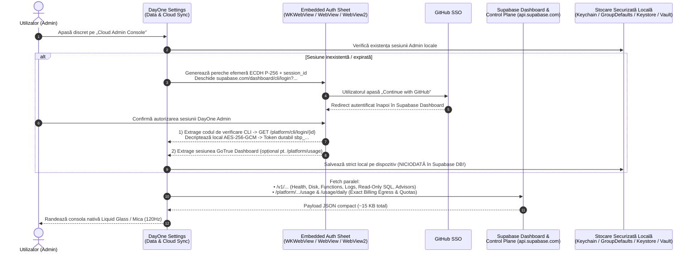

# Arhitectură & Plan Inițial: Supabase Admin Mode & Cloud Observability Console în Ecosistemul DayOne

**Autor:** Antigravity Architecture Team  
**Data:** 6 Noiembrie 2026  
**Status:** Arhitectură Aliniată & Scope v1 Confirmat (Pregătit pentru Implementare)  
**Proiect Supabase Țintă:** `Daily` (`akkfouifxztnfwwiclwg`) — + suport multi-proiect dinamic  
**Platforme Țintă:** iOS & Foldable (`SimulaPhone`, `SimulaDuo`, iPhone 16 Pro „Schmitz”) · macOS 15+ (`Daily.app` Desktop) · Android Phone & Foldable (`Medium_Phone_API_36.1`, Pixel 9 Pro „Trapper”, Galaxy Z Fold 8 „Radar”) · Windows 11 (`Daily.WinUI` .NET 10 ARM64/x64)

---

## 1. Context, Viziune și Obiective

Pe măsură ce ecosistemul **DayOne (`Daily`)** operează simultan pe 8–11 instanțe native conectate în timp real la același backend cloud (**Supabase**), vizibilitatea tehnică directă din aplicație asupra consumului de resurse devine un instrument esențial de inginerie și operare. Auditurile recente ([Supabase_Storage_Egress_Logging_Analysis_2026-10-30.md](../Supabase_Storage_Egress_Logging_Analysis_2026-10-30.md) și [Supabase_Egress_And_Wearable_Retention_Optimization.md](../Features/Supabase_Egress_And_Wearable_Retention_Optimization.md)) au demonstrat cât de valoroasă este corelarea metricilor de **Egress**, **Database Size & Index Bloat**, **Log Ingestion**, **Edge Functions** și **Realtime** cu comportamentul clienților nativi.

### Obiective Principale
1. **Integrare Discretă (Zero Intruziune pentru Utilizatorul Obișnuit):**
   - Punctul de intrare trăiește exclusiv în **Settings**, în penultimul tile — **Data & Cloud Synchronization** — sub forma unui rând compact și elegant în subsolul cardului, fără a încărca vizual setările de zi cu zi și cu **0 cereri de rețea** cât timp consola nu este deschisă.
2. **Autentificare Admin Nativă cu GitHub (via Supabase):**
   - Permite autentificarea directă cu contul de administrator Supabase (inclusiv fluxul uzual **„Continue with GitHub”**), fără a stoca vreodată chei `service_role` în codul sursă și fără a sincroniza token-urile de admin în baza de date comună.
3. **Observabilitate Bogată & Realistă (Paritate cu Supabase Dashboard + Forensics Extins):**
   - Afișează atât metricile oficiale de **Usage & Quota** (Egress defalcat pe servicii, Database Size, Storage, Log Ingestion, Edge Functions, Realtime Peak Connections & Messages, MAU), cât și **diagnostice tehnice mai profunde decât panoul standard de Usage din Supabase** (bloat pe indecși B-tree, top interogări `pg_stat_statements`, top rute HTTP după `content-length`, erori 4xx/5xx recente, starea job-urilor `pg_cron` și alertele Supabase Advisors).
4. **Adaptare Nativă pe Fiecare Platformă & Arhitectură Extensibilă:**
   - Respectă 100% limbajul vizual **Liquid Glass** (iOS, macOS, Android) și **Fluent Mica** (WinUI 3), cu layout-uri adaptate pentru telefoane, ecrane pliabile (`SimulaDuo`, `Radar`) și ferestre desktop widescreen, pregătind fundația pentru viitoare unelte administrative (Phase 2 & 3).

---

## 2. Research Tehnic Realist: Ce Expune (și Ce NU Expune) Supabase API în 2026

Înainte de proiectarea arhitecturii, am inspectat direct specificația OpenAPI oficială `https://api.supabase.com/api/v1-json` (116 rute publice) și codul sursă open-source al **Supabase Studio** (`supabase/supabase/apps/studio/data/usage` & `analytics`) și **Supabase CLI** (`supabase/cli/apps/cli/src/commands/login`).

> [!IMPORTANT]
> **Descoperire Arhitecturală Esențială — Cele Două Planuri de Control din `api.supabase.com`:**
> Supabase își împarte endpoint-urile de administrare și telemetrie în **două suprafețe distincte**:
> 1. **Management API Oficial (`https://api.supabase.com/v1/...`)** — 100% public, documentat, stabil, autentificat cu **Personal Access Token (`sbp_...`)** sau **OAuth 2.0 Token**. Oferă sănătatea serviciilor, dimensiunea discului, statistici API și Edge Functions, interogări ClickHouse pe loguri (`logs`), metrici Prometheus (`/analytics/endpoints/metrics`), Advisors și execuție SQL read-only (`POST /v1/projects/{ref}/database/query/read-only`). **Totuși, `/v1/` NU conține endpoint-ul de facturare/cote lunare agregate pentru Egress în GB!**
> 2. **Studio Platform API (`https://api.supabase.com/platform/...`)** — folosit intern de interfața web `supabase.com/dashboard` (autentificată prin sesiunea GoTrue `supabase.dashboard.auth.token` obținută la login-ul cu **GitHub** în Dashboard). Acesta expune `/platform/organizations/{slug}/usage` și `/platform/organizations/{slug}/usage/daily`, care returnează **exact cifrele de facturare și graficele zilnice de Egress** (`PostgREST`, `Edge Functions`, `Realtime`, `Auth`, `Storage`, `Supavisor`), **Log Ingestion**, **Realtime Peak Connections & Message Count** și **Quota Warnings**.

### 2.1 Matricea Completă și Realistă a Metricilor Disponibile

| Categorie / Metrică Cerută | Sursa A: Management API Oficial (`/v1/...` + Read-Only SQL + ClickHouse) | Sursa B: Studio Platform API (`/platform/...` prin sesiune Dashboard GitHub) | Nivel de Precizie & Comportament în DayOne Admin |
| :--- | :--- | :--- | :--- |
| **Database Size & Quotas** | `POST /v1/projects/{ref}/database/query/read-only` → `pg_database_size()`, `pg_total_relation_size()` pe fiecare tabelă, Data vs Index vs TOAST, Dead Tuples & Bloat + `GET /v1/projects/{ref}/config/disk/util` (`fs_used_bytes` / `fs_size_bytes`, IOPS) | `DATABASE_SIZE` vs cota planului (`500 MB` Free / `8 GB` Pro) în `/platform/organizations/{slug}/usage` | **100% Exact în ambele moduri.** SQL-ul read-only oferă chiar mai mult detaliu (defalcare pe tabele și index bloat) decât pagina Usage din Supabase! |
| **Unified Egress & Cached Egress** | ClickHouse SQL pe `/v1/projects/{ref}/analytics/endpoints/logs` (`edge_logs` → suma `response.headers.content-length` per rută și `user-agent`) | **100% Exact Billing Egress** (`EGRESS`, `CACHED_EGRESS`, ex: `3.01 GB / 5 GB`) + grafic zilnic stivuit pe 7 servicii (`egress_rest`, `egress_function`, `egress_realtime`, `egress_auth`, `egress_storage`, `egress_supavisor`, `egress_graphql`) în `/usage/daily` | **Hibrid Ideal:** Sursa B afișează cota oficială facturată în GB și graficul pe servicii; Sursa A arată **exact ce tabelă și ce dispozitiv** generează traficul HTTP! |
| **Log Ingestion & API Traffic** | `GET /v1/projects/{ref}/analytics/endpoints/usage.api-counts` (serii temporale `REST`, `Auth`, `Realtime`, `Storage`) + ClickHouse SQL `SELECT source, count()` și coduri HTTP `2xx/4xx/5xx` | Cota oficială lunară `LOG_INGESTION`, `LOG_QUERYING`, `LOG_STORAGE` în `/platform/organizations/{slug}/usage` | **100% Exact + Forensics:** Cota de ingestie + distribuția pe surse și inspector live pentru ultimele erori `4xx`/`5xx`. |
| **Edge Functions Stats** | `GET /v1/projects/{ref}/functions` (lista funcțiilor, versiune, status `ACTIVE`/`THROTTLED`) + `GET .../analytics/endpoints/functions.combined-stats` (invocări, rată de eroare, timp mediu/maxim execuție pe `1h`/`1d`/`7d`) | Total lunar facturat `FUNCTION_INVOCATIONS` (vs cota `500.000` Free) și `FUNCTION_CPU_MILLISECONDS` | **100% Exact în ambele moduri** (`health-engine`, `fetch-market-quotes`, latențe și erori). |
| **Realtime Stats** | `GET /v1/projects/{ref}/health?services=realtime` (`db_connected`, `replication_connected`) + SQL `realtime.subscription` (canale active pe tabele) + `pg_stat_statements` (`realtime.list_changes` CPU %) + OpenMetrics `/analytics/endpoints/metrics` | Total lunar `REALTIME_MESSAGE_COUNT` (vs `2M` Free) și `REALTIME_PEAK_CONNECTIONS` (vs `200` Free) + evoluție zilnică | **Complet:** Cota lunară de mesaje/conexiuni de vârf (Sursa B) + subscrierile live din DB și impactul WAL pe CPU (Sursa A). |
| **Auth, Storage & Advisors** | SQL `auth.users`, `auth.sessions`, `auth.refresh_tokens` (token churn 24h), `paired_watches`, `storage.objects`, `cron.job_run_details` + `GET /v1/projects/{ref}/advisors/performance` & `/security` | `MONTHLY_ACTIVE_USERS` (`MAU` vs `50.000`), `STORAGE_SIZE` (vs `1 GB` Free), `/platform/projects-resource-warnings` | **100% Exact + Audit Tehnic** (include verificare automată că jobul `pg_cron` de la `03:00 UTC` rulează cu succes). |

### 2.2 Limite de Rată (Rate Limits) și Protecția Consumului Propriu
- Endpoint-urile `/v1/projects/{ref}/analytics/...` au o limită oficială Supabase de **~30 cereri / minut**.
- Pentru ca însăși consola de Admin să nu consume resurse inutile sau să lovească HTTP `429`:
  - **Zero Background Polling:** Nu rulează niciun timer în fundal când utilizatorul nu se află în pagina `Supabase Admin Console`.
  - **Snapshot Cache Local cu TTL (10 minute implicit):** La redeschiderea consolei în interiorul ferestrei de 10 minute, datele se încarcă instantaneu (`< 5 ms`) din cache-ul local, cu buton explicit **„Refresh Telemetry”** pentru interogare live la cerere.
  - **Batching SQL:** Toate metricile PostgreSQL (dimensiune DB, top tabele, index bloat, `pg_stat_statements`, `auth`, `realtime.subscription`, `pg_cron`) se extrag printr-un **singur apel JSON agregat** către `POST /v1/projects/{ref}/database/query/read-only` (`~3–4 KB` răspuns total!).

---

## 3. Arhitectura de Autentificare Admin (GitHub Login în Supabase)

Deoarece autentificarea în contul Supabase se face cu **GitHub**, am analizat cele 3 mecanisme posibile și propunem o **Arhitectură Duală (Web Handshake Nativ + Fallback PAT)** care nu necesită înregistrarea manuală a unei aplicații OAuth și nu expune niciun `client_secret`:

### De ce această arhitectură de autentificare este superioară?
1. **Zero Configurare Externă & Suport GitHub 1:1:** Spre deosebire de `GET /v1/oauth/authorize` (care obligă crearea unui OAuth App în Supabase Organization Settings, configurarea de redirect URI-uri custom pe 4 sisteme de operare și găzduirea unui `client_secret` într-un Edge Function, oferind acces *doar* la `/v1/` fără cifrele oficiale de Egress), fluxul bazat pe **Dashboard Web Sheet + CLI ECDH P-256 Handshake**:
   - Folosește exact pagina oficială `supabase.com/dashboard` unde butonul **„Continue with GitHub”** funcționează nativ (inclusiv cu GitHub 2FA / Passkeys).
   - Folosește criptografia standard din librăriile native ale sistemului de operare (`CryptoKit` pe iOS/macOS, `javax.crypto` pe Android, `System.Security.Cryptography` pe .NET 10) pentru a obține un token oficial **`sbp_...`** cu durată lungă de viață.
   - Permite interogarea metricilor oficiale de **Billing & Egress (`/platform/organizations/{slug}/usage`)** direct prin sesiunea Dashboard (sau prin bridge-ul same-origin al WebView-ului dacă CORS/Cloudflare restricționează apelul direct), păstrând toate rutele `/v1/...` 100% funcționale permanent prin token-ul `sbp_...`.
2. **Fallback Manual Rapid (`Paste Personal Access Token sbp_...`):**
   - Exact ca în `MediumLoginSheet` (unde am combinat login-ul web cu bara superioară de introducere manuală), dialogul de autentificare include o opțiune colapsabilă pentru lipirea directă a unui token `sbp_...` (ideală pentru testare rapidă în simulatoare sau pentru utilizarea unui *Scoped Read-Only PAT*).
3. **Izolare de Securitate Strictă (Device-Only, Zero Cloud Sync):**
   - Credențialele Admin **NU** intră niciodată în modelul `AppSettings` (care se sincronizează în tabela `user_settings`).
   - Sunt salvate exclusiv local, criptat:
     - **iOS:** `KeychainManager` cu `kSecAttrAccessibleWhenUnlockedThisDeviceOnly` (exclus din backup iCloud).
     - **macOS:** `GroupDefaults.shared.userDefaults` în containerul sandboxed criptat FileVault `7LZ9ZT2Z5B.group.com.intellidream.daily` (conform regulii *macOS Zero-Prompt Credential Storage*, evitând pop-up-urile `SecurityAgent` din `login.keychain-db`).
     - **Android:** `EncryptedSharedPreferences` / Android Keystore în fișier exclus din `allowBackup`.
     - **Windows 11 (`WinUI 3`):** `Windows.Security.Credentials.PasswordVault` / DPAPI (`CurrentUser`).
   - **Opțional:** Comutator *„Require Biometrics (Face ID / Touch ID / BiometricPrompt / Windows Hello)”* la deschiderea consolei Admin + buton clar **„Disconnect Admin Session”** care șterge token-ul local și curăță cookie-urile `supabase.com` din WebView.

---

## 4. Design UI/UX & Integrare pe Fiecare Platformă

### 4.1 Punctul de Intrare Non-Intruziv în Settings (`Data & Cloud Synchronization`)
În interiorul penultimului tile din Settings, experiența rămâne complet curată pentru uzul zilnic:
- La baza cardului **Data & Cloud Synchronization** (sub acțiunile existente de *Sync Now* / *Reset Settings* sau *Connection Diagnostics*), după un separator fin (`opacity 0.08`), se adaugă un singur rând discret:
  - **Stare Neautentificată:** Icon tehnic subtil (`server.rack` / `Dns` / `\uE968`) + titlu **„Cloud Admin & Usage Telemetry”** + subtitlu discret *„Inspect Supabase database, egress & edge metrics”* + buton pastilă secundar `Connect ›`.
  - **Stare Autentificată:** Punct verde smarald + **„Supabase Admin Console”** + rezumat ultra-compact citit **doar din ultimul cache local** (ex: `akkfouifxztnfwwiclwg • Free Plan` sau `DB 28.4 MB • Egress 60%`) + chevron `Open ›`.

### 4.2 Structura Paginii Dedicate „Supabase Admin Console”
Odată deschisă, pagina este organizată în **5 secțiuni bogate în informații** (accesibile prin tab-uri/segmente pe mobil sau ca dashboard Bento multi-coloană pe desktop și pliabile deschise):

1. **Secțiunea 1 — Executive Quota & Service Health Overview**
   - Header cu selector de proiect (implicit `Daily • akkfouifxztnfwwiclwg`), regiune, versiune Postgres, badge Plan (`FREE` / `PRO`), timpul ultimei actualizări și buton `Refresh`.
   - **6-Service Live Health Strip:** pastile de stare pentru `PostgREST`, `Database`, `Pooler`, `Auth`, `Realtime`, `Storage` + eventuale alerte oficiale de cotă (`Resource Warnings`).
   - **4 Inele / Bare Principale de Cotă Lunară:**
     - **Unified Egress** (`GB folosiți / 5 GB`, rată zilnică `MB/zi`, proiecție la final de ciclu).
     - **Database Size** (`MB folosiți / 500 MB` + raport Data vs Index).
     - **Edge Function Invocations** (`apeluri / 500k`).
     - **Realtime Messages & Peak Connections** (`mesaje / 2M`, `vârf conexiuni / 200`).

2. **Secțiunea 2 — Egress & API Gateway Deep-Dive**
   - **Grafic Zilnic Stivuit (14 zile / Ciclu Facturare):** Egress defalcat cromatic pe `PostgREST`, `Edge Functions`, `Realtime`, `Auth`, `Storage`, `Supavisor`.
   - **Volum Cereri API (`usage.api-counts`):** Sparkline pe 24h / 7 zile împărțit pe `REST`, `Auth`, `Realtime`, `Storage`.
   - **Top 10 Rute & Clienți după Trafic (`ClickHouse edge_logs`):** Tabel cu ruta (ex. `/rest/v1/health_daily_summary`), număr de cereri 24h, suma `content-length`, latență medie `ms` și platforma client (`Darwin`, `okhttp`, `.NET`).

3. **Secțiunea 3 — Database Size, Tables, Index Bloat & `pg_cron`**
   - **Bara de Structură Fizică:** Date utile (`Heap`) vs Indecși B-Tree vs `TOAST` vs Spațiu Liber Disc (`gp3` IOPS/Throughput).
   - **Tabel Sortabil pe Tabele:** `health_daily_summary`, `health_daily_vitals`, `health_sleep_sessions`, `health_intraday_heart_rate`, `habits_logs`, `habits_daily_summaries`, `tagdos`, `smart_ledgers`, `auth.refresh_tokens`, `realtime.subscription` — cu **Mărime Date**, **Mărime Indecși**, **Rânduri Live / Dead**, ultimul `autovacuum` și badge automat **„Index Bloat”** dacă indecșii depășesc disproporționat datele.
   - **Monitor `pg_cron`:** Statusul ultimelor execuții ale joburilor automate (ex. `apply_health_data_retention` la `03:00 UTC` — `SUCCEEDED` / `FAILED`, durată).

4. **Secțiunea 4 — Edge Functions & Realtime Engine**
   - **Edge Functions Cards:** Pentru fiecare funcție activă (`health-engine`, `fetch-market-quotes`, etc.): versiune, status, număr invocări, rată de succes %, timp mediu/maxim de execuție (`ms`).
   - **Realtime Engine Diagnostics:** Conexiuni de vârf, mesaje transmise, numărul de abonamente active în `realtime.subscription` grupate pe tabelă și ponderea `realtime.list_changes` în timpul total CPU al bazei de date.

5. **Secțiunea 5 — Log Ingestion, Error Inspector & Supabase Advisors**
   - **Log Ingestion & Coduri HTTP (24h):** Volumul de loguri pe surse (`edge_logs`, `postgres_logs`, `function_edge_logs`, `auth_logs`, `realtime_logs`) și raportul `2xx` vs `4xx` vs `5xx`.
   - **Recent 4xx / 5xx Inspector:** Ultimele 20 de erori cu timestamp, status HTTP, metodă, cale și mesaj — ideal pentru a depista instantaneu bucle de sincronizare eșuate.
   - **Performance & Security Advisors:** Linterele oficiale Supabase (`/advisors/performance` și `/advisors/security`) afișate ca recomandări tehnice clare, plus **Top 8 Interogări SQL (`pg_stat_statements`)** după timp total și număr de apeluri.

6. **Secțiunea 6 — Ecosystem Fleet Footprint („Active Devices Matrix” — Inclus în v1)**
   - Corelează `auth.sessions`, `paired_watches`, `health_sources` și `user-agent`-urile din `edge_logs` (ultimele 24h) într-o matrice vizuală a dispozitivelor din ecosistem (`Schmitz` iOS, `Daily.app` macOS, `Daily.WinUI` Windows 11, `Trapper` Pixel 9 Pro, `Radar` Galaxy Z Fold 8, plus ceasurile asociate `Ultra 2` / `Pixel Watch 5`), evidențiind ponderea în trafic (%), numărul de cereri, erorile 4xx și activitatea de refresh token per platformă.

7. **Secțiunea 7 — AI Cloud Co-Pilot & Forensic Markdown Export (Incluse în v1)**
   - **„Analyze with AI”:** Trimite snapshot-ul tehnic curent (fără secrete sau token-uri) către stiva AI existentă în DayOne (On-Device / Gemini) pentru a genera un rezumat ingineresc concis și sugestii concrete de optimizare SQL / Egress.
   - **„Export Forensic Markdown Report”:** Generează cu un click un raport tehnic complet în format Markdown (copiabil în clipboard sau salvabil ca fișier `.md`), identic ca structură cu rapoartele noastre de audit din `Docs/`, ideal pentru comparații *Before / After* între versiuni.
   - **Garanție 100% Read-Only în v1 + Biometrie Opțională:** Nicio comandă de scriere/modificare nu este expusă în v1 (risc zero asupra producției). În antetul/subsolul consolei există un toggle opțional (dezactivat implicit) **„Require Biometrics on Open”** (Face ID / Touch ID / BiometricPrompt / Windows Hello).

### 4.3 Adaptări Specifice fiecărei Platforme din Ecosistem

| Platformă | Aliniere în Settings (`Data & Cloud Sync`) | Arhitectură Tehnică & Adaptare UI |
| :--- | :--- | :--- |
| **iOS & Foldable** (`iOS/` + `DailyCore/`) | `DataSyncSettingsSection.swift` este **deja penultimul tile** în `SettingsView.swift` (chiar deasupra `AboutSettingsSection`). | Serviciu comun `SupabaseAdminService.swift` + criptografie `CryptoKit` în `DailyCore`. Pagină `SupabaseAdminConsoleView.swift` cu `Swift Charts`, haptic feedback și grilă adaptivă pe 2 coloane pe `SimulaDuo` deschis. |
| **macOS 15+** (`MacOS/` + `DailyCore/`) | `DataSyncSettingsSection.swift` este **deja penultimul tile** în `MacOS/.../SettingsView.swift`. | Reutilizează 100% `SupabaseAdminService` din `DailyCore`, stocare silențioasă în `GroupDefaults` (zero prompt Keychain), layout desktop Bento pe 2–3 coloane, shortcut `⌘R` pentru refresh și copiere rapidă a interogărilor/erorilor. |
| **Android Phone & Foldable** (`Android/`) | În `SettingsScreen.kt`, mutăm și aliniem `CloudSyncSettingsCard` („Data & Cloud Synchronization”) pe **penultima poziție** (deasupra `AboutSettingsCard`) pentru paritate 1:1 cu iOS/macOS. | `SupabaseAdminRepository.kt` (`core-network`) + `SupabaseAdminScreen.kt` (Jetpack Compose Liquid Glass), grafice `Canvas` cu calcule memoizate `remember(...)` pentru scroll 120Hz pe `Trapper` și layout dual-pane pe `Radar` (`Galaxy Z Fold 8`). |
| **Windows 11 (`WinUI 3`)** (`WinUI/Daily.WinUI/`) | În `SettingsPage.xaml.cs`, tab-ul `Tag="Data"` (`Data & Sync`) pointează momentan către placeholder-ul `AboutPage`! Îl transformăm într-o pagină reală **`DataSyncSettingsPage.xaml`** (penultima din grupul funcțional, cu status Supabase, Cloud Sync toggle, Sync Now, Reset și intrarea discretă Admin). | `SupabaseAdminService.cs` (`.NET 10` cu `ECDiffieHellman` + `AesGcm` + `PasswordVault`), autentificare GitHub prin `WebView2`, pagină dedicată **`SupabaseAdminPage.xaml`** cu Mica cards, grafice vectoriale fluide și `Expander` pentru SQL/Logs. |
| **watchOS & Wear OS** *(Decizie Aliniată)* | Ceasurile nu au ecran `Settings` / `Data & Cloud Sync` și respectă politica strictă *Smartwatch Battery & Zero-Polling*. | **Excluse complet** (zero cod sau overhead pe ceasuri). |

---

## 5. Decizii Arhitecturale Aliniate (v1) & Roadmap Evolutiv (v2 / v3)

### 5.1 Decizii Confirmate pentru v1
- **Autentificare:** Hibridă — Login Web interactiv cu **GitHub** în Supabase (`ECDH P-256 CLI Handshake` → token durabil `sbp_...` + sesiune GoTrue Dashboard pentru cifrele exacte de Egress din `/platform/usage`), plus câmp colapsabil de fallback pentru lipire directă de **PAT (`sbp_...`)**.
- **Profil de Risc:** **100% Read-Only în v1** (zero mutații asupra bazei de date sau infrastructurii).
- **Funcționalități Avansate Incluse în v1:** **Ecosystem Fleet Footprint**, **Analyze with AI** și **Export Forensic Markdown Report**.
- **Securitate Locală:** Izolare strictă pe dispozitiv (fără sincronizare cloud a token-ului Admin) + toggle opțional **Require Biometrics** (dezactivat implicit).

### 5.2 Idei Rezervate pentru Evoluții Viitoare (Roadmap Admin v2 & v3)
Construind `SupabaseAdminService` modular și izolat de clientul public `anon`, putem adăuga ulterior:
1. **One-Tap Safe Maintenance Actions (v2 — cu Confirmare Dublă):**
   - **„Defragment Bloated Indexes (`REINDEX TABLE CONCURRENTLY`)”** direct lângă tabelele detectate cu bloat mare.
   - **„Run Nightly Retention Now (`apply_health_data_retention()`)”** cu raportarea numărului de rânduri curățate.
   - **„Reset `pg_stat_statements` Counter”** pentru măsurători curate post-optimizare.
2. **Alerte Proactive de Cotă & Anomalii (v2 — Smart Guardrails):**
   - Notificări locale discrete dacă rata zilnică de Egress depășește bugetul sigur (`> 160 MB/zi` pe Free Tier), dacă erorile `4xx/5xx` sar de `2%` sau dacă un job `pg_cron` a eșuat.
3. **Edge Functions Live Log Tail & Secrets Inspector (v3):**
   - Live tail la cerere pentru logurile `health-engine` / `fetch-market-quotes` în timpul testelor pe dispozitive fizice și inspecția numelor/digest-urilor secretelor configurate (`/v1/projects/{ref}/secrets`).

---

## 6. Plan de Implementare, Testare și Livrare (După Aliniere)

1. **Faza 1 — Core Admin Engine & Security Layer:**
   - Implementarea modelelor canonice de telemetrie, a handshake-ului `ECDH P-256 + AES-256-GCM` + sesiune Dashboard + fallback PAT, a stocării locale izolate și a agregatorului paralel (`/v1/` + Read-Only SQL batch + ClickHouse SQL + `/platform/usage`) în `DailyCore` (Swift), `core-network` (Kotlin) și `WinUI` (.NET 10), însoțite de **teste unitare dedicate** pentru parsarea răspunsurilor OpenAPI/ClickHouse/Prometheus și decriptarea ECDH.
2. **Faza 2 — UI/UX Nativ pe Cele 4 Platforme:**
   - **iOS & macOS:** Actualizarea discretă a `DataSyncSettingsSection.swift`, sheet-ul `SupabaseAdminLoginSheet.swift` și consola `SupabaseAdminConsoleView.swift` (adaptată compact/foldable pe iOS și Bento widescreen pe macOS).
   - **Android:** Reordonarea `CloudSyncSettingsCard` pe penultima poziție în `SettingsScreen.kt`, `SupabaseAdminLoginSheet.kt` și `SupabaseAdminScreen.kt` (120Hz adaptive phone + foldable).
   - **Windows 11 (`WinUI 3`):** Construirea paginii reale `DataSyncSettingsPage.xaml` (înlocuind stub-ul `AboutPage` pe tab-ul `Data & Sync`) + `SupabaseAdminPage.xaml` cu `WebView2` login.
3. **Faza 3 — Verificare Riguroasă Simulator → Fizic:**
   - **macOS:** Build & verificare nativă (`Daily.app`, zero pop-up Keychain, shortcut-uri, telemetrie live).
   - **iOS:** Testare pe `SimulaPhone` și `SimulaDuo`, urmată de build, instalare și verificare live pe **iPhone 16 Pro („Schmitz”)**.
   - **Android:** Testare pe emulatorul `Medium_Phone_API_36.1`, urmată de livrare și verificare pe **Pixel 9 Pro („Trapper”)** și **Galaxy Z Fold 8 („Radar”)**.
   - **Windows 11:** Push, pull în VM-ul Parallels `Windows 11`, build `.NET 10 ARM64` și verificare vizuală și funcțională a `DataSyncSettingsPage` + `SupabaseAdminPage`.
4. **Faza 4 — Documentație Finală & Git Delivery:**
   - Documentarea completă a implementării verificate în `Docs/Features/Supabase_Admin_Observability_Console_2026.md`, commit-uri curate și push în `origin/main`.
