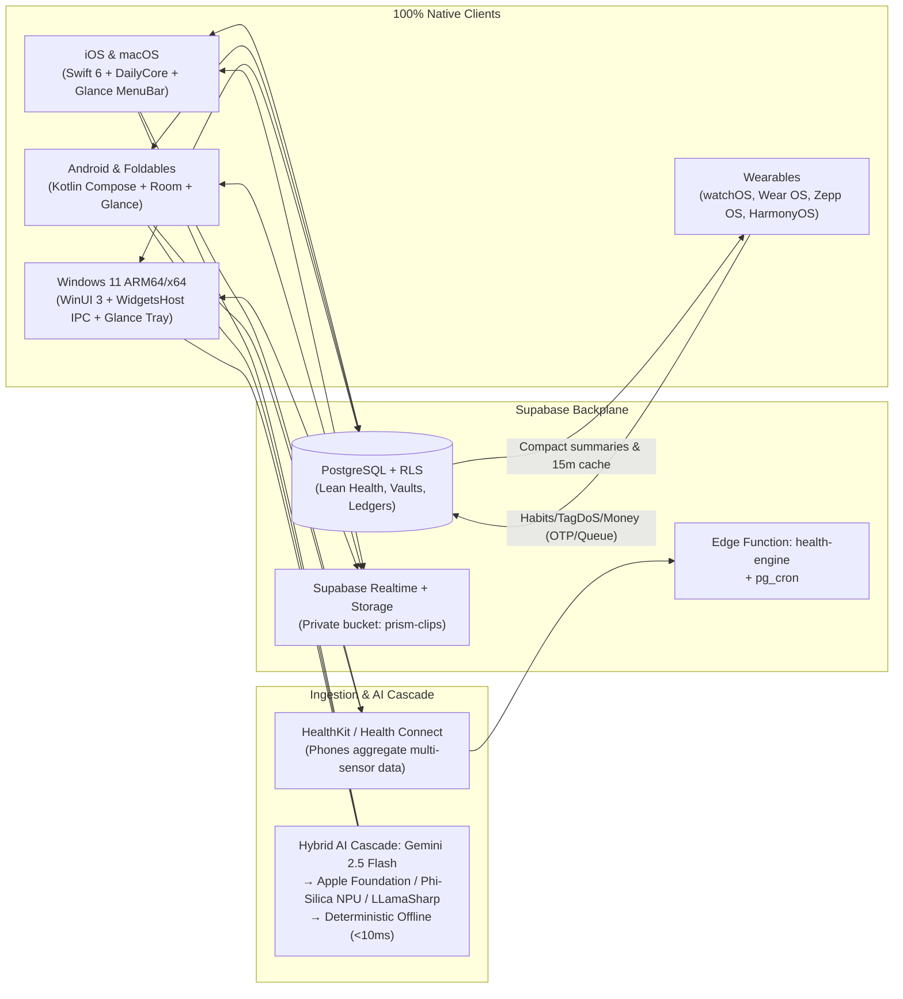

# Daily / DayOne (Orbit) — Functional & Architectural System Overview

> **Last Updated:** November 2026  
> **Scope:** Full-ecosystem functional and technical blueprint across Apple (`iOS`, `macOS`, `watchOS`), Android (`Phone`, `Foldables`, `Wear OS`), Windows 11 (`WinUI 3`), additional wearables (`Zepp OS`, `HarmonyOS`), and the `Supabase` cloud backplane.

---

## 1. Core Concept & Architectural Principles

**Daily / DayOne (Orbit)** is a 100% native, cross-platform **Personal Life & Biometric OS** (no Electron, React Native, or Flutter wrappers), built around three invariants:

1. **Local-First & Thick-Client Compute**: Client apps render strictly from local databases and caches (`0–1 ms`), compute aggregations on-device, and sync incrementally via `updated_at` watermarks, dirty flags, and debounced `Supabase Realtime` streams.
2. **Cross-Platform Parity with Native Ergonomics**: Shared mathematical engines and deterministic parsers (SmartLedger AST, TagDoS tokenizer, astronomy/SGP4, bilingual clustering) behave identically across Swift, Kotlin, and C#, wrapped in native OS paradigms (*Liquid Glass* on Apple, *Material You 120Hz* on Android, *WinUI 3 Mica/Acrylic* on Windows 11).
3. **Egress & Battery Discipline**: Lean health schemas (`Lean Health v2.1`), minimal-return REST upserts (`Prefer: return=minimal`), and consumer-only smartwatch health consumption prevent radio battery drain and cloud bloat.

---

## 2. Ecosystem Architecture Diagram

---

## 3. Functional Overview (Core Modules)

| Module | Capabilities & Behavior |
| :--- | :--- |
| **Health & Pulse Studio** | Multi-source biometric unification (Oura Ring, Apple Watch, Pixel Watch, HealthKit, Health Connect) with source priority rules. Displays sleep stages (REM/Deep/Light/Awake, biphasic sessions), 5-minute intraday HR curves, hourly steps, and a **0–100 Autonomic Stress Score** (HRV + workout-gated HR elevation + sleep recovery) personified by the **Monkey Mascot** (*Zen, Curious, Busy, Overheated*). |
| **Habits (`Bubbles` & `Smokes`)** | **Hydration**: quick logging (`Water`, coffee, tea, etc.) with progress rings and 7-day history. **Smokes**: baseline-relative tobacco reduction (cigarettes vs. heated tobacco), craving cooldown timers, money saved metrics, and instant *Physiological Sigh* breathing interventions. |
| **TagDoS & Notes** | High-density mnemonic capture organized across 5 streams (`Inbox $I`, `Action $A`, `Waiting $W`, `Review $R`, `Someday $S`). Deterministic semantic tokenization (Financial `$`/`€`, Urgent `!`, Metric/Time, Action), non-destructive queue recycling, and attachments. |
| **Finances (`SmartLedger`)** | Plain-text **DSL-driven** financial and net-worth tracker (*Incoming, Outgoing, Balance, Deposit*, scaling multipliers, inline comments) with identical AST parsing across Swift, Kotlin, and C#, paired with market/macro feeds (Yahoo Finance, Finnhub). |
| **News, Orbit Lens & Spectrum** | RSS, Substack, and Medium reader (OAuth WebView login & reading list extraction). Zero-LLM bilingual EN/RO event clustering (`<8 ms` via `StoryClusterEngine`), `209`-outlet Media Intelligence catalog (5-step bias spectrum + RO/EU context + factuality), **Blindspots**, multi-source framing comparisons, and personal reading balance (**Spectrum**). |
| **Prism (`Web Studio`)** | Integrated native browser sharing persistent login sessions with `News`, `Single-Active-Engine` tab hibernation (`0.0%` idle CPU), deterministic `Prism Shield` tracker/ad blocker, **Prism Vault** captures (links, quotes, cropped images up to 1600px, AI notes), bridges to `TagDoS`/`News`, and **Prism Co-Pilot** (TL;DR, Tasks, Key Facts, Q&A). |
| **Cosmos (`Astronomy`)** | Real-time planetarium using `O(1)` conformal stereographic projection (~15,544 stars), Bennett atmospheric refraction, topocentric Sun/Moon/planetary ephemeris (including Moon bright-limb angle $\chi$, Saturn ring tilt, Jupiter's Galilean moons), `SGP4` satellite propagation, and gyroscope tracking. |
| **Calendar & Weather** | Multi-provider calendar aggregation (**Google Calendar, Outlook/M365, Yahoo CalDAV**) + bidirectional **Microsoft ToDo** sync with AES-GCM encrypted cloud token storage, alongside OpenWeatherMap telemetry with GPS $\to$ IP geolocation fallback. |
| **Smart Briefing & Foldable Split** | Executive briefing tailored to 4 diurnal phases across 6 data hubs with progressive word-reveal typography. On dual-screen foldables (`iPhone Duo`, `Galaxy Z Fold 8`), **Hybrid Co-Pilot** splits telemetry/controls (Left Pane) from synthesis/guidance (Right Pane). |
| **Glance, Widgets & Admin SRE** | **Glance** ambient companions (macOS `MenuBarExtra`, Windows 11 `Taskbar Flyout`), native OS widgets (`WidgetKit`, Android `Glance`, decoupled `Daily.WidgetsHost.exe` on Windows), and a read-only **Supabase Admin Observability Console** authenticated via GitHub OAuth `P-256 ECDH + AES-256-GCM`. |

---

## 4. Platform Technical Stack

* **Apple (`DailyCore` Swift 6 Package + `CAstronomy`)**:
  * **iOS & macOS (`iOS/`, `MacOS/`)**: Pure Swift & SwiftUI; macOS runs under App Sandbox with shared FileVault `GroupDefaults` (`7LZ9ZT2Z5B.group.com.intellidream.daily`), `WidgetKit` widgets, `DailyShare` extension, and floating managers (`OrbitLensWindowManager`, `PrismWindowManager`).
  * **watchOS (`WatchOS/DailyWatch`)**: Native SwiftUI + zero-network `WidgetKit` complications backed by App Group cache.
* **Android (`Android/` Multi-Module Gradle)**:
  * Modules: `:app` (Jetpack Compose 120Hz + Dual-Pane Foldables + Jetpack Glance Widgets), `:core-model`, `:core-database` (Room SQLite + dirty tracking), `:core-network`, `:core-health` (Health Connect + Sleep/Stress engines), `:core-designsystem`.
  * **Wear OS (`WearOS/app`)**: Kotlin + Compose for Wear OS (Horologist, zero-allocation memoized `ScalingLazyColumn`, Tiles & Complications on `SharedPreferences`).
* **Windows 11 (`WinUI/Daily.WinUI` + `WinUI/Daily.WidgetsHost`)**:
  * **.NET 10** (`ARM64` & `x64`), MSIX-packaged `Daily.WinUI` linking shared C# `Models/` and `Services/`, Syncfusion (`Scheduler`, `Chart`, `Gauge`), `WebView2`, `H.NotifyIcon.WinUI` (`Glance`), and `LLamaSharp` + `Microsoft.WindowsAppSDK.ML` (`Phi-Silica` NPU).
  * **Out-of-Process Desktop Widgets**: Standalone unpackaged `Daily.WidgetsHost.exe` renders the 9 desktop widgets independently of the main window lifecycle, synchronized via **Named Pipe IPC** and shared `Daily.db3` SQLite.
* **Additional Wearables (`ZeppOS` & `HarmonyOS`)**:
  * 5-page companion apps for Amazfit (`@zeppos/zml`) and Huawei Watch (`ArkTS`), paired via **Orbit 6-digit OTP PIN** (`generate_watch_token()` RPC).

---

## 5. Cloud Backplane, Lean Health & Hybrid AI Cascade

* **Supabase (`PostgreSQL` + `RLS` + `Realtime` + `pg_cron`)**:
  * **Lean Health Architecture v2.1**: Replaces high-frequency raw telemetry with 4 lean tables: `health_sources` (device priority catalog), `health_sleep_sessions` (`stages jsonb` + monotonic session guard), `health_daily_vitals` (1 row/day/device `UPSERT`), and `health_intraday_heart_rate` (5-min buckets, 7-day rolling retention; 90-day curves archived canonically in `health_daily_summary` via Deno Edge Function `health-engine`).
  * **Consumer-Only Smartwatch Health**: Watches (`watchOS` / `Wear OS`) do **not** push raw HealthKit/Health Connect streams directly over Wi-Fi/LTE; companion phones aggregate and upload once, while watches fetch lightweight summaries (~650 B, 15-min TTL cache). Direct watch sync with offline replay remains active only for lightweight actions (`Water`, `Smokes`, `TagDoS`, `SmartLedger`).
  * **Domain Tables & Storage**: `habits_logs`, `habits_goals`, `smart_ledgers`, `tagdos_streams`, `tagdos_quick_notes`, `daily_smart_summaries`, `calendar_accounts` (AES-GCM encrypted), `rss_subscriptions`, `prism_clips`, `prism_pinned_sites` (private bucket `prism-clips`), `news_perspective_cache` (72h TTL purged via `pg_cron`), `news_reading_stats` (1 row/month/user), `paired_watches`.
* **Hybrid AI Cascade** (`SmartBriefing`, `Prism Co-Pilot`, `Orbit Lens`):
  1. **Cloud**: `Gemini 2.5 Flash` (with strict timeouts e.g. 3.5s on briefings, or 72h shared perspective cache).
  2. **On-Device / NPU**: `Apple FoundationModels` (Apple) / `Qualcomm Hexagon Phi-Silica NPU` + `LLamaSharp` GGUF (Windows 11).
  3. **Deterministic Fallback (`<10 ms`, offline)**: Rule-based extractive synthesis when offline or unconfigured.
